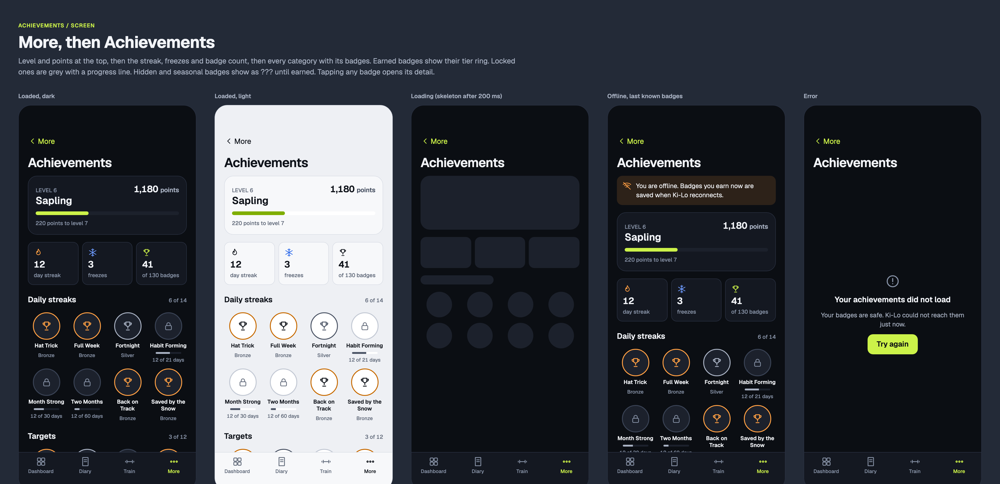
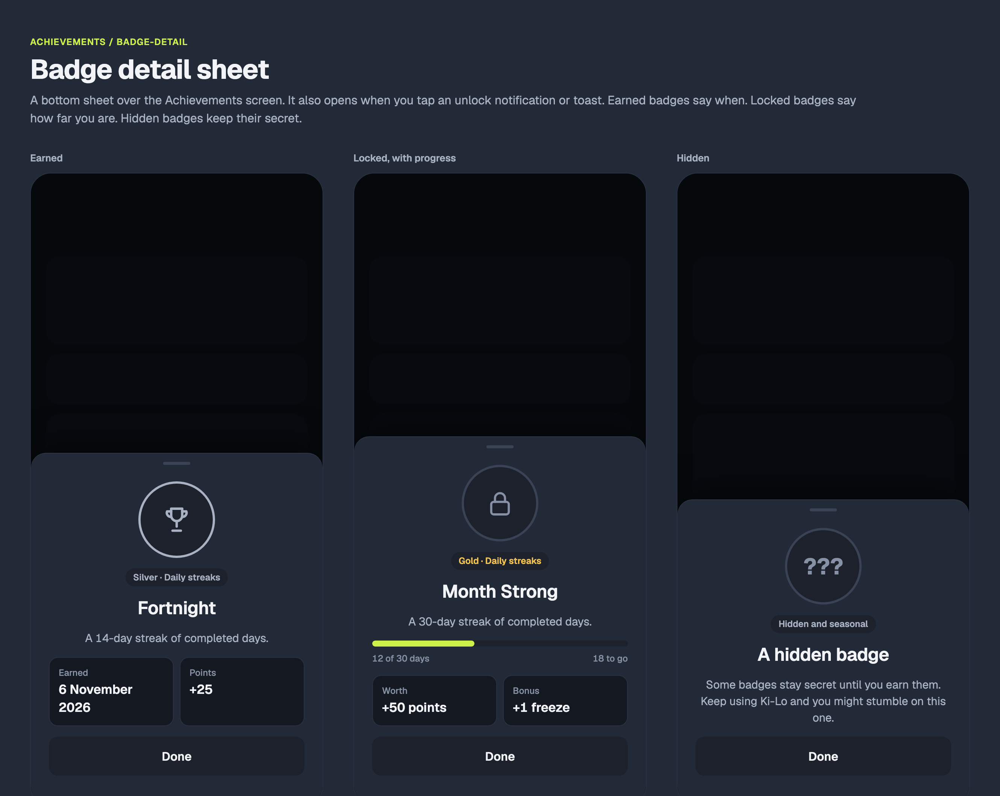
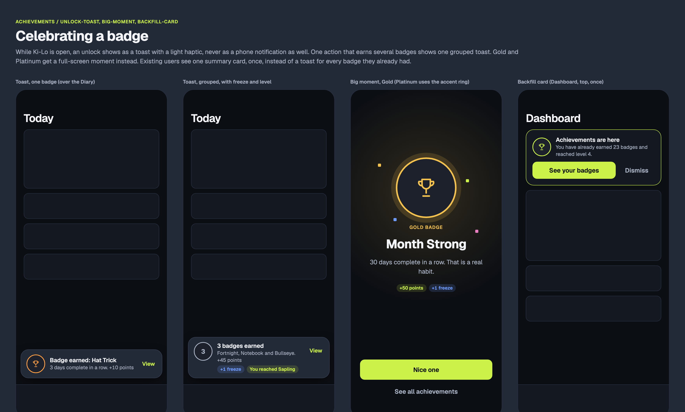
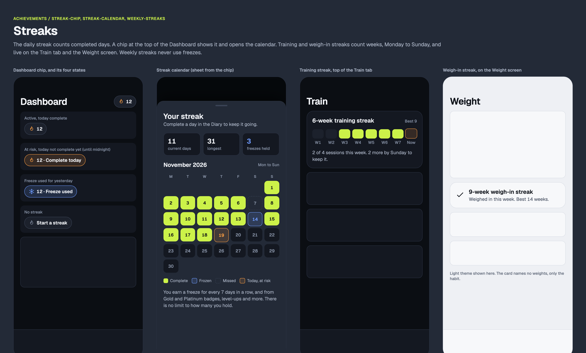
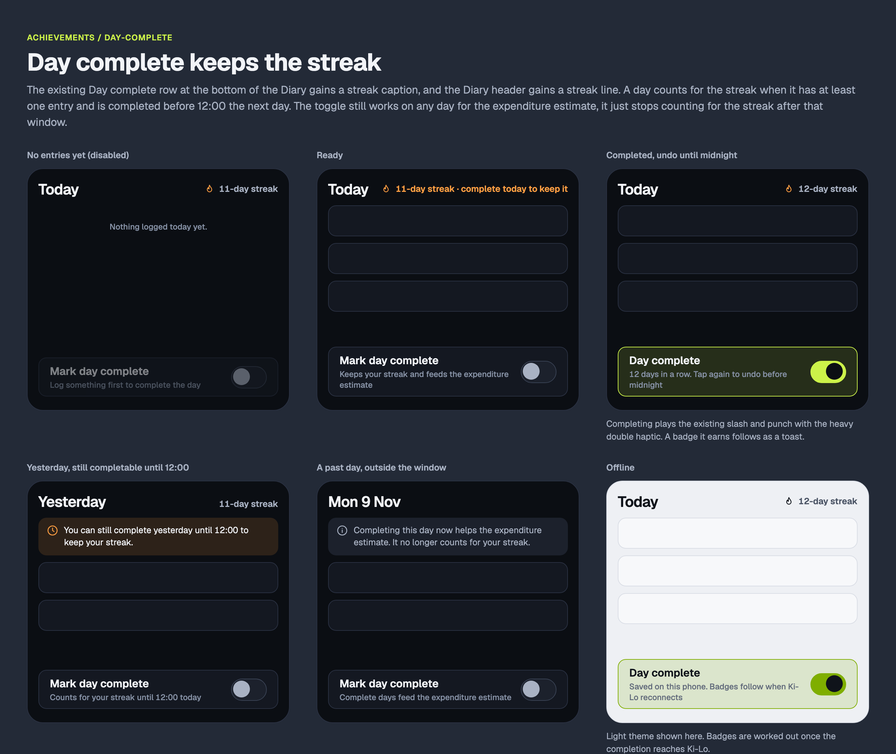
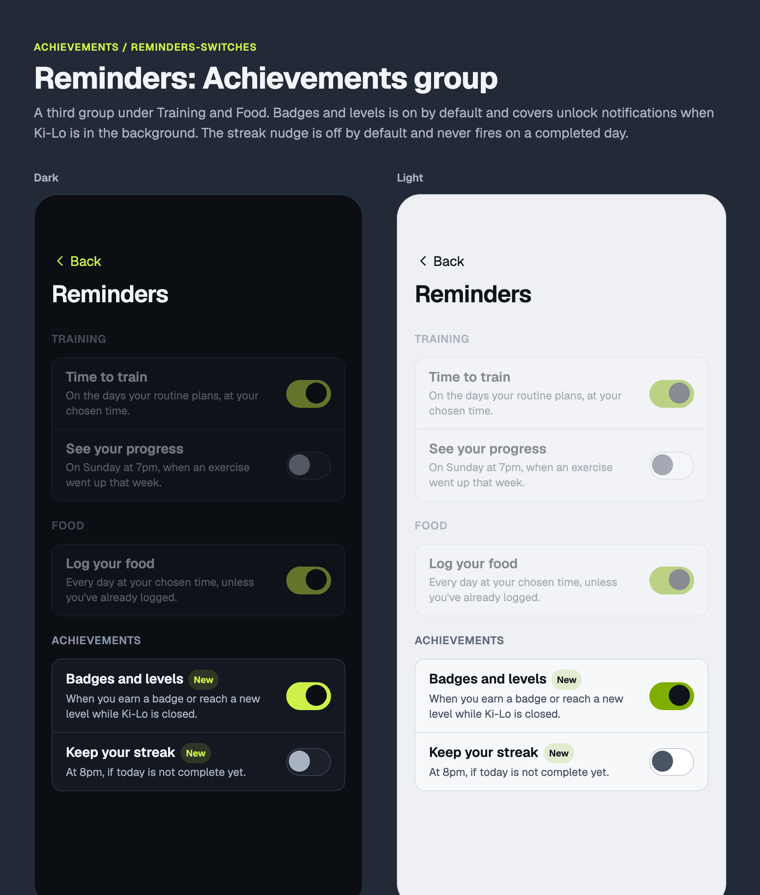
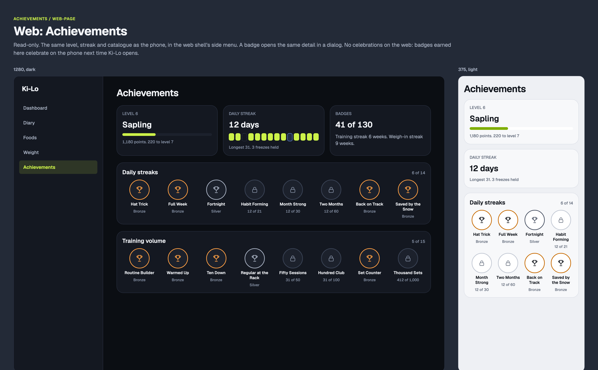
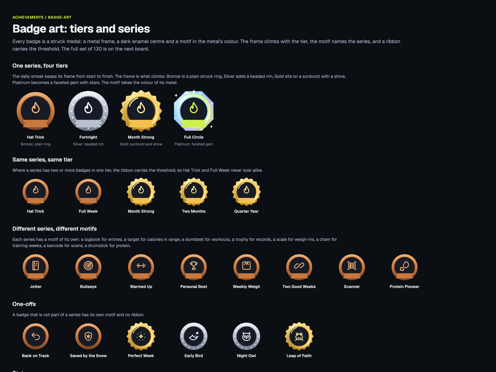
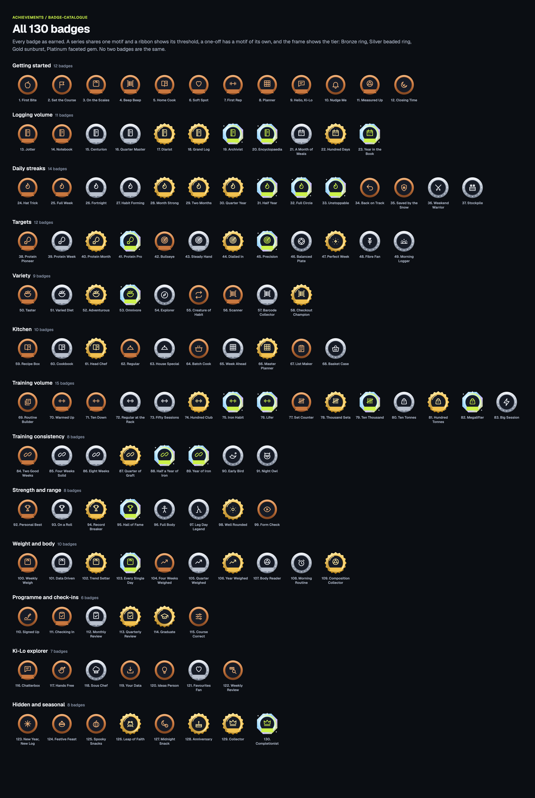

# achievements

Achievements, badges and streaks for Ki-Lo, from the canvas "Ki-Lo achievements". Zee approved all nine boards on 2026-11-19 (KEY-1080). The spec these boards draw is [`catalogue.md`](catalogue.md), and the screen tickets under KEY-1079 build from them.

These boards use the Ki-Lo tokens, so each page links the `packages/tokens` stylesheet and Google Fonts and nothing else. The badge tier colours the canvas proposed (`--tier-enamel`, `--tier-bronze-hi`, `--tier-gold-mid`, `--tier-locked` and the rest, 17 in all) are real tokens in `packages/tokens` now, the same in light and dark because a badge is a struck medal, so there is no proposals stylesheet. They are exported by `tools/design-export` as a third canvas set, with the source kept in `docs/design/source-achievements/` so it does not mix with the M2 `source/` folder (both canvases have a `Main.dc.html`).

## Frames

Each board is one wide canvas with its frames side by side, each in the theme it shows, not an 820 pair like the M2 screens.

| Board | Page | Shows |
| --- | --- | --- |
| 1, Achievements screen | [`screen`](screen.html) | More, then Achievements |
| 2, Badge detail | [`badge-detail`](badge-detail.html) | One badge: earned, locked, hidden |
| 3, Unlock toast, big moment, backfill card | [`celebrations`](celebrations.html) | The celebrations |
| 4, Streak chip, calendar, weekly streaks | [`streaks`](streaks.html) | The streak surfaces |
| 5, Day complete in the Diary | [`day-complete`](day-complete.html) | The Diary control and its states |
| 6, Reminders switches | [`reminders-switches`](reminders-switches.html) | The Reminders screen |
| 7, Web Achievements page | [`web-page`](web-page.html) | The read-only web page |
| 8, Badge art: how tiers and series look | [`badge-art`](badge-art.html) | The badge art system |
| 9, Badge art: all 130 badges | [`badge-catalogue`](badge-catalogue.html) | Every badge |

<!-- design-export:boards:start -->
Generated by `tools/design-export`. Do not edit between the markers.

## Boards

### screen

Achievements screen. One board with its frames side by side, each in the theme it shows.

Open [screen.html](screen.html) in a browser, or read the source [Main.dc.html](../source-achievements/project/Main.dc.html).

### badge-detail

Badge detail. One board with its frames side by side, each in the theme it shows.

Open [badge-detail.html](badge-detail.html) in a browser, or read the source [BadgeDetail.dc.html](../source-achievements/project/BadgeDetail.dc.html).

### celebrations

Unlock toast, big moment and backfill card. One board with its frames side by side, each in the theme it shows.

Open [celebrations.html](celebrations.html) in a browser, or read the source [Celebrations.dc.html](../source-achievements/project/Celebrations.dc.html).

### streaks

Streak chip, calendar and weekly streaks. One board with its frames side by side, each in the theme it shows.

Open [streaks.html](streaks.html) in a browser, or read the source [Streaks.dc.html](../source-achievements/project/Streaks.dc.html).

### day-complete

Day complete in the Diary. One board with its frames side by side, each in the theme it shows.

Open [day-complete.html](day-complete.html) in a browser, or read the source [DayComplete.dc.html](../source-achievements/project/DayComplete.dc.html).

### reminders-switches

Reminders switches for achievements. One board with its frames side by side, each in the theme it shows.

Open [reminders-switches.html](reminders-switches.html) in a browser, or read the source [Reminders.dc.html](../source-achievements/project/Reminders.dc.html).

### web-page

Web Achievements page. One board with its frames side by side, each in the theme it shows.

Open [web-page.html](web-page.html) in a browser, or read the source [WebPage.dc.html](../source-achievements/project/WebPage.dc.html).

### badge-art

Badge art system. One board with its frames side by side, each in the theme it shows.

Open [badge-art.html](badge-art.html) in a browser, or read the source [BadgeArt.dc.html](../source-achievements/project/BadgeArt.dc.html).

### badge-catalogue

All 130 badges. One board with its frames side by side, each in the theme it shows.

Open [badge-catalogue.html](badge-catalogue.html) in a browser, or read the source [BadgeCatalogue.dc.html](../source-achievements/project/BadgeCatalogue.dc.html).

<!-- design-export:boards:end -->

## Decisions

- Zee approved all nine boards on 2026-11-19, after the badge art rework. A board that changes after approval goes back to Zee.
- Boards 8 and 9 define badge art and are the source of truth for how every badge looks. Where boards 1, 2, 3 and 7 still draw the plain medallions, the badge art from 8 and 9 wins, and the screen tickets use it.
- Frozen days do not count towards the 7-day freeze.
- Levels 26 and up are Mythic.
- The tier colours are tokens in `packages/tokens` (`src/source/training.css`, generated into `css/kilo-tokens.css`). A board page reads them from there.
- `catalogue.md` is the written spec. It is not a board and `check:boards` does not count it.
