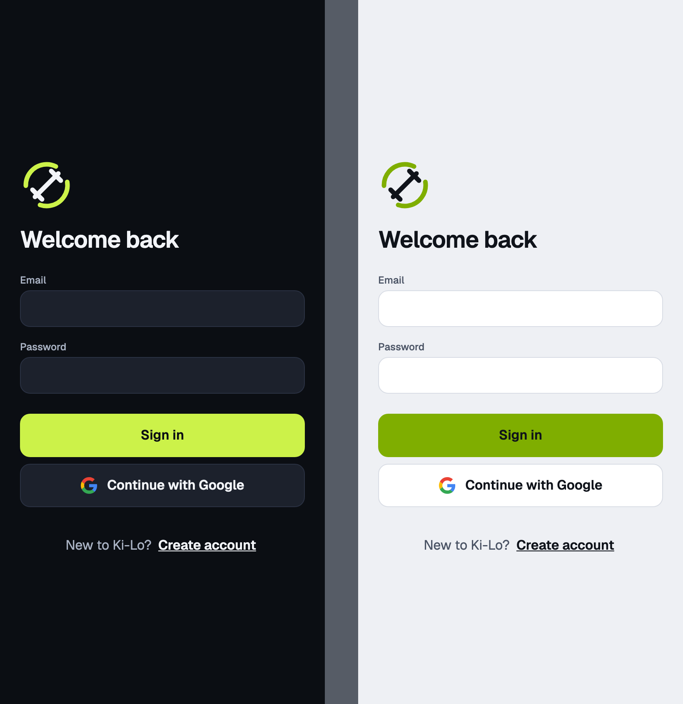
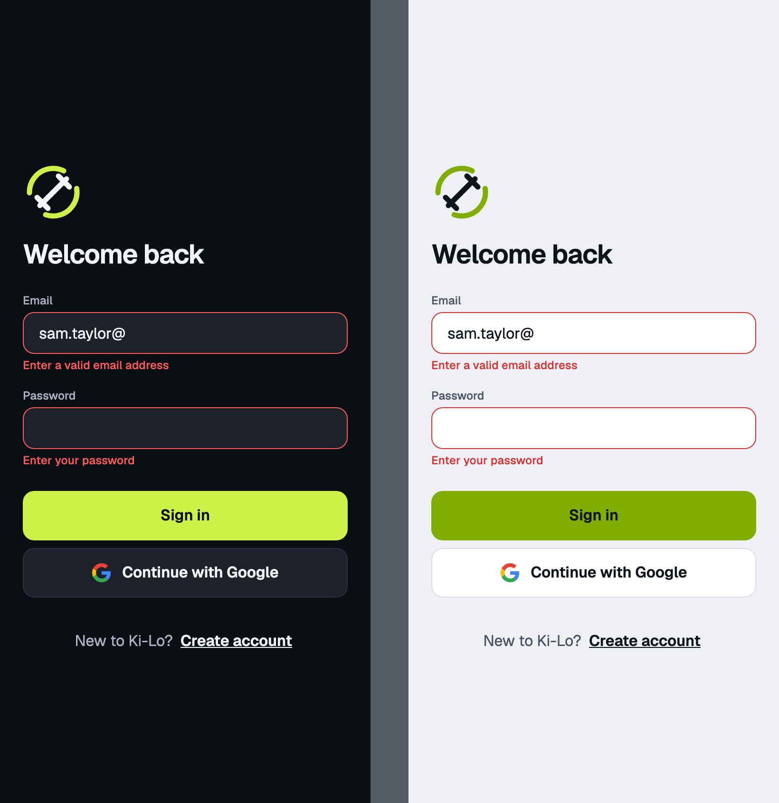
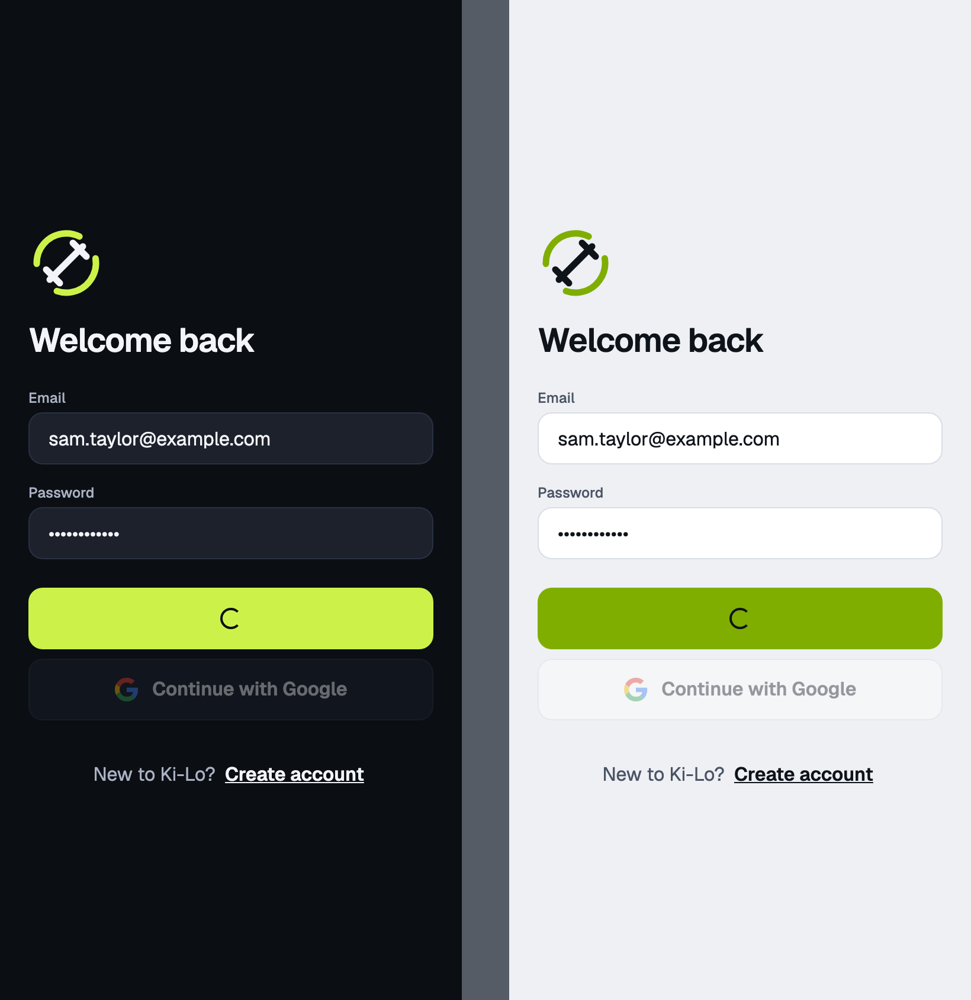
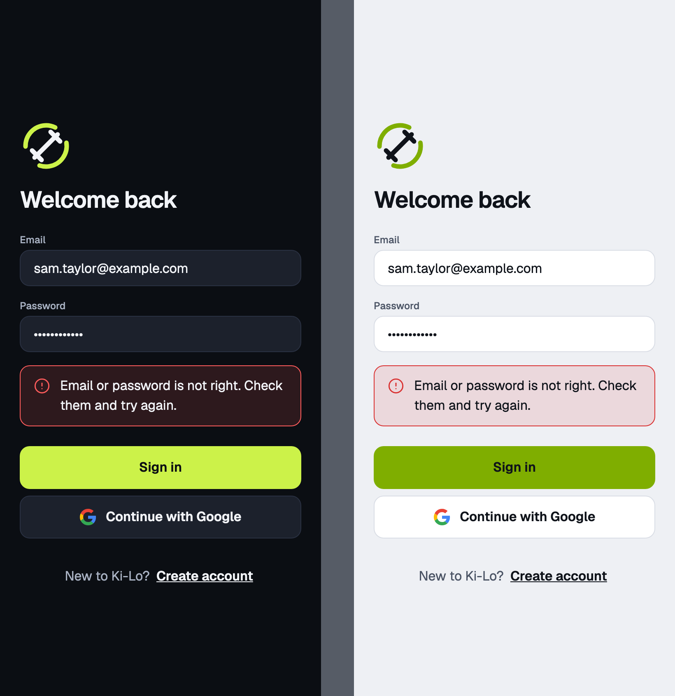
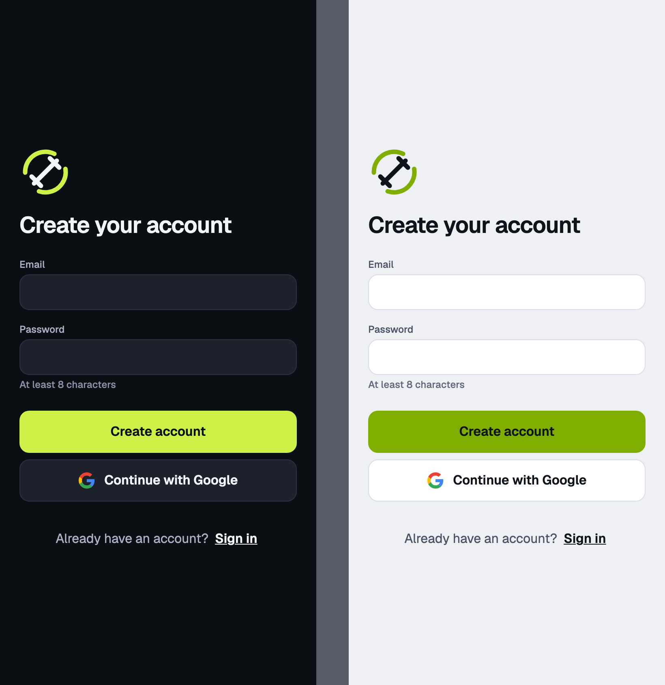
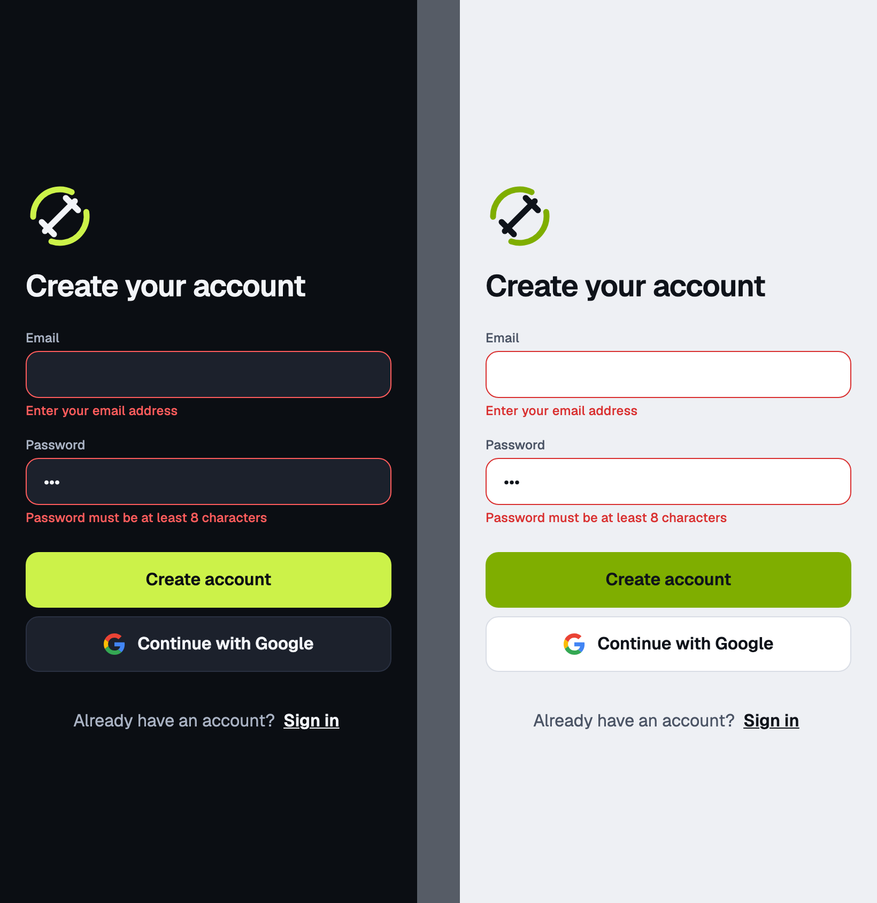
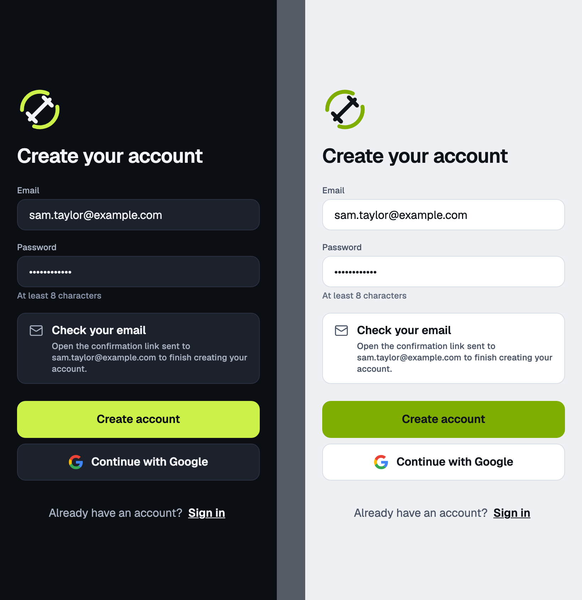
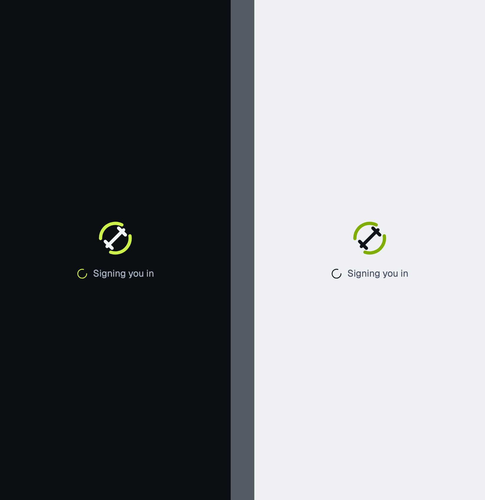
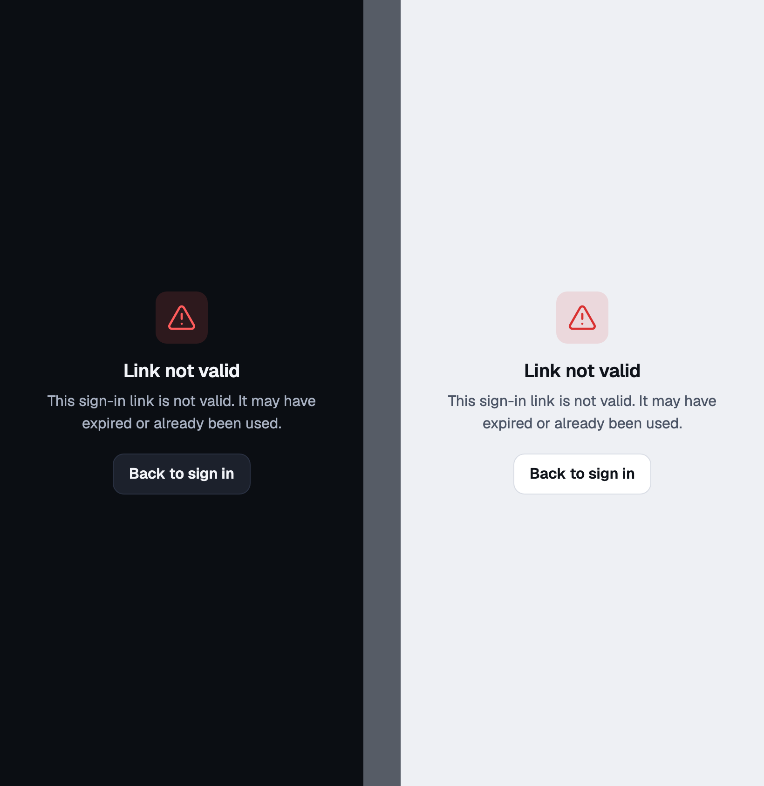

# auth

Sign in and sign up · mobile

<!-- design-export:boards:start -->
Generated by `tools/design-export`. Do not edit between the markers.

## Boards

### sign-in

Auth, sign-in. Dark on the left, light on the right.

Open [sign-in.html](sign-in.html) in a browser, or read the source [auth.sign-in.dc.html](../source/project/auth.sign-in.dc.html).

### sign-in-field-errors

Auth, sign-in-field-errors. Dark on the left, light on the right.

Open [sign-in-field-errors.html](sign-in-field-errors.html) in a browser, or read the source [auth.sign-in-field-errors.dc.html](../source/project/auth.sign-in-field-errors.dc.html).

### sign-in-submitting

Auth, sign-in-submitting. Dark on the left, light on the right.

Open [sign-in-submitting.html](sign-in-submitting.html) in a browser, or read the source [auth.sign-in-submitting.dc.html](../source/project/auth.sign-in-submitting.dc.html).

### sign-in-error

Auth, sign-in-error. Dark on the left, light on the right.

Open [sign-in-error.html](sign-in-error.html) in a browser, or read the source [auth.sign-in-error.dc.html](../source/project/auth.sign-in-error.dc.html).

### sign-up

Auth, sign-up. Dark on the left, light on the right.

Open [sign-up.html](sign-up.html) in a browser, or read the source [auth.sign-up.dc.html](../source/project/auth.sign-up.dc.html).

### sign-up-field-errors

Auth, sign-up-field-errors. Dark on the left, light on the right.

Open [sign-up-field-errors.html](sign-up-field-errors.html) in a browser, or read the source [auth.sign-up-field-errors.dc.html](../source/project/auth.sign-up-field-errors.dc.html).

### sign-up-check-email

Auth, sign-up-check-email. Dark on the left, light on the right.

Open [sign-up-check-email.html](sign-up-check-email.html) in a browser, or read the source [auth.sign-up-check-email.dc.html](../source/project/auth.sign-up-check-email.dc.html).

### signing-in-link

Auth, signing-in-link. Dark on the left, light on the right.

Open [signing-in-link.html](signing-in-link.html) in a browser, or read the source [auth.signing-in-link.dc.html](../source/project/auth.signing-in-link.dc.html).

### signing-in-link-error

Auth, signing-in-link-error. Dark on the left, light on the right.

Open [signing-in-link-error.html](signing-in-link-error.html) in a browser, or read the source [auth.signing-in-link-error.dc.html](../source/project/auth.signing-in-link-error.dc.html).

<!-- design-export:boards:end -->

## Decisions

Where the sources disagree, the order is: Zee's rulings, then the Ki-Lo design system (`../design-system/`), then MacroFactor for layout and behaviour, then the briefs. Zee approved these boards on 2026-10-13. Anything that would visibly change a board goes back to Zee first.

- **Sign in and sign up share one layout** and differ in heading, button label, password rule and footer link. Any signed-out launch lands on Sign in.
- **The Google button is drawn without the Google "G".** Q17 was answered yes, so the build uses the official G as a documented exception to the design system's Lucide-only rule, as an SVG asset on both platforms. The boards do not show it.
- **Sign in with Apple is not drawn.** Apple's App Store rules generally require it when a third-party social login is offered, so it is flagged for a check before any iOS submission and has its own ticket outside M2 scope.
- **The Ki-Lo mark is on the sign in screens**, in the dark or light variant to match the theme.
- **Errors never show the raw message.** Each error kind maps to one fixed sentence from `packages/core` copy, and field errors sit beside their fields.
- **`signing-in-link` is the short screen shown while an email confirmation link opens the app,** and `signing-in-link-error` is its failure.
- **After sign in the app opens on Dashboard (Q12).**
- **Out of scope for M2:** forgotten password, a magic link request, onboarding and profile setup. The onboarding wizard is a later milestone.
