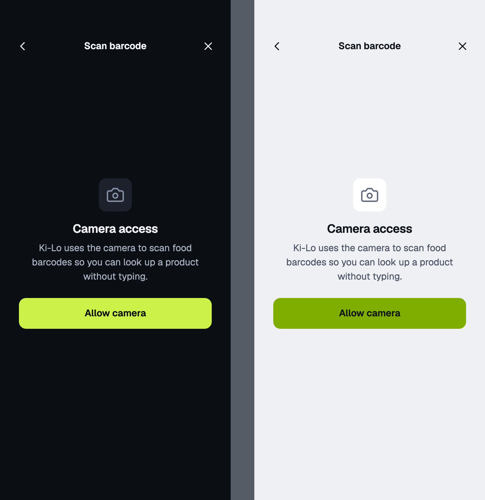
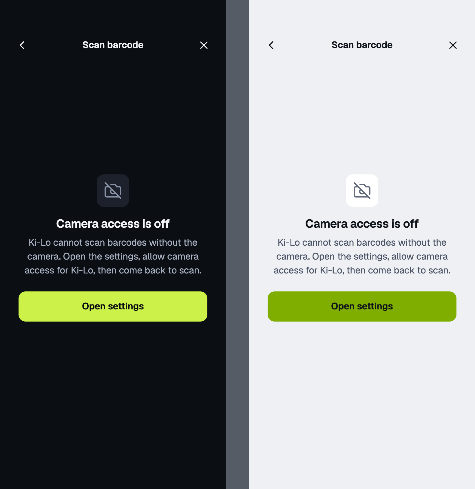
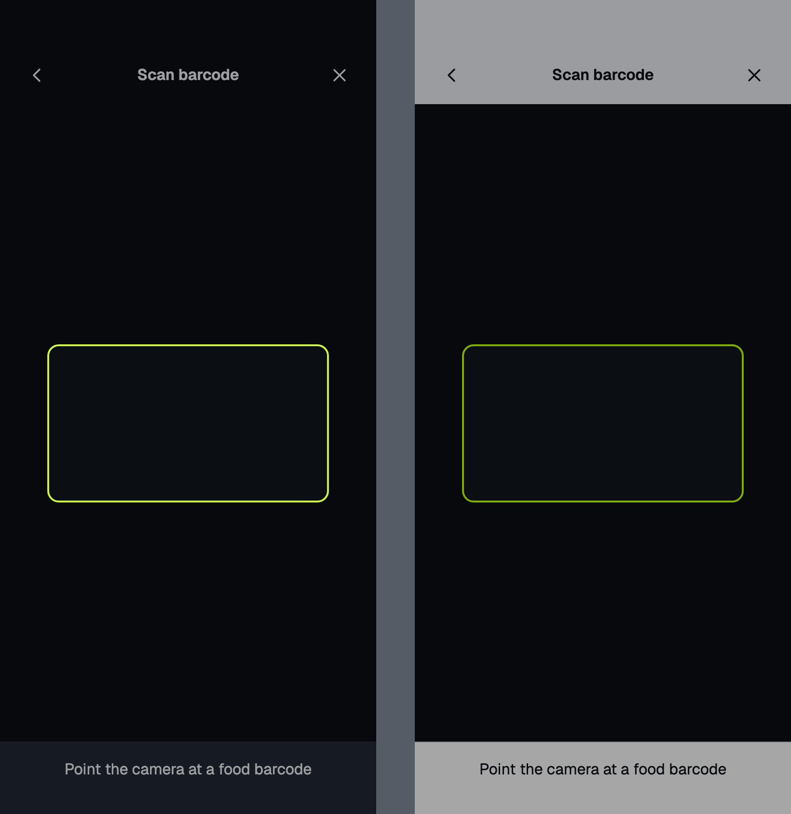
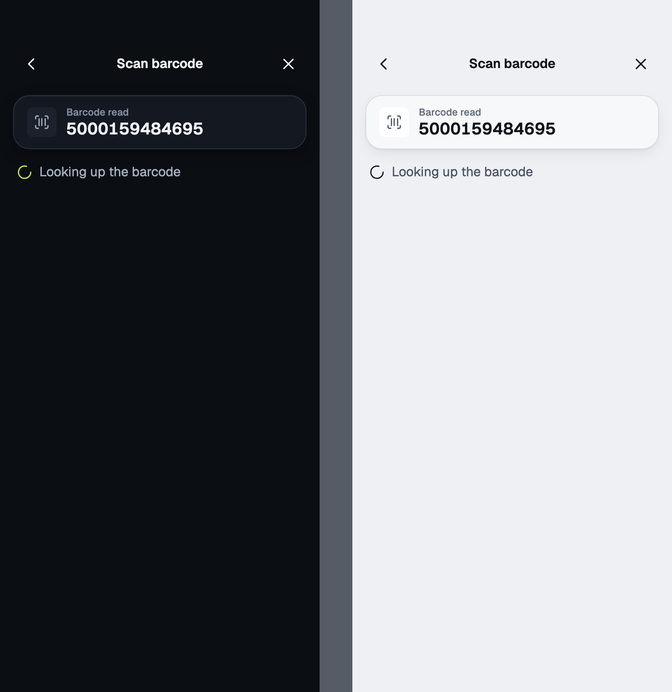
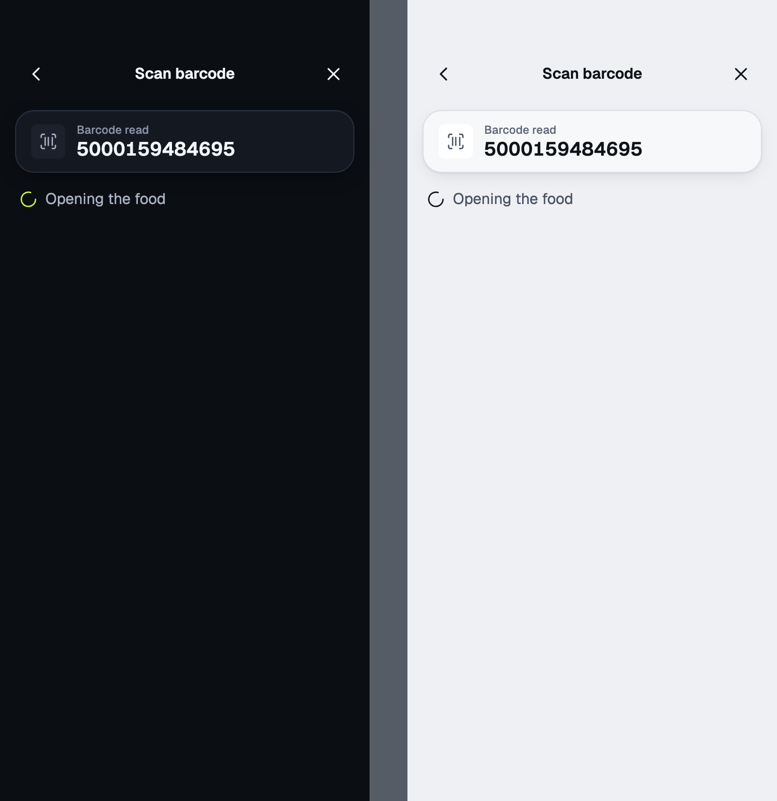
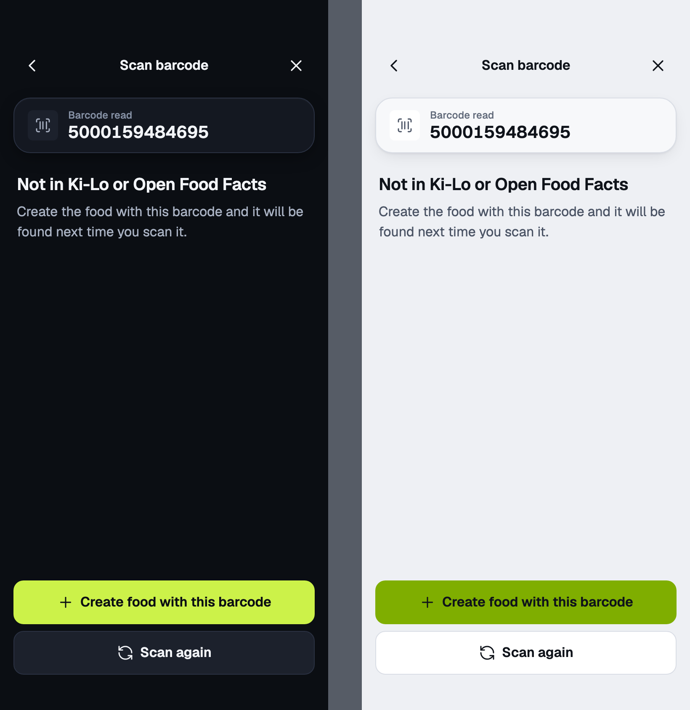
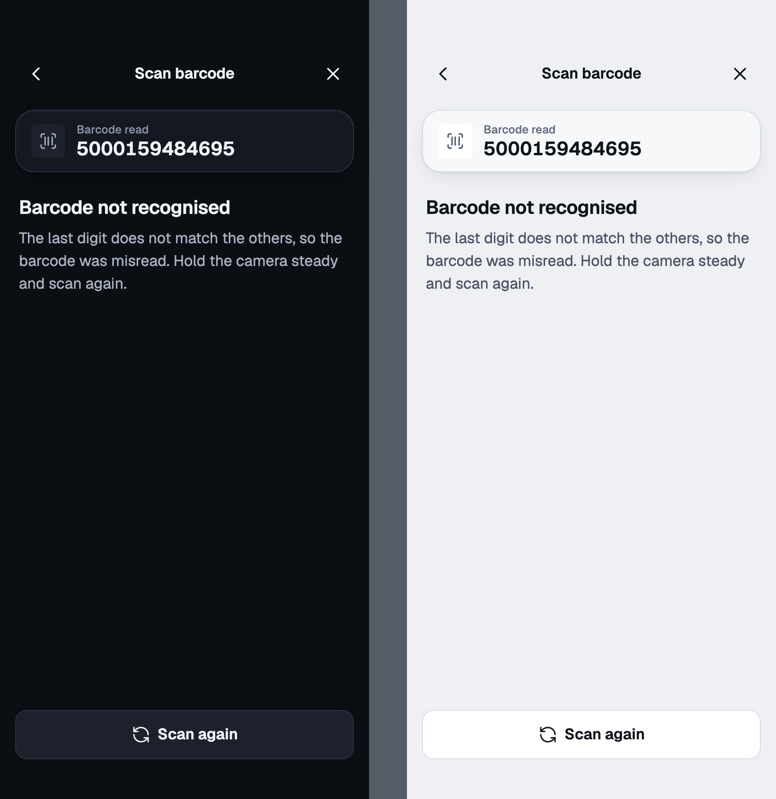
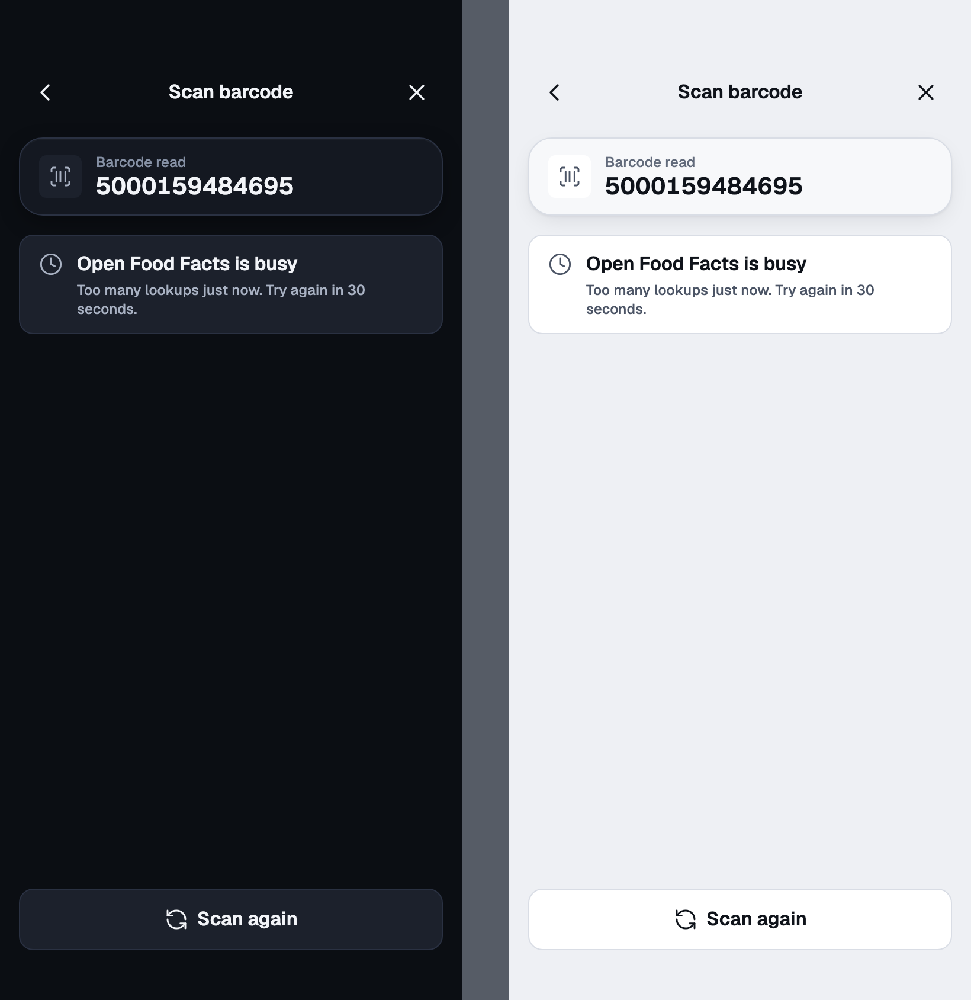
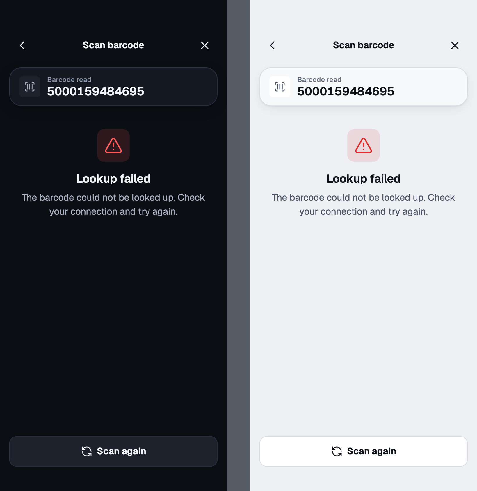
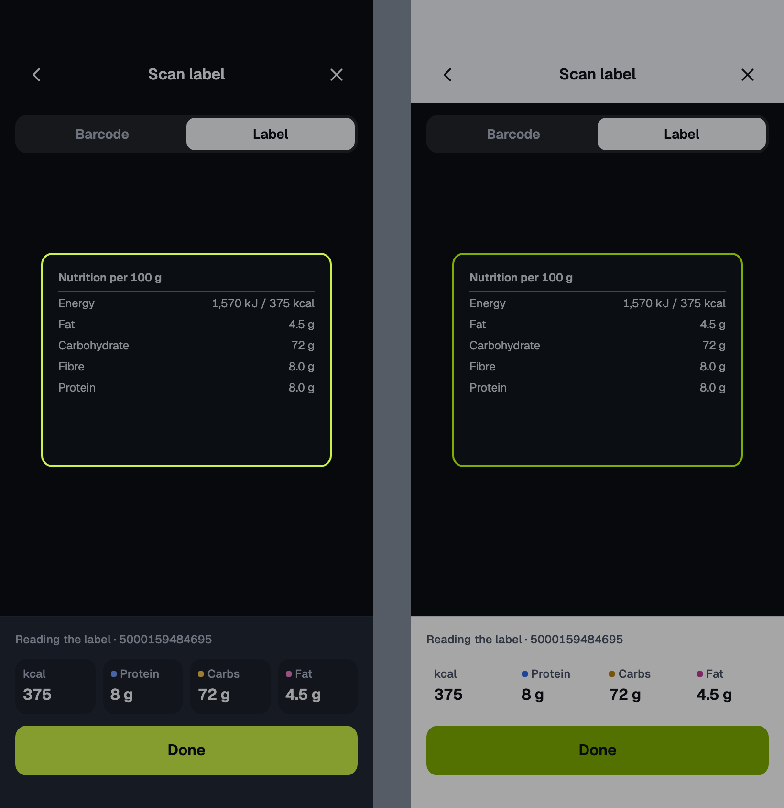

# barcode-scan

Barcode scan · inside the search sheet

<!-- design-export:boards:start -->
Generated by `tools/design-export`. Do not edit between the markers.

## Boards

### permission-ask

Barcode scan, permission-ask. Dark on the left, light on the right.

Open [permission-ask.html](permission-ask.html) in a browser, or read the source [barcode-scan.permission-ask.dc.html](../source/project/barcode-scan.permission-ask.dc.html).

### permission-denied

Barcode scan, permission-denied. Dark on the left, light on the right.

Open [permission-denied.html](permission-denied.html) in a browser, or read the source [barcode-scan.permission-denied.dc.html](../source/project/barcode-scan.permission-denied.dc.html).

### scanning

Barcode scan, scanning. Dark on the left, light on the right.

Open [scanning.html](scanning.html) in a browser, or read the source [barcode-scan.scanning.dc.html](../source/project/barcode-scan.scanning.dc.html).

### looking-up

Barcode scan, looking-up. Dark on the left, light on the right.

Open [looking-up.html](looking-up.html) in a browser, or read the source [barcode-scan.looking-up.dc.html](../source/project/barcode-scan.looking-up.dc.html).

### opening-food

Barcode scan, opening-food. Dark on the left, light on the right.

Open [opening-food.html](opening-food.html) in a browser, or read the source [barcode-scan.opening-food.dc.html](../source/project/barcode-scan.opening-food.dc.html).

### not-found

Barcode scan, not-found. Dark on the left, light on the right.

Open [not-found.html](not-found.html) in a browser, or read the source [barcode-scan.not-found.dc.html](../source/project/barcode-scan.not-found.dc.html).

### invalid

Barcode scan, invalid. Dark on the left, light on the right.

Open [invalid.html](invalid.html) in a browser, or read the source [barcode-scan.invalid.dc.html](../source/project/barcode-scan.invalid.dc.html).

### rate-limited

Barcode scan, rate-limited. Dark on the left, light on the right.

Open [rate-limited.html](rate-limited.html) in a browser, or read the source [barcode-scan.rate-limited.dc.html](../source/project/barcode-scan.rate-limited.dc.html).

### failed

Barcode scan, failed. Dark on the left, light on the right.

Open [failed.html](failed.html) in a browser, or read the source [barcode-scan.failed.dc.html](../source/project/barcode-scan.failed.dc.html).

### label-scan-proposal-m3

Barcode scan, label-scan-proposal-m3. Dark on the left, light on the right.

Open [label-scan-proposal-m3.html](label-scan-proposal-m3.html) in a browser, or read the source [barcode-scan.label-scan-proposal-m3.dc.html](../source/project/barcode-scan.label-scan-proposal-m3.dc.html).

<!-- design-export:boards:end -->

## Decisions

Where the sources disagree, the order is: Zee's rulings, then the Ki-Lo design system (`../design-system/`), then MacroFactor for layout and behaviour, then the briefs. Zee approved these boards on 2026-10-13. Anything that would visibly change a board goes back to Zee first.

- **Scanning is part of the search sheet, not a separate screen.** It opens from the barcode icon in the sheet's docked field, or from the icon in the "Search for a food" bar above the tab bar, which opens the sheet straight on the scanner. Back returns to search and close dismisses the sheet.
- **Lookup order:** foods already in Ki-Lo first, then Open Food Facts. A match always opens Food detail inside the sheet. No match offers "Create food with this barcode", which opens the New food form with the barcode locked.
- **Supported codes:** EAN-13, EAN-8, UPC-A and UPC-E. A read whose check digit does not match is the `invalid` state, which says the barcode was misread and offers "Scan again".
- **Permission states are their own boards** (`permission-ask`, `permission-denied`) and say what happened and what to do.
- **`rate-limited` covers Ki-Lo's own limiter.** When Open Food Facts itself throttles, the app currently reports "could not be looked up", not "busy". Fixing that needs a small backend ticket and is not in this phase.
- **`label-scan-proposal-m3` is not M2 scope.** MacroFactor switches to a label scanner on not-found. That needs OCR, so it is drawn as an M3 proposal only.
- **Out of scope for M2:** label scanning, a Barcode or Label switch, a torch, manual entry on mobile and scanning several items in a row. The torch and manual entry are small proposals for later.
