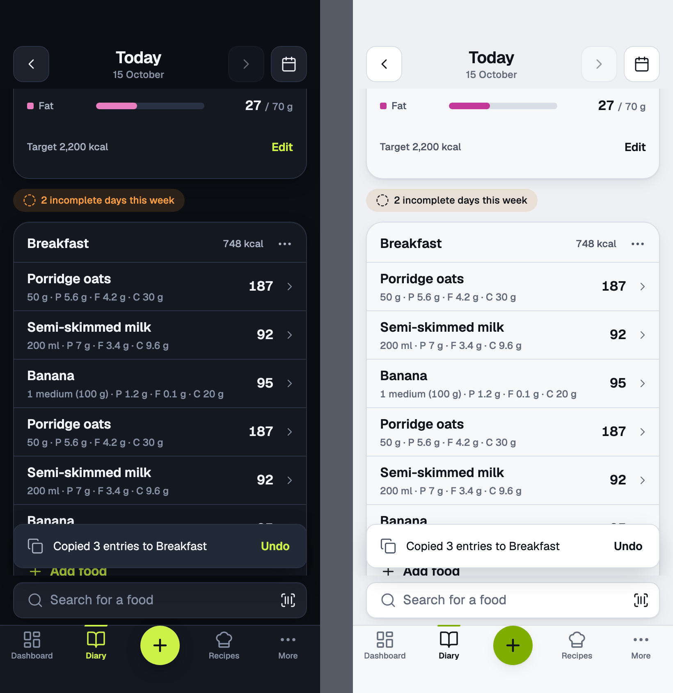
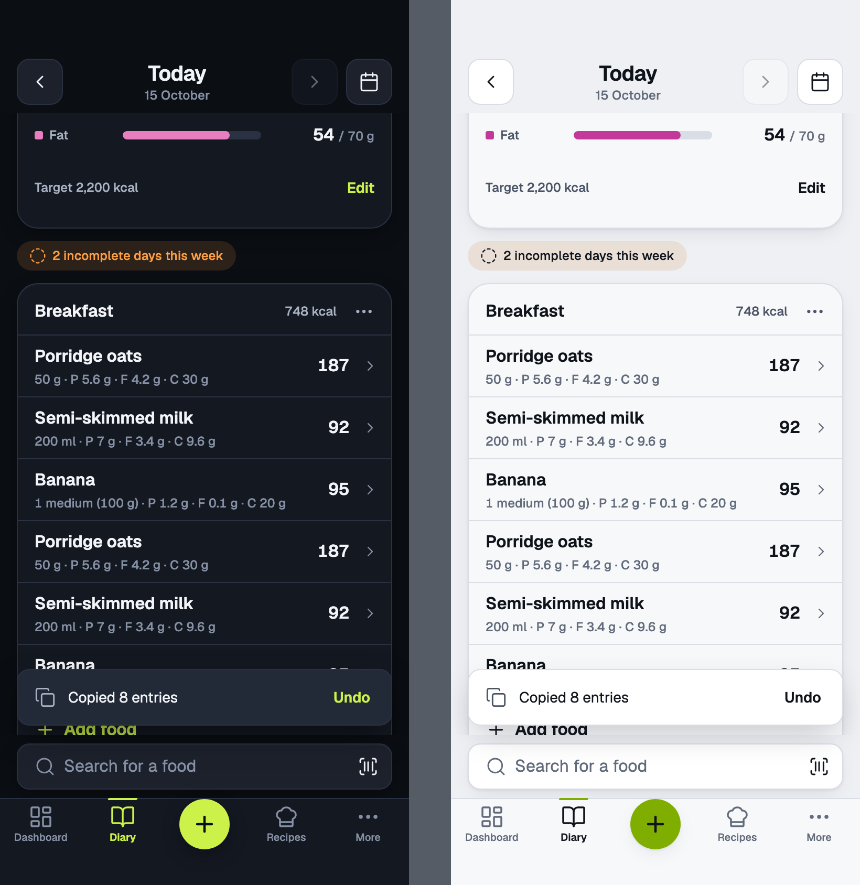
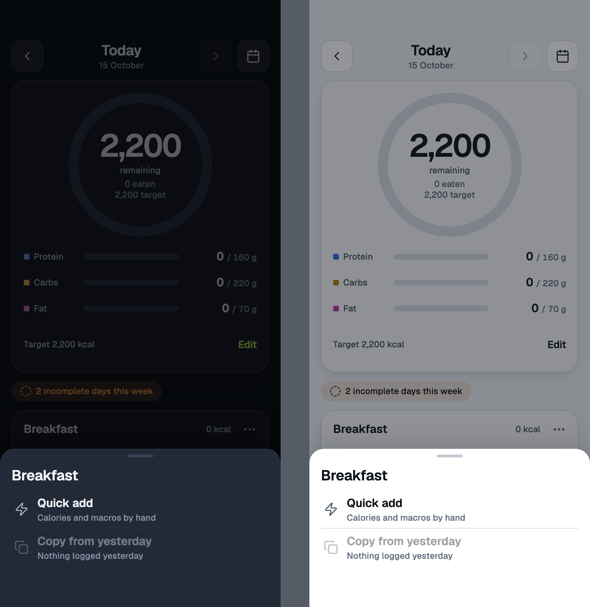
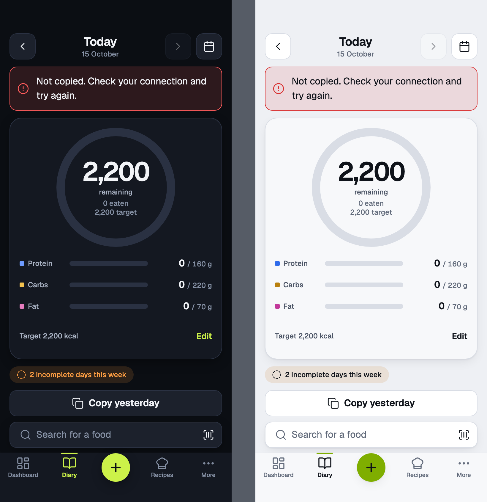

# copy

Copy from yesterday · mobile · copies at once, Undo toast

<!-- design-export:boards:start -->
Generated by `tools/design-export`. Do not edit between the markers.

## Boards

### slot-copied

copy, slot-copied. Dark on the left, light on the right.

Open [slot-copied.html](slot-copied.html) in a browser, or read the source [copy.slot-copied.dc.html](../source-m3/project/copy.slot-copied.dc.html).

### day-copied

copy, day-copied. Dark on the left, light on the right.

Open [day-copied.html](day-copied.html) in a browser, or read the source [copy.day-copied.dc.html](../source-m3/project/copy.day-copied.dc.html).

### nothing-to-copy

copy, nothing-to-copy. Dark on the left, light on the right.

Open [nothing-to-copy.html](nothing-to-copy.html) in a browser, or read the source [copy.nothing-to-copy.dc.html](../source-m3/project/copy.nothing-to-copy.dc.html).

### copy-error

copy, copy-error. Dark on the left, light on the right.

Open [copy-error.html](copy-error.html) in a browser, or read the source [copy.copy-error.dc.html](../source-m3/project/copy.copy-error.dc.html).

<!-- design-export:boards:end -->

## Decisions

Where the sources disagree, the order is: Zee's rulings, then the Ki-Lo design system (`../design-system/`), then MacroFactor for layout and behaviour, then the briefs. These boards are on the canvas "Ki-Lo M3 diary screens" and are **not yet approved by Zee** ([KEY-178](https://linear.app/sojisoft/issue/KEY-178)). Only items tagged Q1 to Q9 are Zee's rulings ([KEY-62](https://linear.app/sojisoft/issue/KEY-62), 2026-10-15). Everything else is brief or canvas content, and items marked as a recommendation are the orchestrator's, all awaiting Zee's approval on KEY-178.

- **Copy yesterday** copies a whole day (the empty-day button) or one meal (the meal menu), at once, with no extra screen (Q8). Copied entries go after existing ones, and nothing is replaced. A toast with Undo follows.
- **Mobile copies from yesterday only.** Web copies from any past day through "Copy to today" in the week view.
