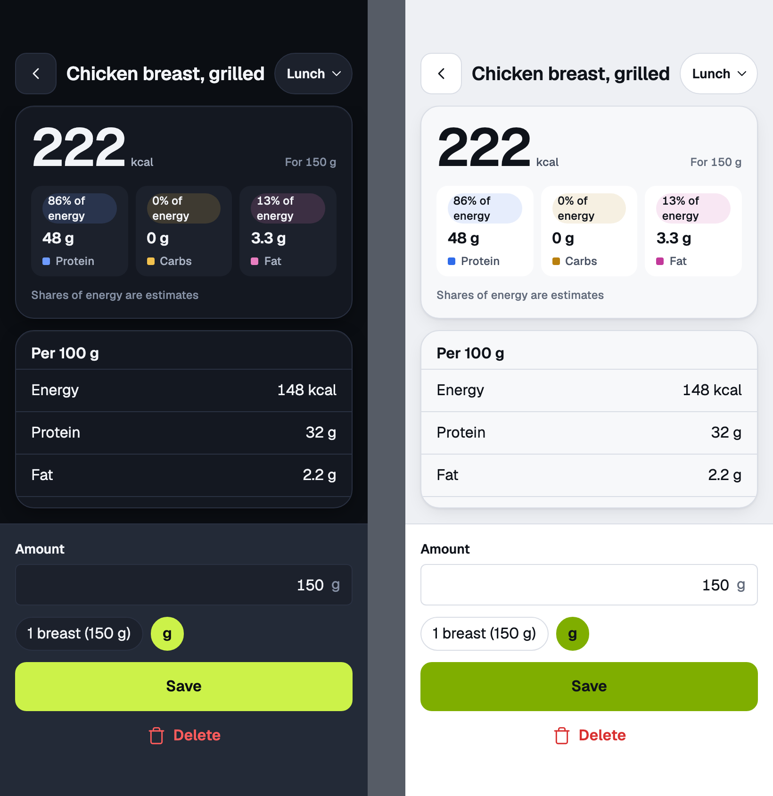
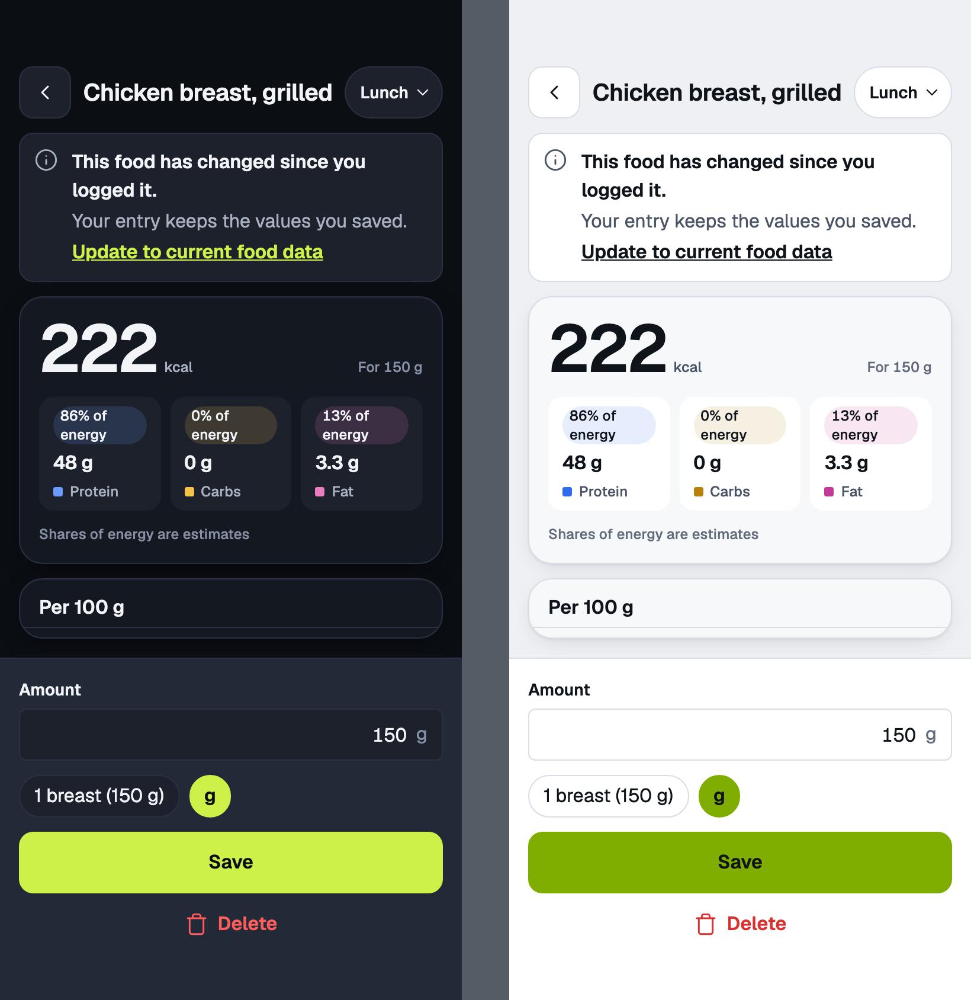
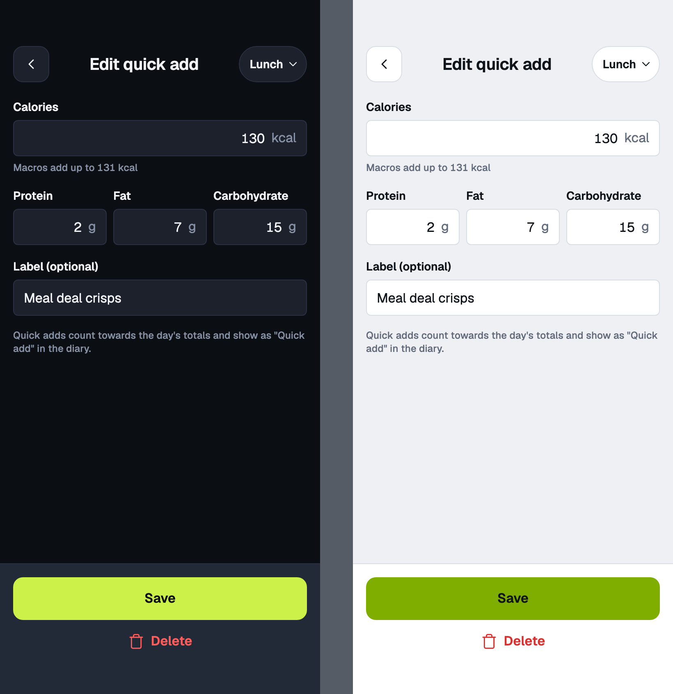
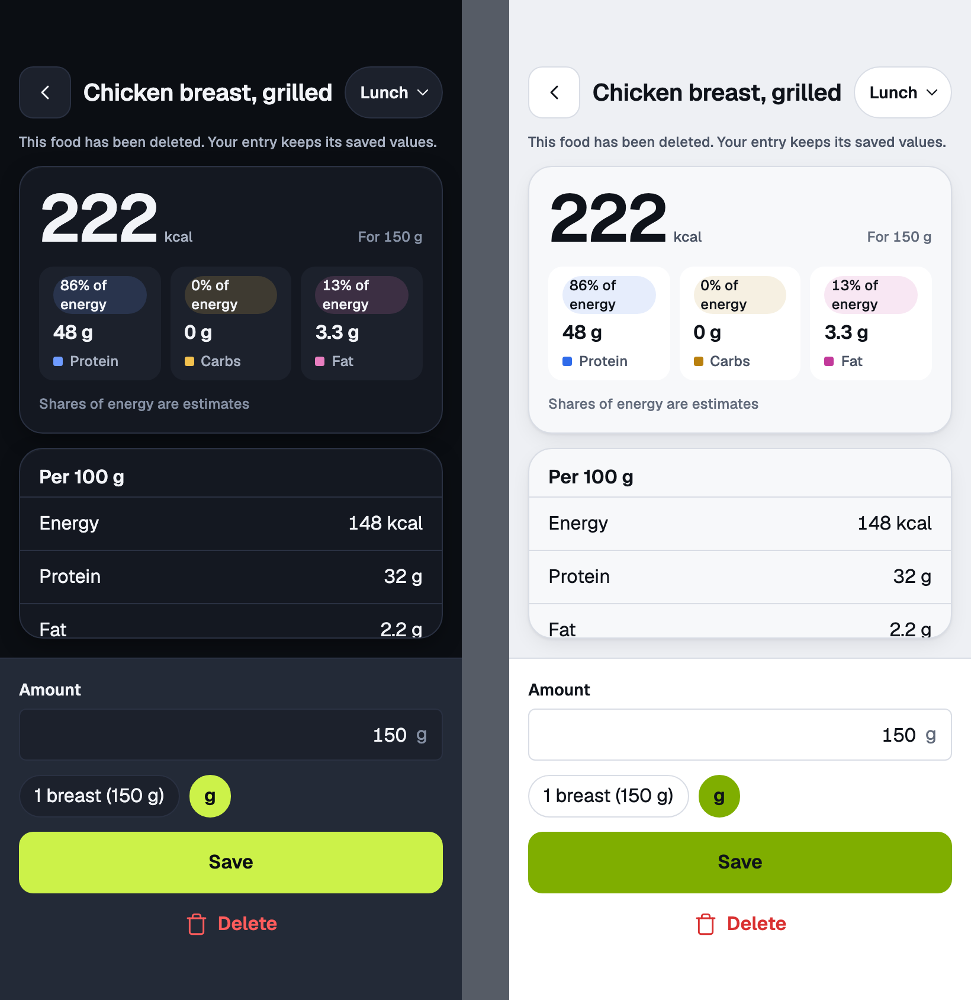

# entry

Edit an entry · mobile · frozen snapshot, Update to current food data

<!-- design-export:boards:start -->
Generated by `tools/design-export`. Do not edit between the markers.

## Boards

### food

entry, food. Dark on the left, light on the right.

Open [food.html](food.html) in a browser, or read the source [entry.food.dc.html](../source-m3/project/entry.food.dc.html).

### food-changed

entry, food-changed. Dark on the left, light on the right.

Open [food-changed.html](food-changed.html) in a browser, or read the source [entry.food-changed.dc.html](../source-m3/project/entry.food-changed.dc.html).

### quick-add

entry, quick-add. Dark on the left, light on the right.

Open [quick-add.html](quick-add.html) in a browser, or read the source [entry.quick-add.dc.html](../source-m3/project/entry.quick-add.dc.html).

### food-deleted

entry, food-deleted. Dark on the left, light on the right.

Open [food-deleted.html](food-deleted.html) in a browser, or read the source [entry.food-deleted.dc.html](../source-m3/project/entry.food-deleted.dc.html).

<!-- design-export:boards:end -->

## Decisions

Where the sources disagree, the order is: Zee's rulings, then the Ki-Lo design system (`../design-system/`), then MacroFactor for layout and behaviour, then the briefs. These boards are on the canvas "Ki-Lo M3 diary screens" and are **not yet approved by Zee** ([KEY-178](https://linear.app/sojisoft/issue/KEY-178)). Only items tagged Q1 to Q9 are Zee's rulings ([KEY-62](https://linear.app/sojisoft/issue/KEY-62), 2026-10-15). Everything else is brief or canvas content, and items marked as a recommendation are the orchestrator's, all awaiting Zee's approval on KEY-178.

- **An entry keeps the food it was logged from** ([KEY-3](https://linear.app/sojisoft/issue/KEY-3)). Changing the amount recalculates from that saved copy, never from the live food.
- **"Update to current food data"** appears only when the food has changed since logging. If the food was deleted, the entry keeps its values and Save still works.
- **Delete is a ghost destructive button,** immediate, with the Undo toast on the diary (Q7).
- A quick add entry opens the quick add layout pre-filled (`quick-add`).
