# exercise-form proposals

Exercise form media · how an exercise is done · `apps/mobile/components/ui/FormMediaCard`

The exercise form media feature shows how an exercise is done in three places: the live workout's exercise sheet, the routine editor and the assistant chat. It has no exported board. This folder holds hand-drawn proposals for it, built from the kit tokens and primitives (`Card`, `PressableSurface`, `Text`, `Icon`, `Badge`, `Skeleton`). They are not on the canvas, so they sit in `proposals/` where `tools/design-export` does not look for boards. Each PNG is 820 by 844 at device pixel ratio 2, dark on the left and light on the right.

## Boards

### form-media-card

The shared card that all three places use, with every state stacked, top to bottom: the video, the photos alternating, the photos with Reduce Motion on, loading, unavailable, and a video whose thumbnail failed to load.

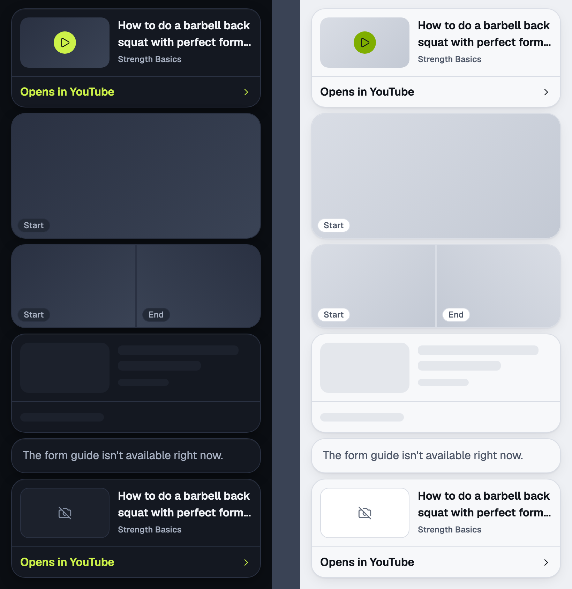

Open [form-media-card.html](form-media-card.html) in a browser.

- **Video.** One pressable card, role `link`, named "Watch <title> by <channel> on YouTube". A 16:9 thumbnail at 128 by 72 with a play glyph over it, the title (two lines at most), the channel, and under a hairline the line "Opens in YouTube" in the accent ink with a chevron, as `AssistantLinkRow` draws its last line. The thumbnail is cropped to 16:9 with cover, because YouTube's `hqdefault.jpg` is 4:3 with letterbox bars. The board uses a neutral placeholder, never a real thumbnail.
- **Photos, alternating.** The start photo and the end photo take turns in one 2:1 stage, crossfading, about 1.5 seconds each. A "Start" or "End" badge sits on the photo.
- **Photos, Reduce Motion.** Both photos side by side, 3:2 each, each with its badge, and nothing moves.
- **Loading.** The skeleton of the video card.
- **Unavailable.** One quiet line, for offline or a failed read. No icon and no error colour.
- **Image failed.** The placeholder tile (the camera-off glyph on the raised surface, named "Image not available") in place of a thumbnail or a photo that did not load. The card still opens the video.

### session-exercise-sheet

The live workout's exercise sheet (the "Muscles it works" sheet the exercise card opens from its name or its body icon) with the form card in it. Three boards, each dark on the left and light on the right, 820 by 844 at device pixel ratio 2. The sheet is drawn as the app draws it today: the handle, the exercise name, the "Muscles it works" caption, the front and back figures coloured by role, the role rows and the explanation.

**Video.** [session-exercise-sheet.html](session-exercise-sheet.html)

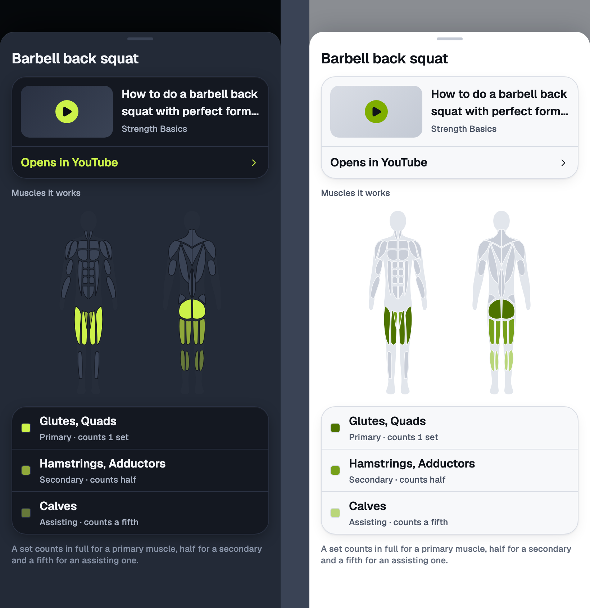

**Photos fallback.** [session-exercise-sheet-photos.html](session-exercise-sheet-photos.html)

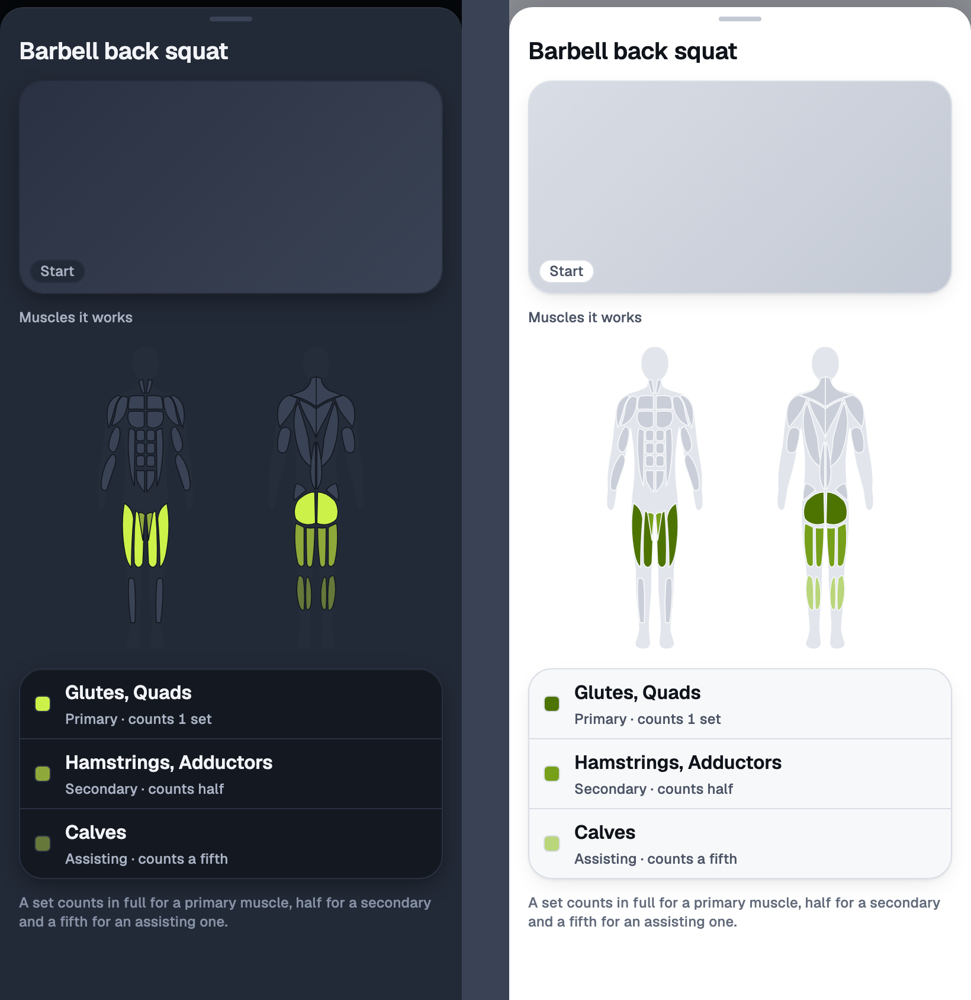

**Loading (dark) and unavailable (light).** [session-exercise-sheet-states.html](session-exercise-sheet-states.html)

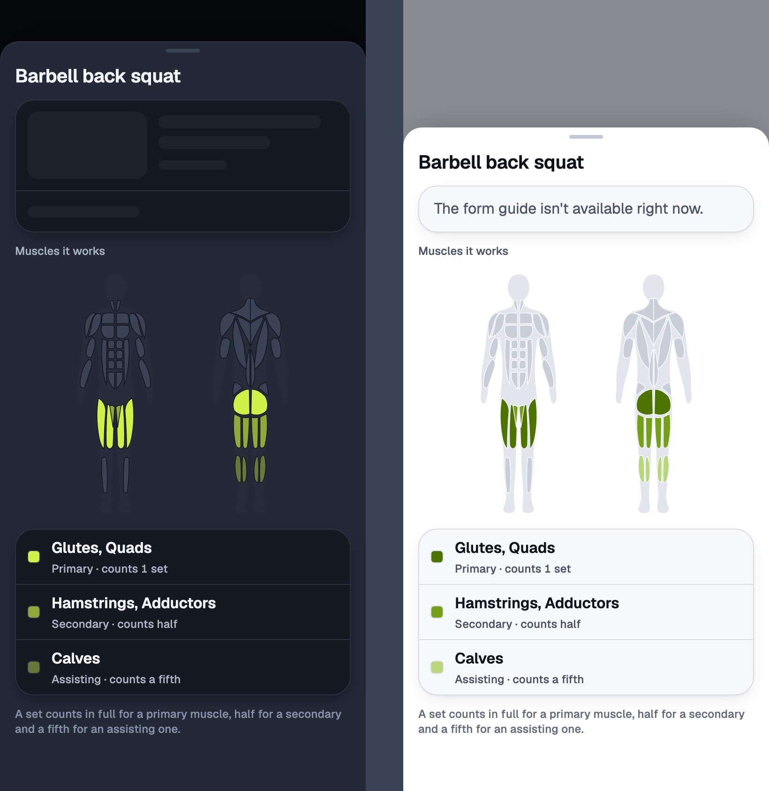

- **Placement.** The card sits directly under the exercise name and above the "Muscles it works" caption. Form is what a lifter wants mid-set, so it comes before the muscles, and the caption then labels the figure and the rows under it, as a section label. The card is the same `FormMediaCard` the routine editor and the assistant draw, with no wrapper of its own and no section heading, so the sheet needs no new copy.
- **Spacing.** The card has 12 above and 12 below, the same as the gap between the other blocks of the sheet. The sheet's body has no gap between the name and the caption (2), so the card's own padding makes up the rest.
- **Custom exercise.** An exercise with no media (a custom exercise, or a library exercise with neither a video nor photos) draws nothing for the form. There is no card, no padding and no gap, so the sheet is the one the app draws today, name and caption 2 apart.
- **Loading and unavailable.** Both take the card's place, and the card that was shown stays on show as the sheet closes. The loading card is the skeleton of the video card. The unavailable card is one quiet line, when the phone is offline or the read failed, and the muscles part of the sheet behaves as it does today. A custom exercise shows the loading card for as long as the read takes, then the card closes up and the sheet moves up with it.
- **Height.** The photos card is 2:1, so it is the tallest, and with it the sheet is 838 points tall in the 844 point frame (804 of content and 34 of home indicator). The board draws a phone tall enough for that. A shorter phone does not get a shorter sheet. The sheet stops below the status bar and its contents scroll. On a 375 by 667 phone (20 points of status bar, no home indicator) the sheet is at most 647 points tall, against about 804 of contents with the photos card, 766 with the video card and 601 with no card. So the photos sheet scrolls by about 157 points, the video sheet by about 119, and a sheet with no card does not scroll, as today. With the 3D body the stage (240 and its switch) replaces the figures (264), so the contents are about 830 with the photos card and scroll in the same way. The stage sits in the scroll view as it does on the body map screen, and a drag on it should turn the body and not scroll. That wants a check on a device.
- **3D body.** The card keeps its place above the caption and the stage. It is an ordinary pressable, so it presses while the body turns under a drag. The sheet does not draw it.
- **Reduce Motion.** The photos card draws both photos side by side, as `form-media-card` shows. The sheet does not repeat it.
- **Words.** Every word of the card comes from `packages/core/src/copy/exerciseForm.ts`. The sheet adds none, and the figure, rows and explanation are the sheet's own.

### routine-editor-exercise

How a person reaches the exercise sheet from the routine editor, and the sheet over the editor. One board, 820 by 844 at device pixel ratio 2. The left frame is dark and draws the way in: the editor with the Legs day open and an exercise's menu open over it. The right frame is light and draws the sheet open over the editor with the video card. The sheet is the one `session-exercise-sheet` draws, so its photos, loading and unavailable states, and its dark theme, are on those boards and are not repeated here.

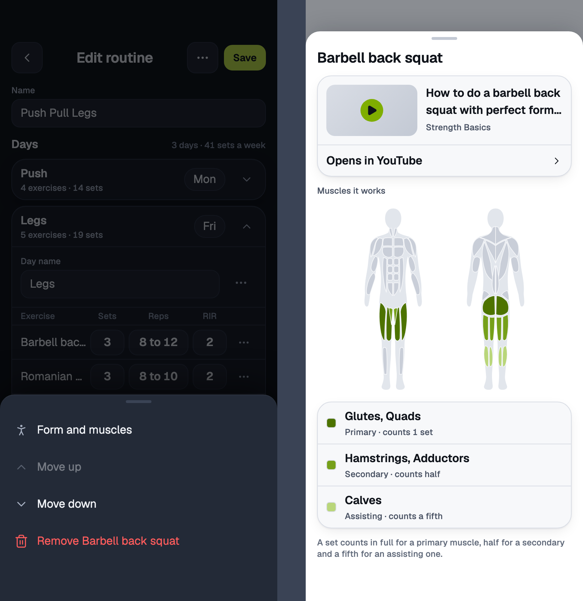

Open [routine-editor-exercise.html](routine-editor-exercise.html) in a browser.

- **The name is the button.** The exercise name in the row becomes a pressable, as the name is in the workout's exercise card, named "Form and muscles, <exercise>". It is drawn as the name has always been, with no underline, icon or colour, so the row looks as it did and the table stays quiet. Its press area is the whole name column, 48 points high.
- **The columns do not move.** The name column is the flexible one and the sets, reps and RIR columns keep their 48, 84 and 48 points with 6 between, so they line up with the column heads. The row stays 48 points high (the board measures all six rows at 48). The name already ends in an ellipsis when it is long, and a press on that ellipsis opens the sheet, which shows the full name.
- **The menu item is the way people find it.** A plain name does not look pressable, so the row's menu has "Form and muscles" at the top, above Move up, Move down and Remove, with the body glyph the workout card's button uses. Pressing it closes the menu and opens the sheet. Both ways open the same sheet for the same exercise.
- **The sheet.** The same sheet as the workout's, with no second component. It reads the muscles itself and the form media only while it is open. A custom exercise shows its muscles and no form card (the brief loading card of the workout sheet applies here too).
- **Closing and the draft.** Closing the sheet, or coming back from YouTube, leaves the editor as it was: the sheet holds no draft state and the editor never unmounts.
- **Words.** The menu item and the name button's name come from `packages/core/src/copy/exerciseForm.ts`. The board uses a neutral placeholder, never a real thumbnail.

### assistant-card

Board name `assistant-card · exercise-form`. The form guide of an exercise as a card in the assistant thread, under a short reply, the way the muscles card sits under its reply. The sheet is at full height, as it is for the muscles card, with the quiet header, the person's question, the reply and the card above the composer. There are two boards so that both kinds show in both themes: `assistant-card` has the video in dark and the photos in light, and `assistant-card-photos` has the photos in dark and the video in light.

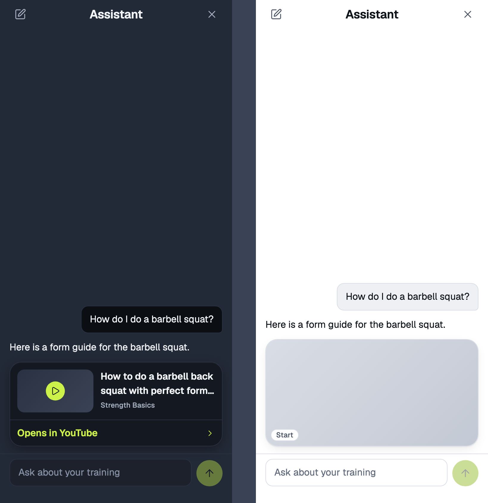

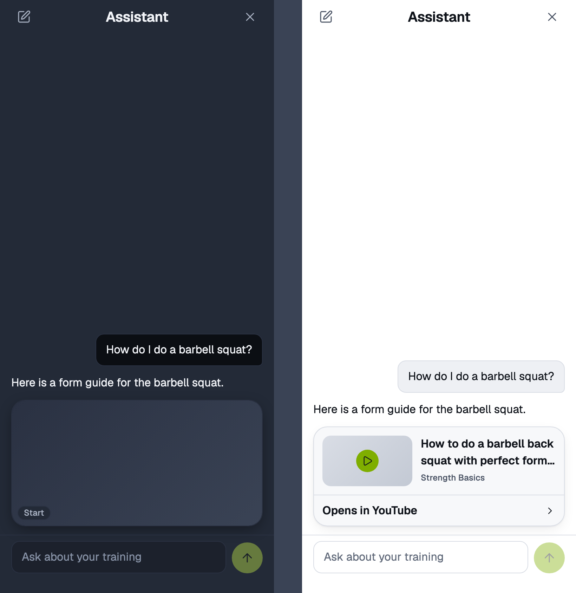

Open [assistant-card.html](assistant-card.html) and [assistant-card-photos.html](assistant-card-photos.html) in a browser.

- **The reply.** One short line, "Here is a form guide for the barbell squat." It never says "I" (KEY-956). The prompt shapes it, so it is not app copy.
- **The card.** `FormMediaCard`, unchanged, straight under the reply with the thread's 12 point gap. The video card opens YouTube. The photos card alternates the start and end photo, and sits side by side with Reduce Motion on, as `form-media-card` shows.
- **Where it sits.** After the reply and before any link, notice or Ask again, whether the turn is live or stored. A stored conversation reopened later draws the same card with no read.
- **Words.** Every word of the card is from `copy/exerciseForm.ts`. The sheet's words are the existing assistant copy. The board uses a neutral placeholder, never a real thumbnail or photo.

## Form media preference (KEY-1059)

Hand-drawn proposals for choosing what an exercise demonstration shows: the form video, the start and end photos, or both. The preference has three values, Video, Photos and Both, and the default is Video. Until now the card drew the video or the photos and never both, and nothing let a person choose. These boards are not on the canvas and Zee has not approved them. The mobile UI ticket does not start until he has. Every board is 820 by 844 at device pixel ratio 2, dark on the left and light on the right, built only from kit tokens and primitives, with a neutral placeholder for the thumbnail and the photos, never a real one.

### Components

- **Reuse as they are:** `FormVideoCard`, `FormPhotos`, `SegmentedControl` (medium in More, small on the card), `ListRow`, `Text`, `Card`.
- **Extend:** `FormMediaCard` gains a `both` kind that composes the two existing parts, and an optional switch slot under the media. No new shared component is needed. The switch is the small `SegmentedControl` the kit already has, so reuse and extension cover it.
- **New:** none. The More row reuses the `Play` icon already in the kit.

### form-media-card-both

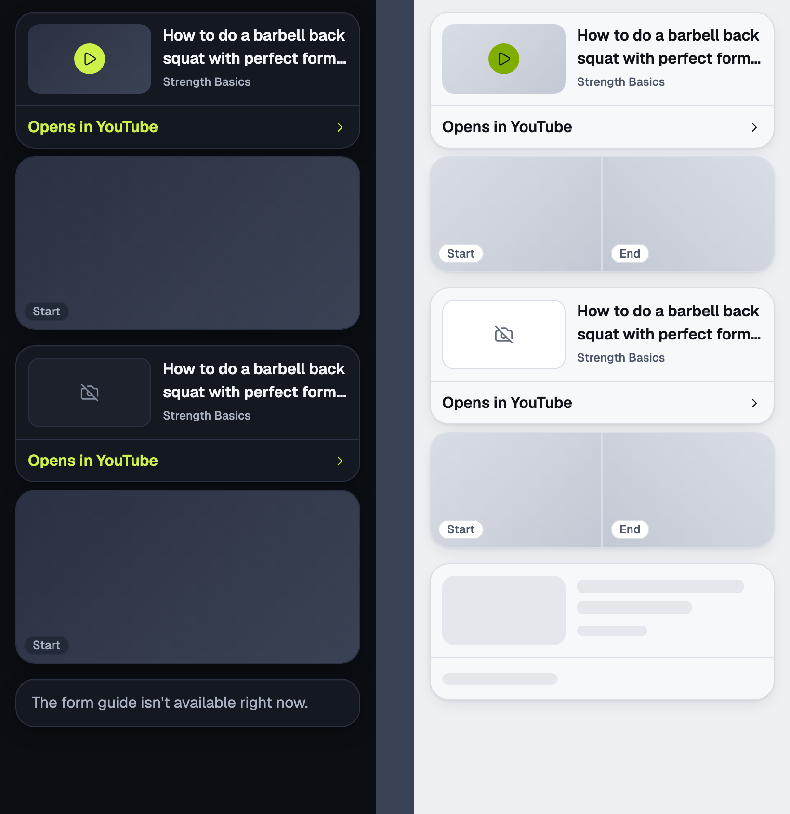

Open [form-media-card-both.html](form-media-card-both.html) in a browser.

- **Order.** The video card comes first and the photos card under it. The video is the richer guide and the photos are the quick check on the two positions.
- **One block, two cards.** They are two cards, the same two cards the video and photos kinds draw, with nothing new around them. A single card would need a divider and a second radius to say where the video ends, and the two existing cards already say it. The pair is one block of the thread or the sheet, so it keeps the block's spacing above and below.
- **Gap.** 8 points between the two cards (`space-2`), the same gap the stacked boards of `form-media-card` use. It is less than the 12 between blocks of the sheet and the thread, so the pair reads as one block.
- **Photos.** The photos card is unchanged. It alternates the start and end photo in a 2:1 stage (dark frame) and draws both side by side, 3:2 each, with Reduce Motion on (light frame). Reduce Motion does not touch the video card.
- **States.** The first frame of each theme is the normal case. The second is a video whose thumbnail failed to load, which shows the placeholder tile as before and still opens the video. Loading is the skeleton of the video card alone (the photos have nothing to load, so they draw when the form media has been read), and unavailable is the one quiet line, as on `form-media-card`. Both replace the whole pair.
- **Only one kind.** An exercise with a video and no photos draws the video card alone under Both, and the reverse draws the photos card alone. `form-media-card` shows both.

### form-media-card-switch

The quick switch on the card, with the cards it sits under. Dark frame, top to bottom: Both with the switch on Both, Photos with the switch on Photos, and a video-only exercise with no switch. Light frame: Video with the switch on Video, Both with Reduce Motion with the switch on Both, and a photos-only exercise with no switch.

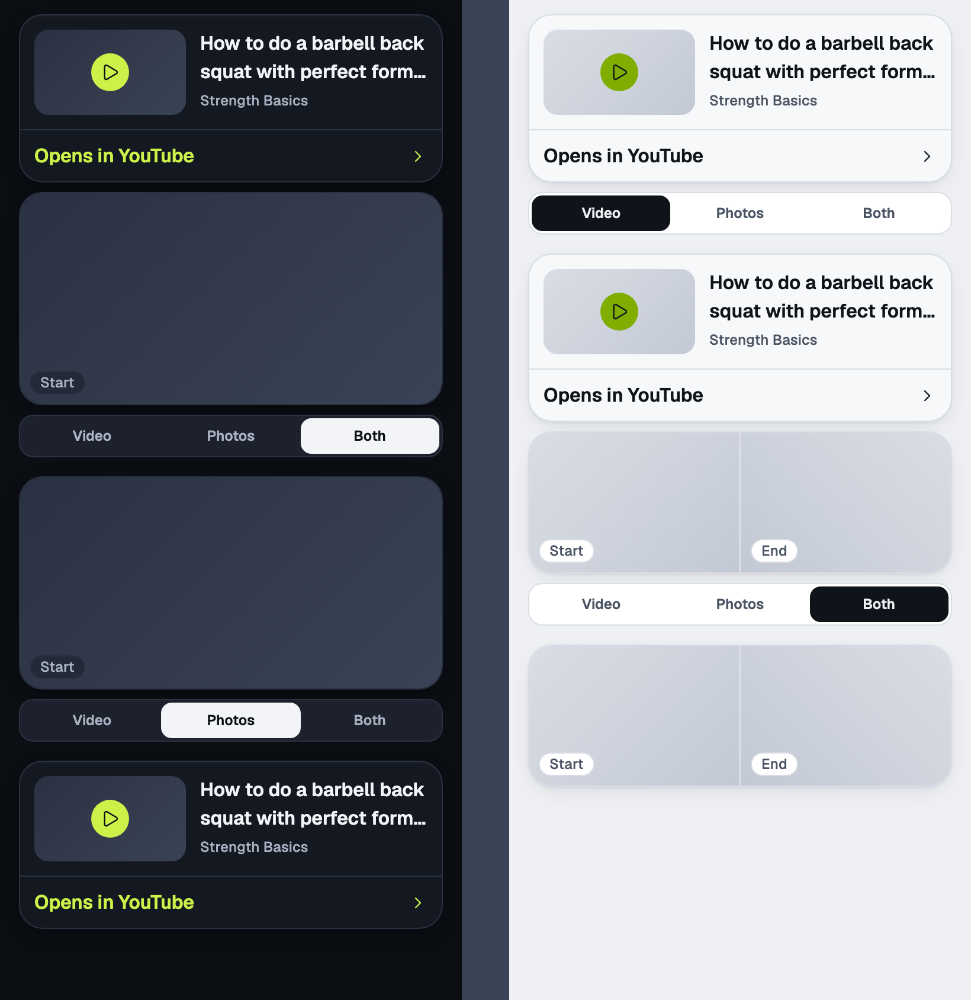

Open [form-media-card-switch.html](form-media-card-switch.html) in a browser.

- **Form.** A small `SegmentedControl` (36 point track, 30 point segments, 12 point labels) of Video, Photos and Both, the full width of the card, 8 points under the media. It is not inside a card, because it changes what the cards show and is not part of any one of them. It keeps the 44 point touch target through the hit slop the small control already has.
- **Accessible name and role.** A radio group named "Show form as", with three radios named "Video", "Photos" and "Both". The chosen one is checked. Pressing the chosen option changes nothing and says nothing, as the control already does.
- **When it shows.** Only when the exercise has both a video and photos. With one kind there is nothing to switch to, so there is no control, whatever the preference says. The two bottom frames show this.
- **What it changes.** The same preference as the More row. Pressing it changes the preference at once and everywhere: the sheet changes, the More row follows, and the next card anywhere draws the new choice. It is not a per exercise choice.
- **Where it shows.** The exercise sheet only, in the live workout and the routine editor. It does not show on the assistant chat card (see `assistant-card-both`).
- **Reduce Motion.** The switch does not move or animate. The cards under it behave as `form-media-card-both` says.

### session-exercise-sheet-both

The live workout's exercise sheet with the preference on Both, and the switch under the media. Dark has the alternating photos, light has Reduce Motion. The sheet is as `session-exercise-sheet` draws it, with the Both block and the switch in the form card's place, under the name and above the "Muscles it works" caption.

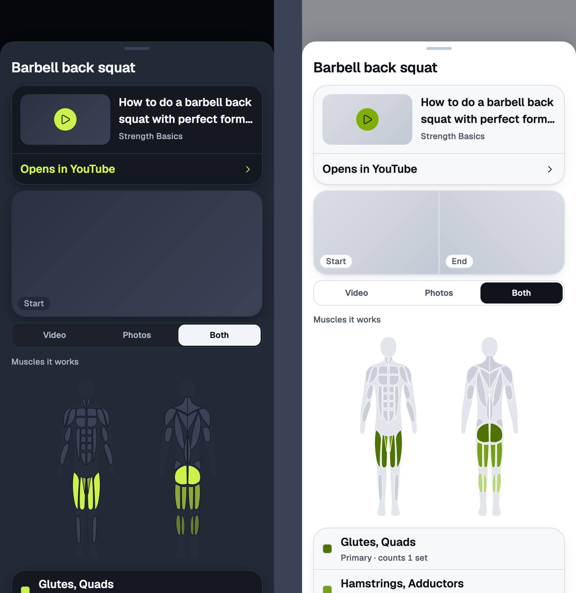

Open [session-exercise-sheet-both.html](session-exercise-sheet-both.html) in a browser.

- **Placement and spacing.** As the other sheet boards: 12 above and 12 below the form block, which is now the video card, 8, the photos card, 8, and the switch.
- **Height.** Both with the switch is the tallest the sheet gets. The block is 142 for the video card, 8, 180 for the alternating photos (120 side by side with Reduce Motion), 8 and 36 for the switch. Contents are about 998 points with the alternating photos and about 938 with Reduce Motion, against 804 for the photos kind and 601 with no card. That is taller than the 844 frame, so the board draws the sheet as a phone draws it: it stops 59 points below the top of the frame, and what does not fit is cut off at the bottom and scrolls.
- **On a 375 by 667 phone.** The sheet is at most 647 points tall (20 of status bar, no home indicator). Against about 998 points of contents, the sheet scrolls by about 351 points with the alternating photos and about 291 with Reduce Motion. The earlier figures stand: 157 for the photos kind and 119 for the video kind. The sheet opens at the top, so the video card, the start of the photos and the switch are on screen at once and the muscles are one scroll away. With the 3D body the stage (240 and its switch) replaces the figures (264), so every figure above is 24 points less.
- **Why this is acceptable.** Form is what a lifter wants mid-set, and it comes first in the sheet. The cost is that the muscles move down on Both. The preference is a choice made for that reason, and the switch is one press away on the card.

### tab-shell-more-form-media-setting

Board name `tab-shell.more · form-media-setting`. The More screen with the new row in the Settings card, drawn under Appearance. Dark has Video chosen and light has Both chosen. It sits in this folder, beside the other form media boards, and is built from the exported `tab-shell.more` board.

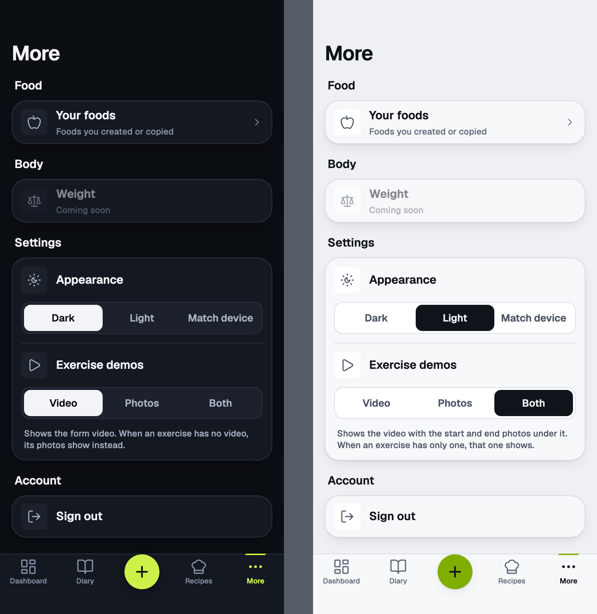

Open [tab-shell-more-form-media-setting.html](tab-shell-more-form-media-setting.html) in a browser.

- **Form.** As `DashboardBodyChartSetting`: a `ListRow` with an icon and the title, over a medium `SegmentedControl` of Video, Photos and Both, and a caption in the secondary ink that changes with the choice. The icon is `Play`, which the kit already has. The row is separated from the one above by a hairline inside the Settings card.
- **Position.** After Appearance on this board. In the built screen, where the Settings card also holds the body map and dashboard body map rows, it goes after the Dashboard body map row. Zee's call.
- **Accessible name and role.** A radio group named "Exercise demos", with three radios. The choice applies at once and is kept per device, like the other settings, and the control always shows what was chosen. It is the same preference as the switch on the card.
- **Words.** Title "Exercise demos". Options "Video", "Photos", "Both". One caption each:
  - Video: "Shows the form video. When an exercise has no video, its photos show instead."
  - Photos: "Shows the start and end photos. When an exercise has no photos, its video shows instead."
  - Both: "Shows the video with the start and end photos under it. When an exercise has only one, that one shows."
- **Where the words go.** `MORE_SCREEN.settings.exerciseDemos` in `packages/core/src/copy/shell.ts`, as `{ title, options: { video, photos, both }, captions: { video, photos, both } }`.

### assistant-card-both

The chat card when the preference is Both, above the composer under a short reply, as `assistant-card` draws it. Dark has the alternating photos, light has Reduce Motion.

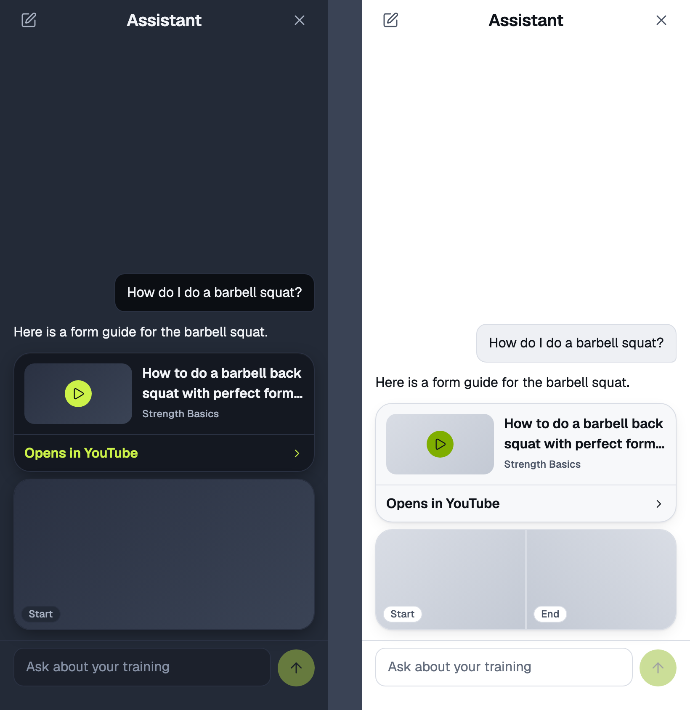

Open [assistant-card-both.html](assistant-card-both.html) in a browser.

- **The card.** The pair of `form-media-card-both`, with no switch, straight under the reply with the thread's 12 point gap. The video card opens YouTube, and the photos card behaves as it does on `assistant-card`.
- **Where it sits.** After the reply and before any link, notice or Ask again, whether the turn is live or stored.
- **Reading the preference.** The card draws what the preference is when it is drawn, so a stored thread reopened after a change draws the new choice, from the same stored form media and with no new read of the exercise.

### Words for the card

Every word goes into `packages/core/src/copy/exerciseForm.ts`, beside the words of the card:

- The switch's group name: "Show form as".
- The switch's options: "Video", "Photos", "Both".
- Nothing else is new. The video card, the badges "Start" and "End", "Loading the form guide" and "The form guide isn't available right now." are unchanged.

### Open questions for Zee

1. **Order.** Video on top and photos under it. Is that the order you want?
2. **Two cards, not one.** The pair is two cards with an 8 point gap. Do you prefer one card with a divider?
3. **Switch on the chat card.** Proposed: sheet only. A switch in a stored thread would change every older card at once, which surprises. Do you want it on the chat card too?
4. **Switch form.** A small segmented control under the media. The alternative is a chip row in the card header. Do you prefer the chips?
5. **Switch changes the preference.** A press on the card changes the setting for everything, not only that exercise. Is that right, or should it be this sheet only for now?
6. **Sheet height on Both.** The sheet scrolls by about 351 points on a 375 by 667 phone. Is that acceptable, or should Both draw the photos side by side always?
7. **Position of the More row.** After the Dashboard body map row. Is that where you want it?
