# Kitchen proposals, lane B: meal plans

KEY-1021, design gate item 5 of the M9 plan (section 7). Zee ruled on 2026-11-12 that plans live on a Plan screen reached from the Diary tab, and on 2026-11-13 that the person chooses how often a recipe can repeat, with "No limit" as one answer. These are hand-drawn proposals, built from the kit tokens and the mobile kit, in the shape of `docs/design/exercise-form/proposals/`. Each PNG is 820 by 844 at device pixel ratio 2, a 390 by 844 phone frame on each side. Where both frames show the same state, dark is on the left and light on the right. Where they differ, the board says what each side shows.

The boards were approved by the orchestrator on 2026-11-13 under Zee's overnight rule, for his review in the morning. Every decision below is written as "Recommended (Zee away), reversible", so any of them can be turned round before a screen ticket starts.

## The data on the boards

All figures are real sums over real fixture rows, not invented.

- **Foods.** The 13 CoFID foods of the eval fixture user (`tools/assistant-evals/fixtures/diary.ts`), with per 100 g values from `packages/db/data/cofid/cofid-2021.normalised.csv` (energy, protein, carbohydrate and fat columns). For example chicken breast `18-323` is 148 kcal and 32.0 g protein, boiled rice `11-862` is 131 kcal and 2.8 g.
- **Recipes.** "Eval porridge bowl" (1 serving, 389 kcal, P 13 g a serving) and "Eval chicken and rice" (2 servings, 518 kcal, P 49 g a serving), from the same fixture. These match the M9 plan's own figures (section 2).
- **Gram amounts.** Each planned food uses the diary fixture's usual amount for that meal, moved in 5 g steps within half and double of it, as the planner's fitter will. Times are the fixture's 07:30, 12:30 and 19:00.
- **Serving weights.** "Eval porridge bowl" is 340 g a serving and "Eval chicken and rice" 350 g. The chicken and rice ingredients add up to 795 g raw, but the fixture saves the recipe with `yieldGrams: 700` (cooked weight, `tools/assistant-evals/fixtures/diary.ts`), and core's `computeRecipe` uses the yield when one is set (`effectiveGrams` is the yield, else the sum of the ingredients). So one serving is 700 / 2 = 350 g, which is what the app shows. The review asked for 398 g (795 / 2). That figure would be right only for a recipe saved with no yield. Every board that shows this recipe uses 350 g, as the app would.
- **Day targets.** The eval user today has a manual target (1,300 kcal, 90 g protein, 150 g carbs, 50 g fat) with no day-of-week figures. The M9 plan's fixture ticket (M9-08) gives it a programme-style `targets` row with varying `dow_calories_kcal`. That row does not exist yet, so the boards use a proposed one: Monday to Friday 1,300, Saturday 1,550, Sunday 1,450, with the existing week macros. M9-08 can adopt these figures or replace them, and the boards would be redrawn from its numbers.
- **Plan week.** Mon 16 to Sun 22 Nov 2026, with "today" Wednesday 18. Default limit of 2 a week: the porridge bowl on Monday and Wednesday, the chicken and rice cooked on Monday (2 servings) with its leftover on Tuesday.

| Day | Target kcal | Planned kcal | Protein of 90 g | Status |
| --- | --- | --- | --- | --- |
| Mon 16 | 1,300 | 1,296 | 86 | within (confirmed on the boards) |
| Tue 17 | 1,300 | 1,292 | 93 | within (confirmed on the boards) |
| Wed 18 | 1,300 | 1,294 | 93 | within |
| Thu 19, first plan | 1,300 | 1,280 | 87 | within |
| Thu 19, replanned "no meat or fish" | 1,300 | 1,292 | 68 | short by 22 g protein |
| Fri 20 | 1,300 | 1,315 | 93 | within |
| Sat 21 | 1,550 | 1,493 | 94 | within (-3.7 %) |
| Sun 22 | 1,450 | 1,451 | 87 | within |

The vegetarian Thursday is short because no fixture food without meat or fish carries enough protein per kcal: eggs are the densest at 14.1 g per 143 kcal, and at twice their usual amount the day still reaches only 68 g within 5 % of 1,300 kcal.

Sources disagreed in one place. The real planner (`planMeals`, M9-06) does not exist yet, so the grams it chooses will differ from these. The boards show core's arithmetic on the boards' own grams, and the built screens show whatever core computes. The shapes (bands, totals, status, misses) are the contract, not these exact grams.

## Boards

### diary · plan-entry

[diary-plan-entry.html](diary-plan-entry.html)

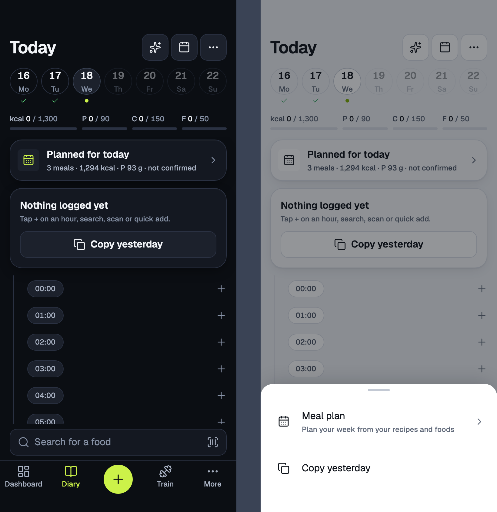

Dark: the Diary tab as built today (header with Assistant, Choose a date and More, the week strip, the progress strip, the empty day card, the hour log, the search bar and the tab bar), with one new row above the empty day card. Light: the same screen with the More sheet open.

- **Two ways in.** "Meal plan" is a new first item in the Diary's More sheet, always there, with the caption "Plan your week from your recipes and foods". When the viewed day is in a plan and not confirmed, a "Planned for today" row sits at the top of the day and opens that day of the plan. Recommended (Zee away), reversible: the header keeps its three buttons, because a fourth crowds a long day title such as "Wednesday 18 November".
- **The row.** "Planned for today", then "3 meals · 1,294 kcal · P 93 g · not confirmed". On another day it says "Planned for Thu 19 Nov". It is not shown on a confirmed day (the entries are in the log) or a day with no plan.
- Kit: `DiaryHeader`, `WeekStrip`, `MacroProgressStrip`, `EmptyDayCard`, `SearchLauncher`, `MainTabBar`, `BottomSheet` and `ActionMenu` reuse. The plan row is new (`PlanTodayRow`), drawn as a `Card` holding a `ListRow` look (icon tile, title, caption, chevron). The More sheet's item list is extended by one item.

### plan · week

[plan-week.html](plan-week.html)

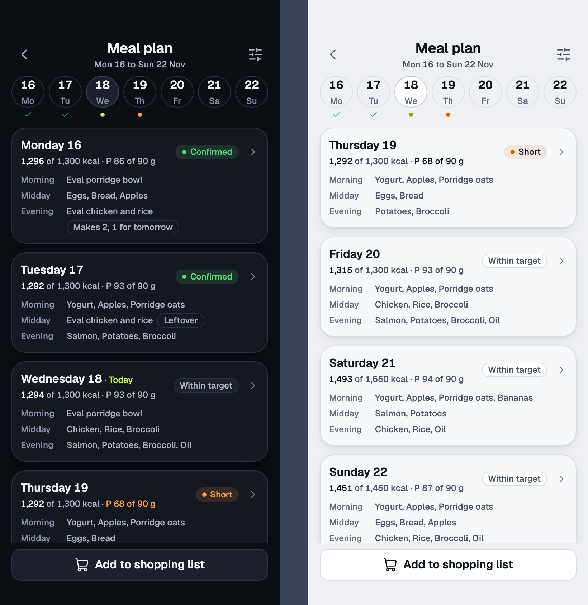

Dark: the top of the week. Light: the same screen scrolled to Thursday to Sunday, so the day with a different target (Saturday, 1,550) shows.

- **Header.** Back to the Diary, the title "Meal plan", the week as `describeWeekRange` writes it, and a settings button (named "Plan settings") that opens `plan · settings`.
- **Week strip.** The Diary's `WeekStrip`, with plan states under each pill: the success tick for a confirmed day, the accent dot for today, and a warning dot for a short day. A tap on a pill opens that day (`plan · day`). Recommended (Zee away), reversible: future days are pressable here, unlike the Diary's strip, because a plan is about days to come.
- **Day cards.** One card a day: the day, "1,296 of 1,300 kcal · P 86 of 90 g" against that day's own target, a status badge, and one line a band (Morning, Midday, Evening) naming what is planned. A recipe is named in full, a food by the part of its name before the first comma ("Chicken, Rice, Broccoli"), so the line fits. A short day's protein is in the warning ink. The whole card opens the day.
- **Footer.** "Add to shopping list" for the days not yet confirmed (see `plan · shopping-added`).
- **Leftovers.** Monday's evening "Eval chicken and rice" carries the badge "Makes 2, 1 for tomorrow" and Tuesday's midday one the badge "Leftover", both on this board. The badge sits beside the band's line and wraps under it when the line is long, so neither is cut.
- Kit: `SheetHeader`, `WeekStrip` (extended with a short-day mark), `Badge` (success, warning and neutral looks) and `Button` reuse. `PlanDayCard` is new, a `Card` with the rows above.

### plan · day

[plan-day.html](plan-day.html)

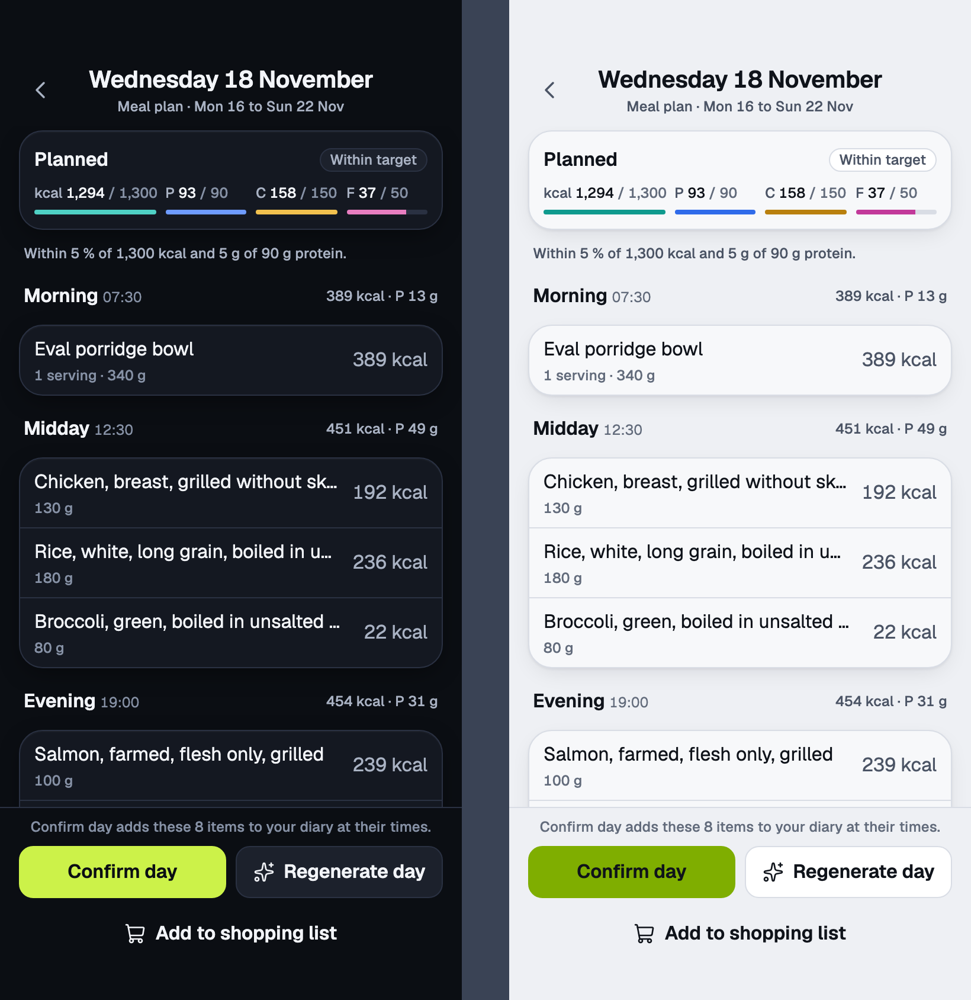

Wednesday 18 November, today, not confirmed. Both themes.

- **Totals.** A card titled "Planned" with its status badge and the `MacroProgressStrip` of the planned sums against the day's target (kcal 1,294 / 1,300, P 93 / 90, C 158 / 150, F 37 / 50). Under it the tolerance line: "Within 5 % of 1,300 kcal and 5 g of 90 g protein." Carbs and fat show but are not judged, because the person did not name them (ruling 6).
- **Bands.** Morning 07:30, Midday 12:30 and Evening 19:00, each a grouped list with its own kcal and protein on the right, each item as a food row: name, "1 serving · 340 g" or "130 g", and kcal. A cooked recipe that leaves servings for the next day carries the badge "Makes 2, 1 for tomorrow" and the next day's item the badge "Leftover".
- **Buttons.** "Confirm day" (primary) and "Regenerate day" side by side, with "Add to shopping list" as a ghost button under them, and a caption above: "Confirm day adds these 8 items to your diary at their times." Confirm writes every item through `confirm_meal_plan_day` at its band time, as diary entries with fresh snapshots, and the day becomes `plan · day-confirmed`. "Regenerate day" opens the assistant sheet with "Replan Wed 18 Nov: " in the composer (the day's short date and a colon) and the keyboard up, so the person adds their words and sends. Nothing is sent without them. "Add to shopping list" here adds this day alone.
- Kit: `SheetHeader`, `Card`, `MacroProgressStrip` (card surface), `Badge`, `GroupedList`, `FoodRow` look and `Button` reuse.

### plan · day-confirmed

[plan-day-confirmed.html](plan-day-confirmed.html)

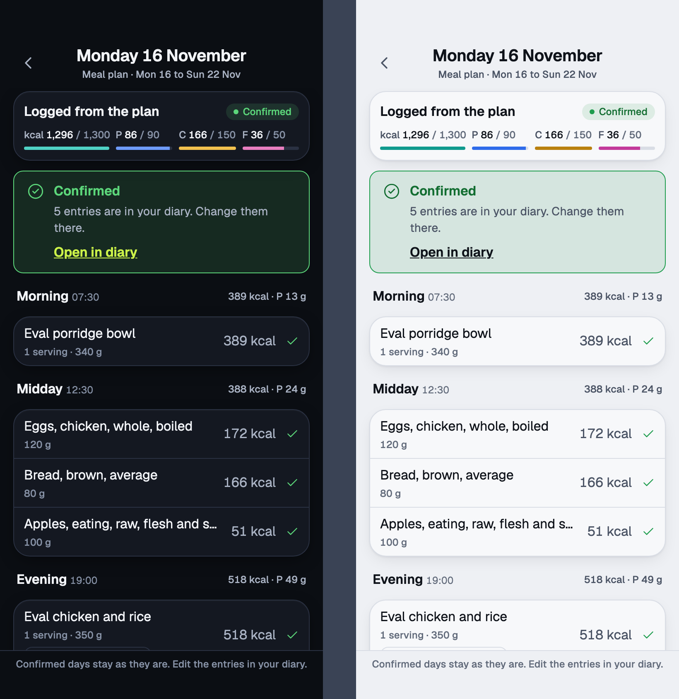

Monday 16 November after Confirm day. Both themes.

- The totals card is titled "Logged from the plan" with the "Confirmed" badge. A banner says "Confirmed", "5 entries are in your diary. Change them there.", with the link "Open in diary", which opens the Diary on that day.
- Each item has the success tick, named "In your diary". The buttons are gone, and a caption takes their place: "Confirmed days stay as they are. Edit the entries in your diary."
- Recommended (Zee away), reversible: a confirmed day cannot be regenerated or confirmed again (`replan_day` and `confirm_meal_plan_day` refuse it), and it has no "unconfirm". The diary is where entries change, with its own delete and Undo.
- Kit: `Banner` extended with a success look (success-muted fill, success border, success ink title), which the kit does not have today. If Zee prefers no new variant, the quiet `info` banner with the success icon does the same job.

### plan · day-short

[plan-day-short.html](plan-day-short.html)

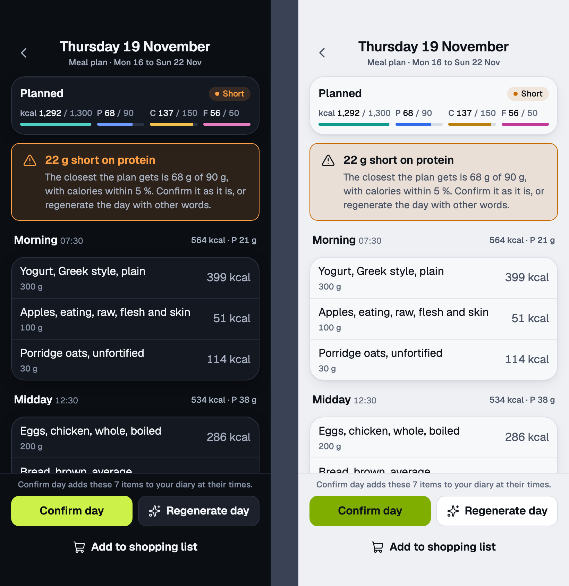

Thursday 19 November after "Replan Thu 19 Nov: no meat or fish that day". Both themes.

- The status badge is "Short" in the warning look. A review banner says it plainly: "22 g short on protein", then "The closest the plan gets is 68 g of 90 g, with calories within 5 %. Confirm it as it is, or regenerate the day with other words." The figures come from the planner's `misses` (target and achieved), never from the model.
- The day can still be confirmed. Recommended (Zee away), reversible: a short day is the person's to accept, because the gap comes from what they asked for.
- When calories are the miss, the same banner says "180 kcal under" or "120 kcal over" with "The closest the plan gets is 1,120 kcal of 1,300 kcal, with protein within 5 g." (pattern, numbers illustrative). When both miss, the title names both: "22 g short on protein and 180 kcal under".
- Kit: `Banner` review variant reuse.

### plan · empty

[plan-empty.html](plan-empty.html)

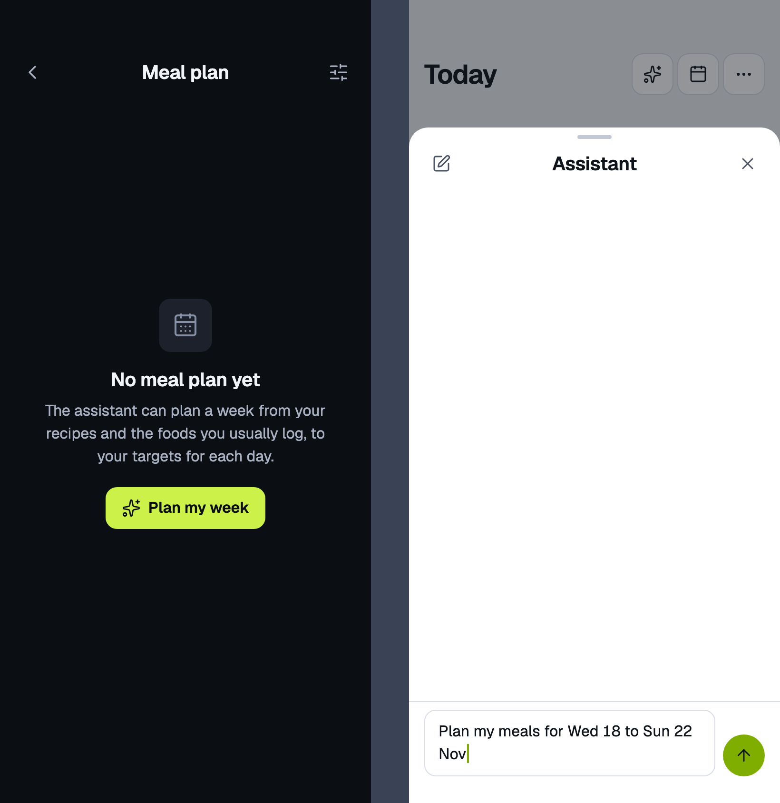

Dark: the Plan screen with no plan. Light: after "Plan my week", the assistant sheet over the Diary with the words in the composer.

- `EmptyState`: "No meal plan yet", "The assistant can plan a week from your recipes and the foods you usually log, to your targets for each day.", and the primary button "Plan my week" with the sparkles icon.
- The board's today is Wednesday 18, so the button opens the assistant with "Plan my meals for Wed 18 to Sun 22 Nov" in the composer and does not send. Pressed midweek, a plan runs from today to the coming Sunday (Decisions). On a Monday it is the whole week. The words come from the new range helper below, not `describeWeekRange`, which takes a Monday. The person can edit or send it, so a turn is spent only when they choose (ruling 3, plans share the daily turns).
- The settings button stays in the header, so the repeat limit can be chosen before a first plan.
- Kit: `EmptyState`, `SheetHeader`, `AssistantSheet` reuse. The prefilled composer is an extension of the sheet's open call (a draft text), as "Regenerate day" also needs.

### plan · settings

[plan-settings.html](plan-settings.html)

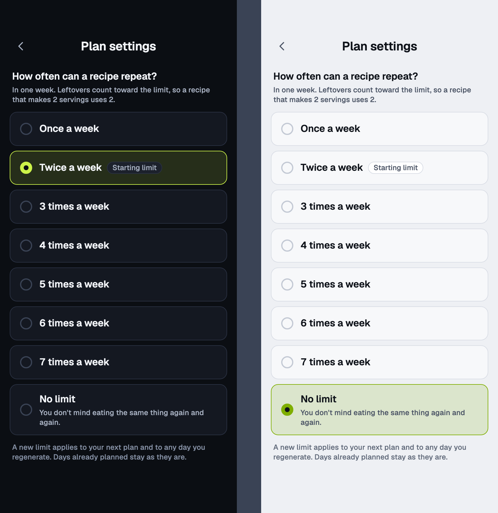

Dark: nothing chosen yet, so the starting limit of 2 is selected and marked "Starting limit". Light: "No limit" chosen.

- The question is "How often can a recipe repeat?", with the hint "In one week. Leftovers count toward the limit, so a recipe that makes 2 servings uses 2."
- Eight answers as radio option cards: "Once a week", "Twice a week", "3 times a week" to "7 times a week", and "No limit" with the line "You don't mind eating the same thing again and again." (Zee's words, 2026-11-13).
- A choice saves at once to `profiles.meal_plan_repeat_limit` (1 to 7, or 0 for No limit), with the toast "Repeat limit saved". The caption under the list says what it changes: "A new limit applies to your next plan and to any day you regenerate. Days already planned stay as they are." Recommended (Zee away), reversible: changing the limit does not replan the week by itself.
- Reached from the settings button on the Plan screen, and from the "Change" link of `plan · first-plan-variety`.
- Kit: `SheetHeader`, `OptionCard` (radio) and `Badge` reuse. The screen is new (`PlanSettingsScreen`).

### plan · first-plan-variety

[plan-first-plan-variety.html](plan-first-plan-variety.html)

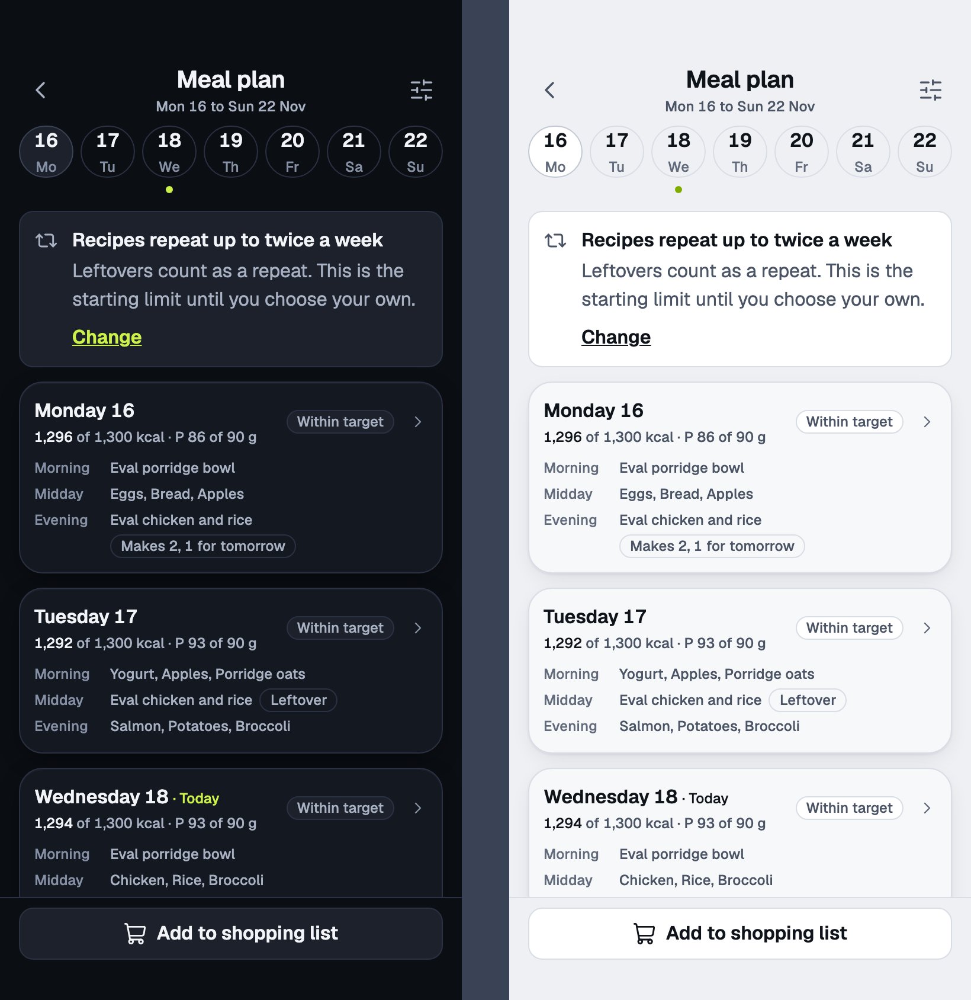

The first plan, while the person has not chosen a limit (the column is null). Both themes.

- A quiet info banner heads the week: "Recipes repeat up to twice a week", then "Leftovers count as a repeat. This is the starting limit until you choose your own.", and the link "Change", which opens `plan · settings`.
- It shows on every plan while the column is null, and goes once the person picks any answer, the starting one included. Recommended (Zee away), reversible: no dismiss button, because the way to make it go is to choose.
- The `plan_created` card carries the same fact as its note (see below).
- Kit: `Banner` info variant reuse, with the `Repeat2` icon the kit already has.

### plan · shopping-added

[plan-shopping-added.html](plan-shopping-added.html)

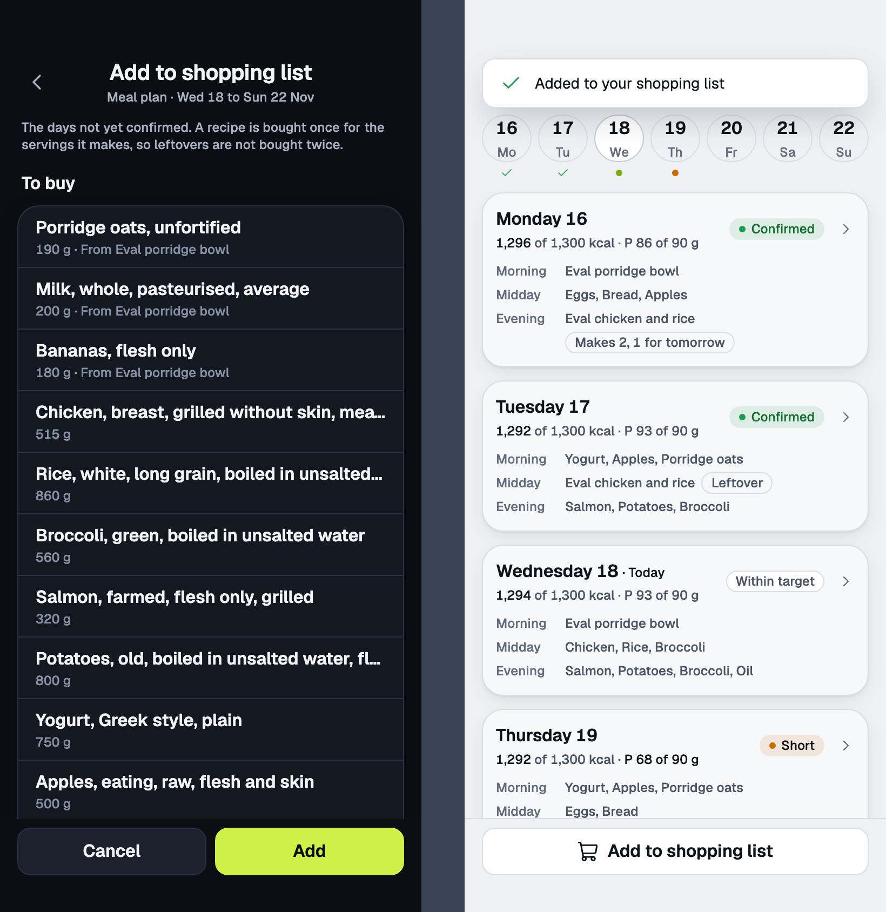

Dark: the add screen for the plan, scrolled to its end so the store cupboard group shows. Light: back on the Plan screen with the shopping list's own toast.

- The screen is the existing `AddToListScreen` layout for a plan instead of a recipe: the title "Add to shopping list", the subtitle "Meal plan · Wed 18 to Sun 22 Nov" (the days not yet confirmed, or the one day when opened from `plan · day`), no servings stepper, the "To buy" group, the "Store cupboard items left out" group with "Add anyway", and Cancel and Add.
- A line at the top says what is counted: "The days not yet confirmed. A recipe is bought once for the servings it makes, so leftovers are not bought twice." (M9 plan, `shoppingDraftsOfPlan`).
- Amounts are core's sums: for Wed 18 to Sun 22 with the replanned Thursday, chicken breast 515 g, boiled rice 860 g, broccoli 560 g, salmon 320 g, potatoes 800 g, "Yogurt, Greek style, plain" 750 g, apples 500 g, eggs 300 g, brown bread 200 g, oats 190 g, milk 200 g, bananas 180 g, and olive oil 39 g left out as a staple. Items from a recipe say "From Eval porridge bowl" as the list does today. A food planned on its own has no source line, because the list's sources are recipes.
- The dark frame draws the top of the screen: the header, the line about unconfirmed days, "To buy", and the first three items with their "From Eval porridge bowl" source lines. The store cupboard group (olive oil) is further down the same scroll.
- The one-day subtitle, opened from `plan · day`, is "Meal plan · Wed 18 Nov" (`describeShortDate`). The range subtitle cannot use `describeWeekRange`, which takes a Monday and always spans seven days. It needs a new helper, `describeDateRange(start, end)`, in `packages/core/src/copy/bodyMap.ts` beside `describeWeekRange`: "Wed 18 to Sun 22 Nov", the month named once when both ends share it and on both ends when they do not ("Fri 27 Nov to Sun 6 Dec"), and the short date alone when start and end are the same day. The empty state's prefill uses it too.

The totals by day in grams, to check the sums. The porridge bowl is cooked once, on Wednesday, for 1 serving.

| Food | Wed 18 | Thu 19 (replanned) | Fri 20 | Sat 21 | Sun 22 | Total |
| --- | --- | --- | --- | --- | --- | --- |
| Porridge oats, unfortified | 50 (porridge) | 30 | 30 | 30 | 50 | 190 |
| Milk, whole, pasteurised, average | 200 (porridge) | | | | | 200 |
| Bananas, flesh only | 90 (porridge) | | | 90 | | 180 |
| Chicken, breast, grilled without skin, meat only | 130 | | 130 | 125 | 130 | 515 |
| Rice, white, long grain, boiled in unsalted water | 180 | | 180 | 250 | 250 | 860 |
| Broccoli, green, boiled in unsalted water | 160 | 160 | 160 | | 80 | 560 |
| Salmon, farmed, flesh only, grilled | 100 | | 100 | 120 | | 320 |
| Potatoes, old, boiled in unsalted water, flesh only | 200 | 200 | 200 | 200 | | 800 |
| Yogurt, Greek style, plain | | 300 | 150 | 150 | 150 | 750 |
| Apples, eating, raw, flesh and skin | | 100 | 100 | 100 | 200 | 500 |
| Eggs, chicken, whole, boiled | | 200 | | | 100 | 300 |
| Bread, brown, average | | 120 | | | 80 | 200 |
| Oil, olive (left out) | 5 | | 10 | 12 | 12 | 39 |
- Add writes through `planListMerge` as today, shows the existing toast "Added to your shopping list" and goes back.
- Kit: `AddToListScreen` body extended (a plan source and no stepper), `GroupedList`, `Checkbox`, `Button`, `Toast` reuse.

### assistant-card · plan-created

[assistant-card-plan-created.html](assistant-card-plan-created.html)

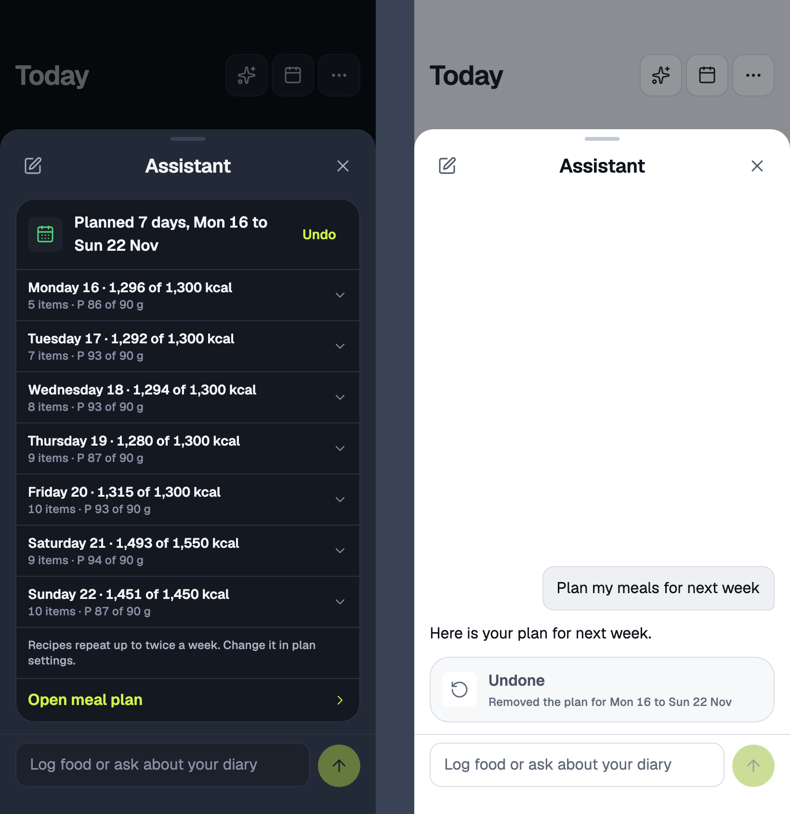

Dark: the card as it arrives, the thread scrolled so the whole card shows. Light: the same turn after Undo.

- `AssistantActionCard` as built: the calendar icon tile, the title "Planned 7 days, Mon 16 to Sun 22 Nov" and Undo. The seven days are the card's day rows (the `RoutineDayRow` the routine card uses), each "Monday 16 · 1,296 of 1,300 kcal" over "5 items · P 86 of 90 g", closed on arrival, opening to the items as "Eval porridge bowl" over "Morning 07:30 · 1 serving · 340 g".
- While the starting limit applies, the note says "Recipes repeat up to twice a week. Change it in plan settings." When a day is short, the note says so first: "Thu 19 Nov is 22 g short on protein."
- The link is "Open meal plan", to the Plan screen on that week.
- Undo archives the plan (`archived_at`). After it the card reads "Undone" with "Removed the plan for Mon 16 to Sun 22 Nov", muted, with the rotate icon, as `assistant-card · undone` draws it. Once any day is confirmed, Undo reads "Can't undo".
- Kit: `AssistantActionCard`, `RoutineDayRow`, `AssistantLinkRow` reuse. New card kind `plan_created` in `assistantCardSchema` (M9 plan section 6), from the tool ticket KEY-1031 (`plan_meals`), shipped through `eas update` before the tool that emits it.

### assistant-card · plan-day-replanned

[assistant-card-plan-day-replanned.html](assistant-card-plan-day-replanned.html)

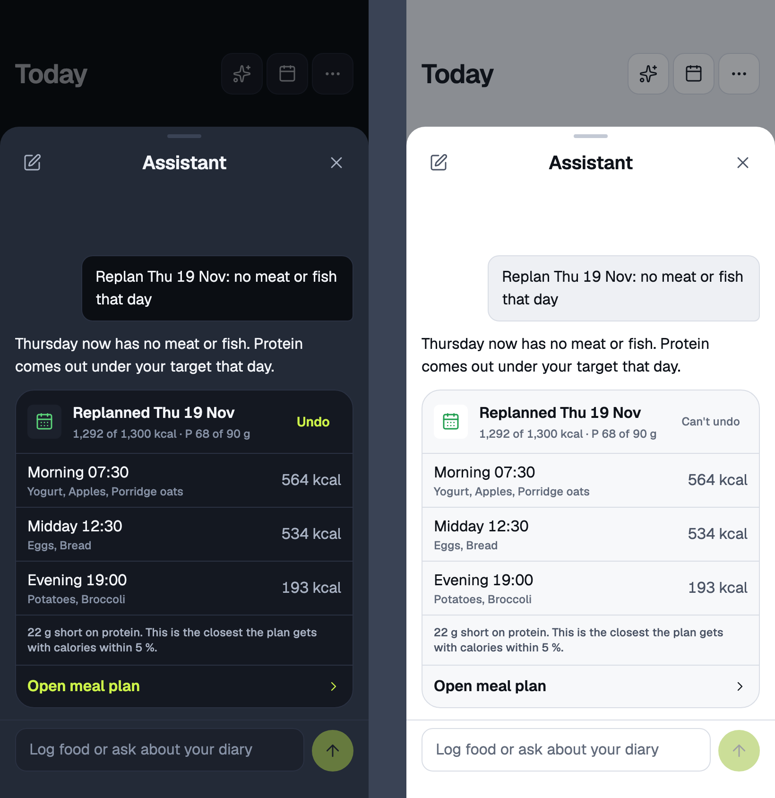

Dark: the card as it arrives, with Undo. Light: the same card after the day was confirmed, so Undo reads "Can't undo".

- The person's words come from "Regenerate day": "Replan Thu 19 Nov: no meat or fish that day". The reply is prompt-shaped and not app copy.
- The card: "Replanned Thu 19 Nov", then "1,292 of 1,300 kcal · P 68 of 90 g". One row per band, "Morning 07:30" over "Yogurt, Apples, Porridge oats" with "564 kcal". The note is the honest miss: "22 g short on protein. This is the closest the plan gets with calories within 5 %." A day within tolerance has no note.
- Undo restores the day's previous items. It reads "Can't undo" once the day changed since or was confirmed.
- Kit: `AssistantActionCard` and `AssistantLinkRow` reuse. New card kind `plan_day_replanned`, from the tool ticket KEY-1033 (`replan_day`).

## New strings

All British English, for a new `packages/core/src/copy/mealPlan.ts` unless noted. Existing strings used as they are: `SHOPPING_LIST.addToList`, `.added`, `.toBuy`, `.leftOut`, `.addAnyway`, `.cancel`, `.addItem` ("Add"), `describeLeftOutCount`, `describeShoppingSources`, `describeWeekRange`, `describeShortDate`, `describeDateInWords`, `describeRecipeServings`, `EMPTY_DAY`, `DIARY_ACTIONS.copyYesterday`, `ASSISTANT_SHEET.composerPlaceholder`, `ASSISTANT_CARD_WORDS.undoLabel`, `.cannotUndoLabel`, `.undoneTitle`, `FOOD_FORM.back`.

| Where | String |
| --- | --- |
| Diary More sheet item | "Meal plan" |
| Its caption | "Plan your week from your recipes and foods" |
| Diary plan row title | "Planned for today", or "Planned for Thu 19 Nov" on another day |
| Diary plan row caption | "3 meals · 1,294 kcal · P 93 g · not confirmed" |
| Plan screen title | "Meal plan" |
| Settings button name | "Plan settings" |
| Band names | "Morning", "Midday", "Evening" |
| Day figures | "1,296 of 1,300 kcal · P 86 of 90 g" |
| Status badges | "Confirmed", "Within target", "Short" |
| Today marker | "Today" (exists as `DAY_STEPPER.today`) |
| Item badges | "Leftover", "Makes 2, 1 for tomorrow" |
| Day subtitle | "Meal plan · Mon 16 to Sun 22 Nov" |
| Totals card titles | "Planned", "Logged from the plan" |
| Tolerance line | "Within 5 % of 1,300 kcal and 5 g of 90 g protein." |
| Confirm caption | "Confirm day adds these 8 items to your diary at their times." |
| Buttons | "Confirm day", "Regenerate day" |
| Regenerate prefill | "Replan Wed 18 Nov: " (the day's short date and a colon) |
| Confirmed banner | "Confirmed", "5 entries are in your diary. Change them there.", link "Open in diary" |
| Confirmed footer | "Confirmed days stay as they are. Edit the entries in your diary." |
| Tick name | "In your diary" |
| Short banner title | "22 g short on protein", "180 kcal under", "120 kcal over", joined with "and" |
| Short banner body | "The closest the plan gets is 68 g of 90 g, with calories within 5 %. Confirm it as it is, or regenerate the day with other words." |
| Empty state | "No meal plan yet", "The assistant can plan a week from your recipes and the foods you usually log, to your targets for each day.", button "Plan my week" |
| Plan prefill | "Plan my meals for Wed 18 to Sun 22 Nov" (built with the new `describeDateRange`) |
| Working line hint for `plan_meals` and `replan_day` | "Plans take longer, up to about 40 seconds." It sits under the working words "Planning your meals" (`plan_meals`) and "Replanning the day" (`replan_day`), the words-table rows of M9 plan section 6. The working-line board itself is lane A's `assistant · working-long`. |
| Settings title | "Plan settings" |
| Question | "How often can a recipe repeat?" |
| Hint | "In one week. Leftovers count toward the limit, so a recipe that makes 2 servings uses 2." |
| Answers | "Once a week", "Twice a week", "3 times a week", "4 times a week", "5 times a week", "6 times a week", "7 times a week", "No limit" |
| No limit line | "You don't mind eating the same thing again and again." |
| Starting badge | "Starting limit" |
| Settings caption | "A new limit applies to your next plan and to any day you regenerate. Days already planned stay as they are." |
| Settings toast | "Repeat limit saved" |
| First plan banner | "Recipes repeat up to twice a week", "Leftovers count as a repeat. This is the starting limit until you choose your own.", link "Change" |
| Add screen subtitle | "Meal plan · Wed 18 to Sun 22 Nov" |
| Add screen line | "The days not yet confirmed. A recipe is bought once for the servings it makes, so leftovers are not bought twice." |
| Card titles (`assistantPlanCards.ts`) | "Planned 7 days, Mon 16 to Sun 22 Nov", "Replanned Thu 19 Nov" |
| Card day row | "Monday 16 · 1,296 of 1,300 kcal" over "5 items · P 86 of 90 g" |
| Card item detail | "Morning 07:30 · 1 serving · 340 g" |
| Card notes | "Recipes repeat up to twice a week. Change it in plan settings.", "Thu 19 Nov is 22 g short on protein.", "22 g short on protein. This is the closest the plan gets with calories within 5 %." |
| Card link | "Open meal plan" |
| Undone line | "Removed the plan for Mon 16 to Sun 22 Nov" |

With another limit the banner and note read "Recipes repeat up to once a week" or "up to 3 times a week" and so on. With "No limit" they are not shown.

## Kit summary

| Piece | Reuse, extend or new |
| --- | --- |
| `DiaryHeader`, `MacroProgressStrip`, `EmptyDayCard`, `SearchLauncher`, `MainTabBar`, `BottomSheet`, `ActionMenu` | reuse (the More sheet gains an item) |
| `WeekStrip` | extend: a short-day warning dot, and future days pressable on the Plan screen |
| `SheetHeader`, `Card`, `GroupedList`, `Badge`, `Button`, `OptionCard`, `EmptyState`, `Toast`, `Checkbox` | reuse |
| `Banner` | reuse info and review, extend with a success look (or use info) |
| `FoodRow` look in a band | reuse |
| `AddToListScreen` | extend: a plan as the source, no servings stepper |
| `AssistantSheet` | extend: open with a draft in the composer |
| `Icon` | new kit icons: `SlidersHorizontal` (the Plan settings button) and `CalendarDays` (the plan row, the More item, the empty state and the plan cards). Neither is in `apps/mobile/components/ui/Icon/icons/` today. Both come from `lucide-react-native`, which the kit already uses, so no native dependency moves. `Repeat2`, `ShoppingCart`, `RotateCcw`, `Sparkles` and `TriangleAlert` already exist |
| `copy/bodyMap.ts` | new helper `describeDateRange(start, end)` |
| `AssistantActionCard`, `RoutineDayRow`, `AssistantLinkRow` | reuse, two new card kinds |
| `PlanTodayRow`, `PlanDayCard`, `PlanScreen`, `PlanDayScreen`, `PlanSettingsScreen` | new |

## Decisions

Each is stated as the boards draw it today. Recommended (Zee away), reversible.

- **Time bands.** Both kitchen lanes use "Morning", "Midday" and "Evening", split at 11:00 and 16:00 (the palate view's bands). A plan item's time defaults to 07:30, 12:30 or 19:00 within its band, the diary fixture's times, and confirming writes the entry at that time. Recommended (Zee away), reversible.
- **When the Diary's plan row shows.** Only on a viewed day that is in a plan and not yet confirmed. Not on a confirmed day, where the entries are already in the log, and not on a day with no plan. Recommended (Zee away), reversible.
- **The repeat limit saves at once.** A tap on an answer writes `profiles.meal_plan_repeat_limit` with the toast "Repeat limit saved". There is no Save button. The limit applies to the next plan and to any day regenerated after it. Days already planned stay as they are. Recommended (Zee away), reversible.
- **Leftovers are on by default.** A recipe that makes more servings than a meal needs places the rest in the same band on the next days, and each leftover counts toward the repeat limit. There is no switch for it in plan settings. Recommended (Zee away), reversible.
- **Undo on the plan card archives the plan.** It sets `archived_at`, the Plan screen goes back to its empty state or the plan this one replaced, and the card reads "Undone". Undo reads "Can't undo" once any day of the plan is confirmed. Recommended (Zee away), reversible.
- **"Plan my week" pressed midweek plans from today to the coming Sunday.** A plan never covers days already past. Recommended (Zee away), reversible.
- **A new plan replaces an overlapping one.** A new plan that overlaps a week with a plan replaces the old plan's unconfirmed days and keeps its confirmed days, which stay in the diary and on the Plan screen. Recommended (Zee away), reversible.
- **A success look for Banner.** The confirmed day uses a new success variant (success-muted fill, success border, success ink title). The info banner with the success icon would do the same job if Zee prefers no new variant. Recommended (Zee away), reversible.
- **Prefills never send.** "Plan my week" and "Regenerate day" open the assistant with the words in the composer and the keyboard up. A turn is spent only when the person presses Send. Recommended (Zee away), reversible.
- **A confirmed day is final on the Plan screen.** No regenerate and no unconfirm. The entries are changed in the Diary. Recommended (Zee away), reversible.
- **A short day can be confirmed as it is.** Recommended (Zee away), reversible.

## What is not settled

- **A day the person logged by hand before confirming.** Confirm writes every planned item, so a food already logged that day would be logged twice. The boards do not draw a check. Recommended (Zee away), reversible: no check in v1, and the Confirm caption says how many items it adds, so the person sees it.
- **Leftovers as a setting.** `meal_plans.rules` has `leftovers`, and `plan_meals` takes it, but the brief did not ask for a switch, so plan settings has the repeat limit only. Leftovers are on by default.
- **Past and archived plans.** The Plan screen shows the current week's plan. Earlier weeks and a list of plans are not drawn.
- **Fixture targets.** The day-of-week figures above wait for M9-08.
