# Kitchen: palate, foods to avoid, recipe suggestion and adjustment (lane A)

Proposal boards for KEY-1021, lane A of the M9 design gate (plan section 7, items 1 to 4). Each board is an `.html` page that opens from `file://` and links `packages/tokens/css/kilo-tokens.css` by relative path, with its `.png` rendered by Playwright at device pixel ratio 2. Every frame is 390 points wide, dark on the left and light on the right. Colours, type, radii and spacing are token references only.

Some frames are taller than a phone so that the whole screen or the whole turn shows on one board. On a phone the screen scrolls, and the assistant thread scrolls under the sheet header as it does today.

## Where the numbers come from

- **Per 100 g values:** the CoFID rows of the local seed, `packages/db/supabase/seeds/10_cofid_subset.sql`, for the eval fixture codes in `tools/assistant-evals/fixtures/diary.ts` (`FIXTURE_FOOD_CODES`). Chicken breast 18-323 (148 kcal, P 32, C 0, F 2.2), white rice 11-862 (131, 2.8, 31.1, 0.4), broccoli 13-503 (28, 3.3, 2.8, 0.5), olive oil 17-038 (899, 0, 0, 99.9), salmon 16-357 (239, 24.6, 0, 15.6), potatoes 13-490 (74, 1.8, 17.5, 0.1), Greek yogurt 12-555 (133, 5.7, 4.8, 10.2), oats 11-788, milk 12-596, banana 14-318.
- **Recipes:** "Eval chicken and rice" (260 g chicken, 360 g rice, 160 g broccoli, 15 g oil, 2 servings) and "Eval porridge bowl" (50 g oats, 200 g milk, 90 g banana, 1 serving) from `fixtureRecipes`.
- **Sums:** each figure is the sum of grams times the per 100 g value, divided by the servings, as `computeRecipe` does, then printed with `formatCalories` and `formatGrams` (whole grams from 10 up, one decimal under 10).
- **Fitted grams:** the drafts and the adjustment were fitted by a stand-in for `fitRecipeToTargets` (each unlocked ingredient between half and double its proposed grams, in 5 g steps, weighted by the tolerance). The real fitter may land on other grams. Whatever it returns, the card prints core's own sums of those grams, so the layout holds.
- **Palate:** counted from `diaryDay()` over the 42 fixture days (day 41 is yesterday), with the three breakfasts, lunches and dinners taken in turn. The avoid list (peanuts, an allergy, and mushrooms and coriander, dislikes) is synthetic, because the fixture user has none.

## The +30 g protein adjustment, worked

Eval chicken and rice per serving before: 1,036 kcal and 98.6 g protein for the recipe, so **518 kcal, P 49 g, C 58 g, F 11 g**. The change is `add 30` to protein (`adjustmentTarget`), so the target is 79.3 g protein, with calories held at 518 kcal within 5 % (492 to 544, ruling 9). The fitted grams are chicken 455 g (from 260), rice 180 g (from 360, its lower bound), oil 10 g (from 15) and broccoli 160 g (unchanged). Per serving after: **522 kcal, P 78 g, C 30 g, F 11 g** (521.95, 77.96, 30.23, 10.76). Protein is 1.3 g under the target and calories 0.8 % over, both inside the tolerance.

## Boards

### kitchen · palate

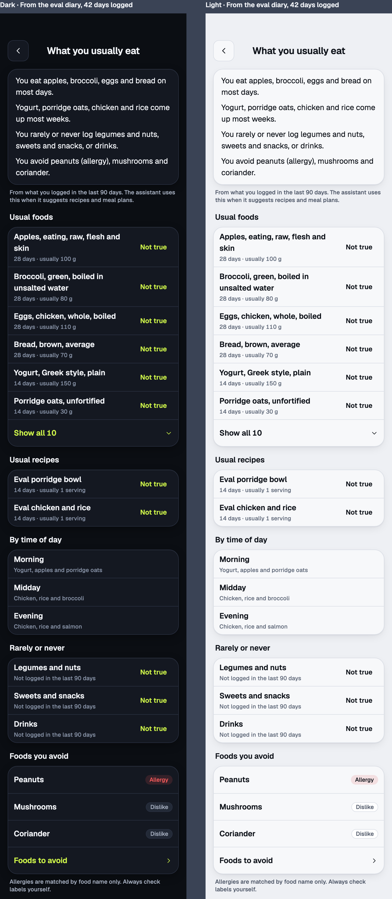 [kitchen-palate.html](kitchen-palate.html)

The palate screen, pushed from More, Settings, Assistant, Your food, What you usually eat. A stack header with Back, then a card of summary lines, a caption, and five groups: Usual foods, Usual recipes, By time of day, Rarely or never, Foods you avoid.

- Usual foods are the fixture foods logged on at least 4 days, ordered by distinct days then the last day logged: apples, broccoli, eggs and bread on 28 days, then yogurt and oats on 14. The typical portion is the median grams (eggs are 120 g at breakfast and 100 g at lunch on 14 days each, so 110 g). Six show, then "Show all 10" opens the rest in place (chicken, rice, salmon, potatoes).
- Usual recipes are the two fixture recipes, 14 days each.
- By time of day is the top three per band by count, ties broken by the last day logged (day 41 had yogurt, apples and oats at breakfast, chicken, rice and broccoli at lunch, and chicken and rice at dinner, so salmon from day 40 is the third evening item).
- Rarely or never are the coarse groups with 0 or 1 logs out of the fixed list: legumes and nuts, sweets and snacks, drinks (milk is only inside the porridge recipe). "Other" is never listed.
- Each usual food, usual recipe and rare group has "Not true".
- Foods you avoid is the same list on every board: peanuts (allergy), mushrooms and coriander (dislikes). It matches the summary line "You avoid peanuts (allergy), mushrooms and coriander.", the Foods to avoid screen and the count of 3 on the Your food row.

### kitchen · palate-empty

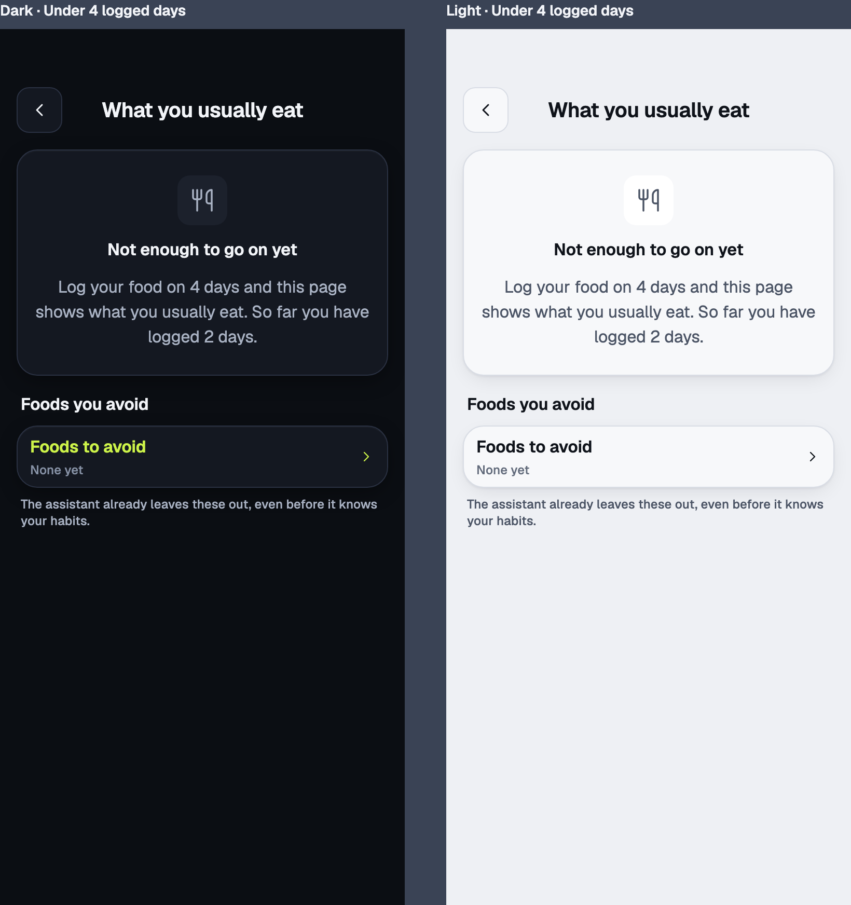 [kitchen-palate-empty.html](kitchen-palate-empty.html)

Fewer than 4 logged days in the window. One empty card says so and counts the days logged, and Foods you avoid stays, because the avoid list works from the first day.

### kitchen · palate-corrected

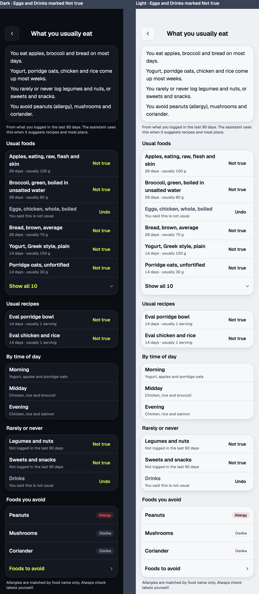 [kitchen-palate-corrected.html](kitchen-palate-corrected.html)

Eggs and Drinks were marked Not true. Each stays in its place, muted, with "You said this is not usual" and Undo. The summary lines are rebuilt without them ("You eat apples, broccoli and bread on most days", "legumes and nuts, or sweets and snacks").

### settings · foods-to-avoid

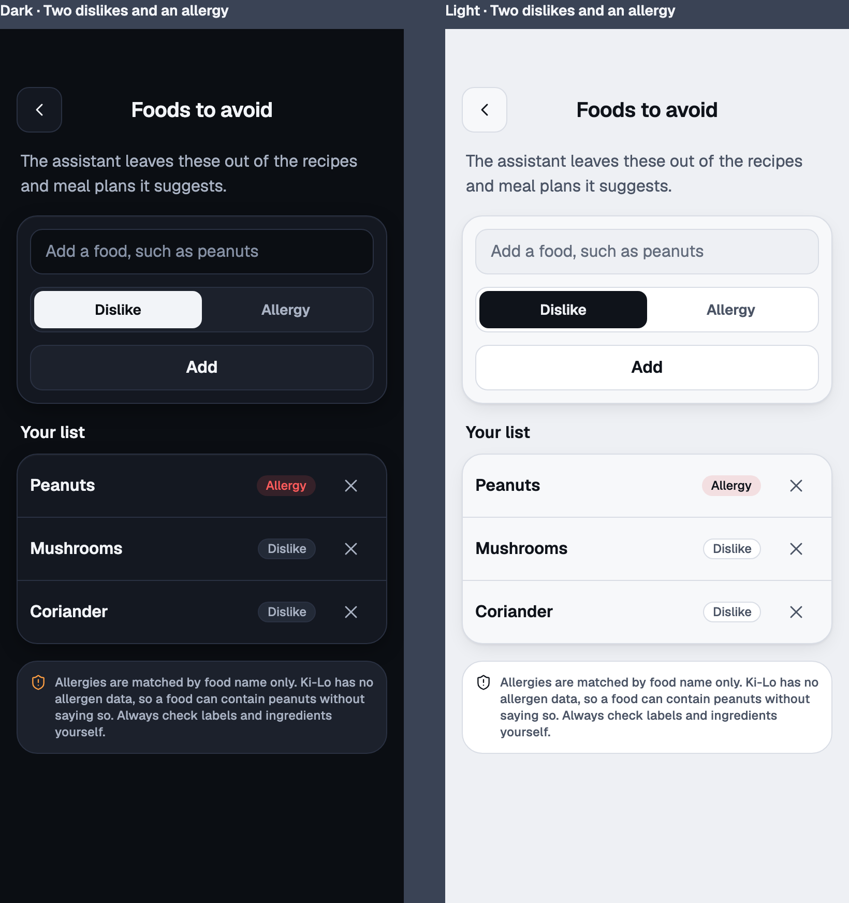 [settings-foods-to-avoid.html](settings-foods-to-avoid.html)

The new Settings section (ruling 2), pushed from Assistant, Your food. A line on what it does, an add card (a field, Dislike or Allergy, Add), the list with each item's kind as a badge and a Remove button, and the allergy disclaimer under it with the shield glyph.

### settings · assistant-your-food

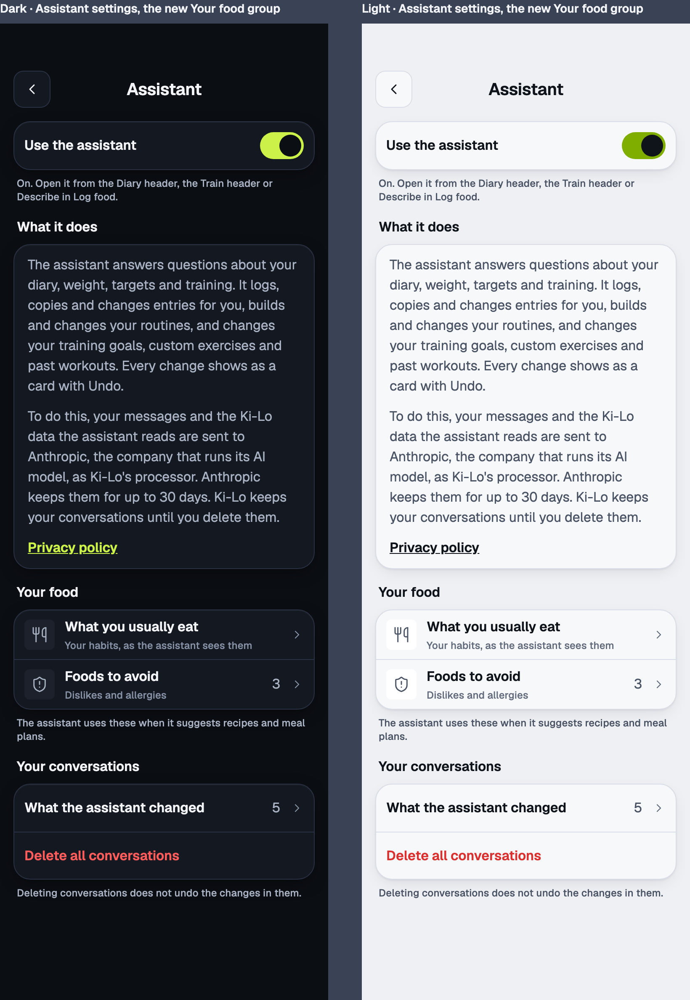 [settings-assistant-your-food.html](settings-assistant-your-food.html)

The entry point. This board is not in the brief's list. It is drawn because the brief puts the entry at "More, Assistant section" and More has no Assistant section today: Assistant is a row of More's Settings group that opens the Assistant settings screen. The screen gains a "Your food" group between "What it does" and "Your conversations", with "What you usually eat" and "Foods to avoid" (its count as the value). Everything else on the screen is the approved `assistant-settings · consent` board, On state.

### assistant-card · recipe-draft

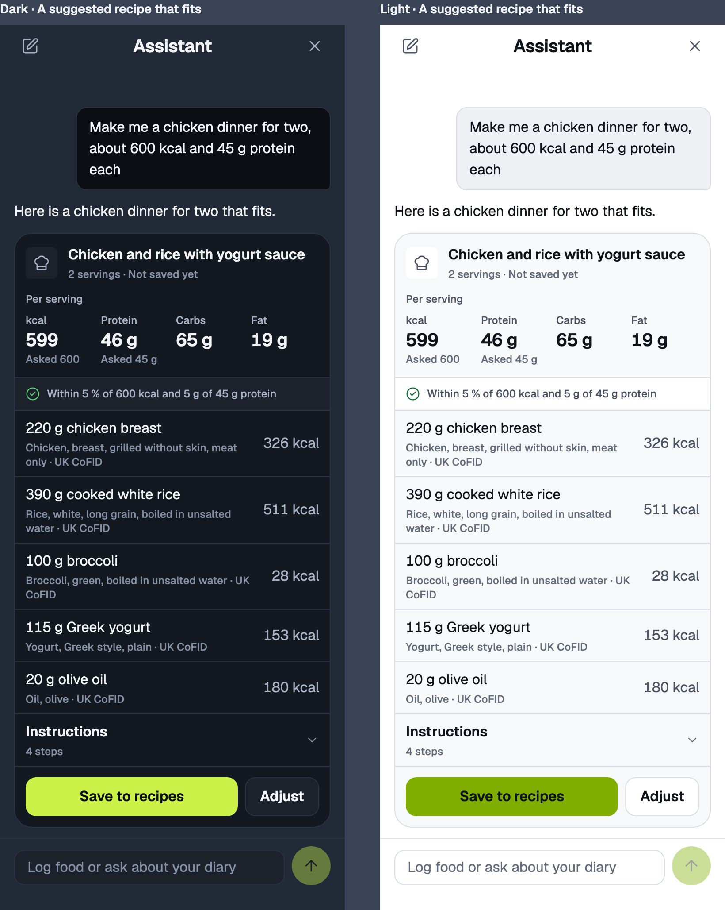 [assistant-card-recipe-draft.html](assistant-card-recipe-draft.html)

A suggested recipe that fits: "Make me a chicken dinner for two, about 600 kcal and 45 g protein each". The card has the ChefHat tile, the name, "2 servings · Not saved yet", a Per serving strip of kcal, protein, carbs and fat with "Asked" under each figure the person named, the fit line, one row per ingredient (the amount and the words of the line, the matched food and its source, the line's kcal for the whole recipe), Instructions closed with its step count, and "Save to recipes" with "Adjust". Per serving 599 kcal, P 46 g, C 65 g, F 19 g from 220 g chicken, 390 g rice, 100 g broccoli, 115 g Greek yogurt and 20 g olive oil.

### assistant-card · recipe-draft-short

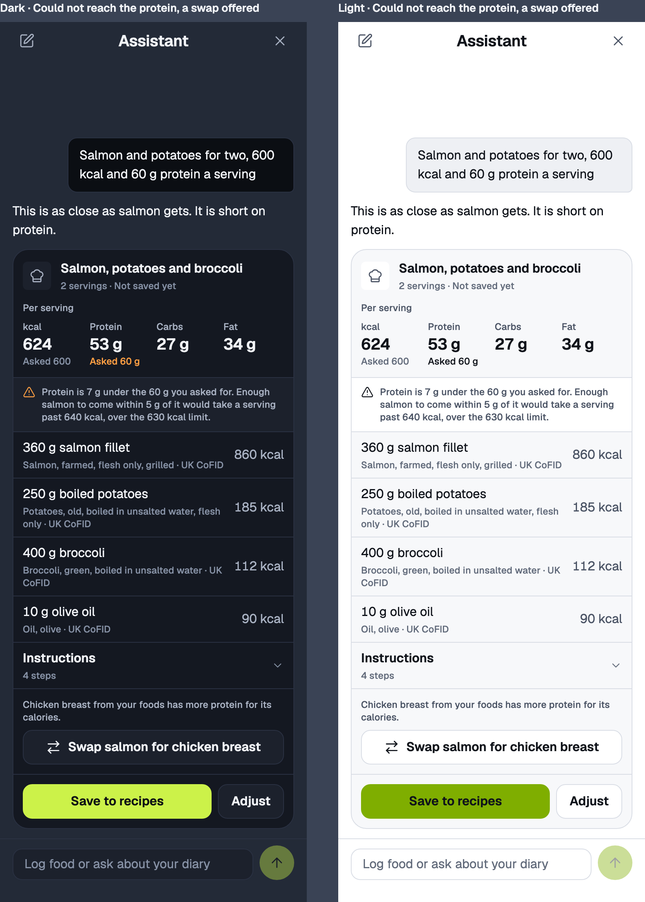 [assistant-card-recipe-draft-short.html](assistant-card-recipe-draft-short.html)

"Salmon and potatoes for two, 600 kcal and 60 g protein a serving." Salmon's fat makes the pair unreachable: the closest fit is 624 kcal (inside 5 %) and 53 g protein, 7 g short. The protein figure's "Asked 60 g" turns to the warning ink, the fit line has the warning glyph and says what fell short and what limited it (`misses[].limitedBy`), and a swap from the person's own foods is offered as a secondary button. Pressing it sends "Swap salmon for chicken breast" as the person's message, so the next turn is an ordinary request.

### assistant-card · recipe-draft-unmatched

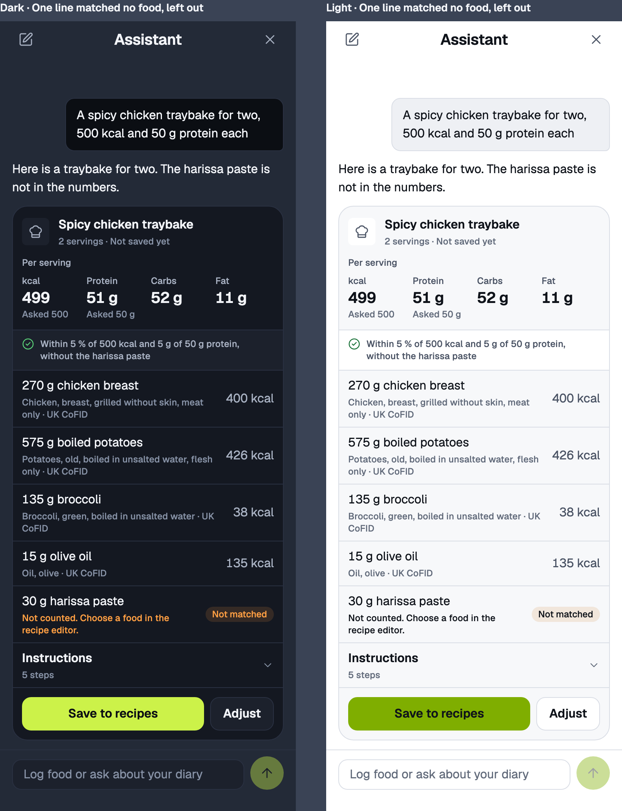 [assistant-card-recipe-draft-unmatched.html](assistant-card-recipe-draft-unmatched.html)

One proposed line, 30 g harissa paste, matched no food. It is shown last, with the "Not matched" badge and the import card's own words "Not counted. Choose a food in the recipe editor.", and the figures and the fit line leave it out ("without the harissa paste"). Per serving 499 kcal, P 51 g, C 52 g, F 11 g.

### assistant-card · recipe-draft-saved

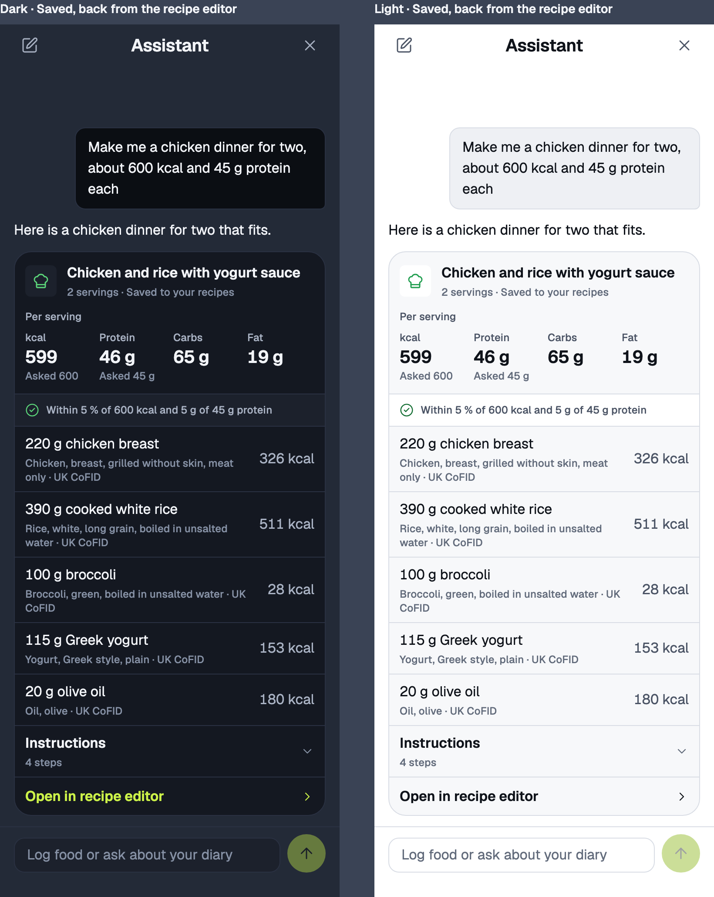 [assistant-card-recipe-draft-saved.html](assistant-card-recipe-draft-saved.html)

The draft card after "Save to recipes", seen on coming back from the recipe editor. The tile turns success green, the sub line says "Saved to your recipes", and the buttons give way to the "Open in recipe editor" link row of `assistant-card · recipe-created`.

### assistant-card · recipe-draft-failed

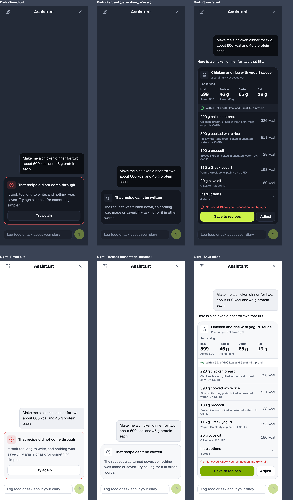 [assistant-card-recipe-draft-failed.html](assistant-card-recipe-draft-failed.html)

Three states, dark on the top row and light under it, drawn like the failed turn of `assistant · unavailable`.

- **Timed out.** The generation passed its 40 s budget. A danger `AssistantNotice` (red border, the CircleAlert tile in the danger tone) with "That recipe did not come through", the body, and Try again.
- **Refused (`generation_refused`).** A neutral `AssistantNotice` with "That recipe can't be written" and no button.
- **Save failed.** "Save to recipes" was pressed and `createRecipe` failed. The draft card stays, and a danger line with the CircleAlert glyph, "Not saved. Check your connection and try again.", sits above the actions. Nothing else on the card changes.

### assistant · working-long

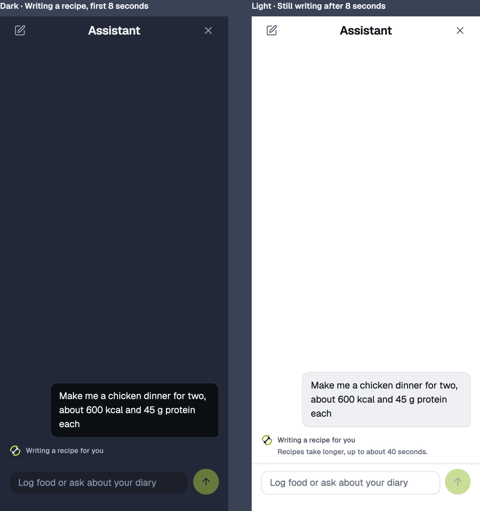 [assistant-working-long.html](assistant-working-long.html)

The `WorkingLine` as `assistant · working` draws it, the animated Ki-Lo logo at 20 points and the step words in the secondary caption, with the generation tools' words. Dark is the first 8 seconds: "Writing a recipe for you". Light is after 8 seconds, when a second caption line in the muted ink appears under the words, indented to the words: "Recipes take longer, up to about 40 seconds." Send stays disabled as it is during any turn.

### assistant-card · recipe-compare

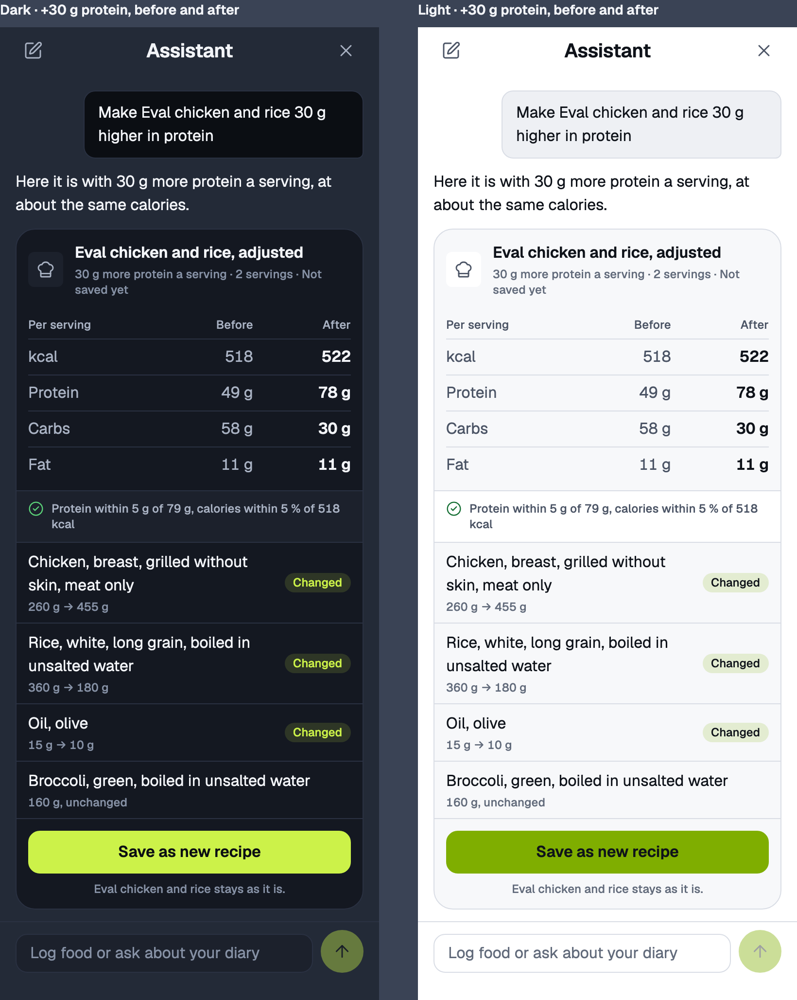 [assistant-card-recipe-compare.html](assistant-card-recipe-compare.html)

"Make Eval chicken and rice 30 g higher in protein", with the real numbers above. A Before and After table per serving (After in the strong weight), the fit line, every ingredient with its grams as "260 g → 455 g" and a "Changed" badge, or "160 g, unchanged", then one action, "Save as new recipe", with the line "Eval chicken and rice stays as it is." under it (ruling 9 and Zee 2026-11-13: never overwrite).

### assistant-card · recipe-compare, refused

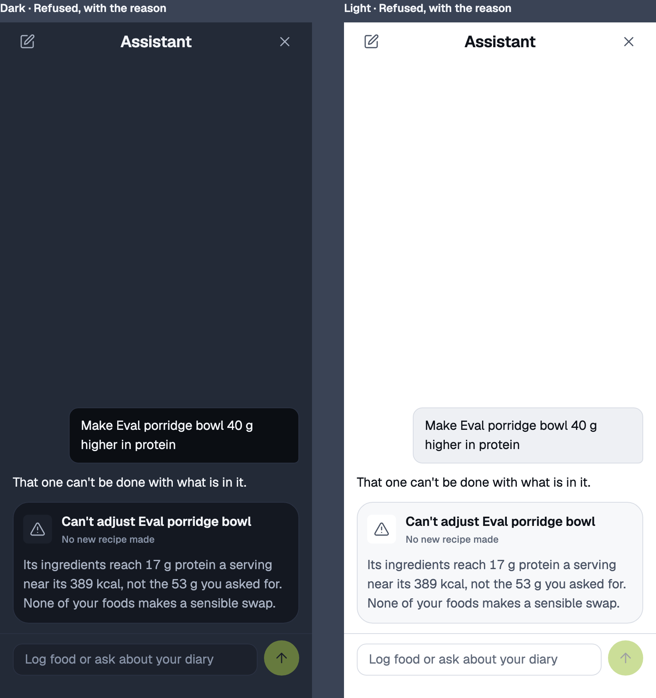 [assistant-card-recipe-compare-refused.html](assistant-card-recipe-compare-refused.html)

"Make Eval porridge bowl 40 g higher in protein." The bowl is 389 kcal and 13 g protein, so the target is 53 g. Within half to double of each ingredient, the best fit near 389 kcal reaches 17 g (30 g oats, 400 g milk, 45 g banana: 403 kcal, P 17 g). The card says it can't, why, with the figures, and that no swap from the person's foods makes sense. No action.

### kitchen · compare (not drawn)

The compare card holds a recipe of up to 12 ingredients at about 64 points a row inside the scrolling thread, and the table is four rows. A full screen adds a route and a back step for no extra information, so it is not drawn. See decisions.

## Kit: reuse, extend, new

| Piece                                                                                                                                                                                                                                                                                   | Status                                                                                                                                                                                | Where                                 |
| --------------------------------------------------------------------------------------------------------------------------------------------------------------------------------------------------------------------------------------------------------------------------------------- | ------------------------------------------------------------------------------------------------------------------------------------------------------------------------------------- | ------------------------------------- |
| Stack header with Back, `GroupedList`, `ListRow`, `Card`, `Badge` (danger, neutral, warning, accent), `IconButton`, `Button` (primary, secondary, md), `SegmentedControl`, `Input`, `Icon` (ChefHat, Utensils, ShieldAlert, TriangleAlert, CircleCheck, ArrowRightLeft, ChevronDown, X) | Reuse                                                                                                                                                                                 | palate, foods to avoid, entry, cards  |
| `EmptyState` look (tile, title, body) inside a card                                                                                                                                                                                                                                     | Reuse                                                                                                                                                                                 | palate-empty                          |
| `AssistantSheet` chrome, `ChatMessage` bubbles, composer                                                                                                                                                                                                                                | Reuse                                                                                                                                                                                 | every assistant board                 |
| `WorkingLine` with `LoadingMark` at 20                                                                                                                                                                                                                                                  | Extend: an optional second line, `hint`, shown after 8 seconds for the three generation tools                                                                                         | working-long                          |
| `AssistantActionCard` header (tile, title, sub line) and its `Row` (name, detail, value, `match: "unresolved"` with the warning badge)                                                                                                                                                  | Extend: the draft and compare cards reuse the header and the row as they are, with the tile tone `secondary` before saving and `success` after                                        | draft cards                           |
| `AssistantLinkRow`                                                                                                                                                                                                                                                                      | Reuse                                                                                                                                                                                 | draft-saved                           |
| `AssistantNotice` (danger with one secondary button, and neutral)                                                                                                                                                                                                                       | Reuse                                                                                                                                                                                 | recipe-draft-failed                   |
| Save error line on the draft card                                                                                                                                                                                                                                                       | New: the CircleAlert glyph at 16 and a caption in the danger tone, above the actions                                                                                                  | recipe-draft-failed                   |
| `RoutineDayRow` (a row that opens in place)                                                                                                                                                                                                                                             | Reuse its open and closed behaviour for Instructions, which opens to the numbered steps                                                                                               | draft cards                           |
| `AssistantRecipeDraftCard`                                                                                                                                                                                                                                                              | New: header, `TargetFigures` strip, fit line, ingredient rows, Instructions, actions or link                                                                                          | recipe-draft, short, unmatched, saved |
| `TargetFigures`                                                                                                                                                                                                                                                                         | New: four columns of caption, numeral small and an "Asked" caption, the last in the warning ink on a miss                                                                             | draft cards                           |
| Fit line                                                                                                                                                                                                                                                                                | New: the raised strip of the card's total line with a 16 point glyph, success or warning                                                                                              | draft and compare cards               |
| `AssistantRecipeCompareCard`                                                                                                                                                                                                                                                            | New: header, a three column table in the `ReplyTable` type ramp, the fit line, ingredient rows with a "Changed" accent badge, one primary action and its caption, or the refused body | recipe-compare                        |
| `PalateScreen`, `FoodsToAvoidScreen`                                                                                                                                                                                                                                                    | New screens built from the kit above                                                                                                                                                  | palate, foods-to-avoid                |
| "Not true" and "Undo" text buttons                                                                                                                                                                                                                                                      | Reuse the card Undo's look: label small in the accent ink, 36 points high                                                                                                             | palate                                |

## Strings

Existing strings used as they are:

- `ASSISTANT_SHEET.composerPlaceholder` "Log food or ask about your diary".
- `assistantRecipeCards.ts`: `OPEN_IN_RECIPE_EDITOR` "Open in recipe editor", `IMPORT_LINE_NOT_COUNTED` "Not counted. Choose a food in the recipe editor.", `describeRecipeServings` ("2 servings").
- `assistantNotices.ts`: "Not matched" (the import card's `notMatchedLabel`), `ASSISTANT_CONSENT_CARD` paragraphs and "Privacy policy".
- `assistantSettings.ts`: `ASSISTANT_SETTINGS` ("Assistant", "Back to More", "Use the assistant", "What it does", "Your conversations", "What the assistant changed", "Delete all conversations", the delete caption), `describeAssistantConsentCaption(true)`.
- `recipeEditor.ts`: "Instructions".
- `foodSources.ts`: "UK CoFID".

New strings (British English, for `packages/core/src/copy/palate.ts`, `foodsToAvoid.ts` and `assistantRecipeCards.ts`, and the tool words table in `assistantNotices.ts`):

| Where                    | Exact wording                                                                                                                                                                                                                                                                                                                                                         |
| ------------------------ | --------------------------------------------------------------------------------------------------------------------------------------------------------------------------------------------------------------------------------------------------------------------------------------------------------------------------------------------------------------------- |
| Assistant settings group | "Your food"                                                                                                                                                                                                                                                                                                                                                           |
| Row and palate title     | "What you usually eat", sub line "Your habits, as the assistant sees them"                                                                                                                                                                                                                                                                                            |
| Row and screen title     | "Foods to avoid", sub line "Dislikes and allergies", value the count                                                                                                                                                                                                                                                                                                  |
| Group caption            | "The assistant uses these when it suggests recipes and meal plans."                                                                                                                                                                                                                                                                                                   |
| Palate back              | "Back to Assistant"                                                                                                                                                                                                                                                                                                                                                   |
| Palate caption           | "From what you logged in the last 90 days. The assistant uses this when it suggests recipes and meal plans."                                                                                                                                                                                                                                                          |
| Palate group titles      | "Usual foods", "Usual recipes", "By time of day", "Rarely or never", "Foods you avoid"                                                                                                                                                                                                                                                                                |
| Palate row detail        | "{n} days · usually {grams} g", or "usually {n} serving(s)" for a recipe                                                                                                                                                                                                                                                                                              |
| Show more                | "Show all {n}"                                                                                                                                                                                                                                                                                                                                                        |
| Bands                    | "Morning" (before 11:00), "Midday" (11:00 to 15:59), "Evening" (16:00 and later), in the person's own time zone, the same three words as lane B. The detail is up to three names joined as a list: "Yogurt, apples and porridge oats"                                                                                                                                 |
| Rare detail              | "Not logged in the last 90 days", or "Logged once in the last 90 days"                                                                                                                                                                                                                                                                                                |
| Correction               | button "Not true" (accessible name "Not true: {item}"), detail "You said this is not usual", button "Undo"                                                                                                                                                                                                                                                            |
| Kind badges              | "Allergy", "Dislike"                                                                                                                                                                                                                                                                                                                                                  |
| Summary lines            | "You eat {up to 4 names} on most days." "{Up to 4 names} come up most weeks." "You rarely or never log {groups}." "You avoid {names}." with "(allergy)" after each allergy                                                                                                                                                                                            |
| Palate empty             | title "Not enough to go on yet", body "Log your food on 4 days and this page shows what you usually eat. So far you have logged {n} day(s)."                                                                                                                                                                                                                          |
| Empty avoid row          | detail "None yet", caption "The assistant already leaves these out, even before it knows your habits."                                                                                                                                                                                                                                                                |
| Palate avoid caption     | "Allergies are matched by food name only. Always check labels yourself."                                                                                                                                                                                                                                                                                              |
| Foods to avoid intro     | "The assistant leaves these out of the recipes and meal plans it suggests."                                                                                                                                                                                                                                                                                           |
| Add field                | placeholder "Add a food, such as peanuts", kind control "Dislike" and "Allergy", button "Add"                                                                                                                                                                                                                                                                         |
| Your list                | group title "Your list", remove button accessible name "Remove {food}"                                                                                                                                                                                                                                                                                                |
| Disclaimer               | "Allergies are matched by food name only. Ki-Lo has no allergen data, so a food can contain peanuts without saying so. Always check labels and ingredients yourself."                                                                                                                                                                                                 |
| Draft sub line           | "{servings} · Not saved yet", and "{servings} · Saved to your recipes"                                                                                                                                                                                                                                                                                                |
| Figures                  | "Per serving", captions "kcal", "Protein", "Carbs", "Fat", target "Asked {value}"                                                                                                                                                                                                                                                                                     |
| Fit line, within         | "Within 5 % of {kcal} kcal and 5 g of {protein} g protein", with ", without the {line}" when a line is not counted, and the carbs or fat clause only when named                                                                                                                                                                                                       |
| Fit line, short          | "{Nutrient} is {gap} under the {target} you asked for. Enough {limiting food} to come within {tolerance} of it would take a serving past {kcal} kcal, over the {limit} kcal limit." The limit is the asked kcal plus 5 % (630 for 600), and {kcal} is core's figure at the first grams that reach the tolerance. "Over" and "under" swap for a nutrient that is over. |
| Swap offer               | "{Food} from your foods has more {nutrient} for its calories." and the button "Swap {a} for {b}"                                                                                                                                                                                                                                                                      |
| Steps row                | "{n} steps"                                                                                                                                                                                                                                                                                                                                                           |
| Draft actions            | "Save to recipes", "Adjust"                                                                                                                                                                                                                                                                                                                                           |
| Adjust prefill           | "Change this recipe: " (with the trailing space), put in the composer and focused when Adjust is pressed                                                                                                                                                                                                                                                              |
| Compare title            | "{recipe}, adjusted", sub line "{change} · {servings} · Not saved yet", for example "30 g more protein a serving"                                                                                                                                                                                                                                                     |
| Compare table            | "Per serving", "Before", "After"                                                                                                                                                                                                                                                                                                                                      |
| Compare fit line         | "Protein within 5 g of {target} g, calories within 5 % of {kcal} kcal"                                                                                                                                                                                                                                                                                                |
| Ingredient change        | "{before} g → {after} g", "{grams} g, unchanged", badge "Changed"                                                                                                                                                                                                                                                                                                     |
| Compare action           | "Save as new recipe", caption "{recipe} stays as it is."                                                                                                                                                                                                                                                                                                              |
| Refused                  | title "Can't adjust {recipe}", sub line "No new recipe made", body "Its ingredients reach {best} g {nutrient} a serving near its {kcal} kcal, not the {target} g you asked for. None of your foods makes a sensible swap."                                                                                                                                            |
| Tool words               | `get_palate_profile` "Reading what you usually eat", `suggest_recipe` "Writing a recipe for you", `adjust_recipe` "Adjusting the recipe" (plan section 6 drafts, unchanged)                                                                                                                                                                                           |
| Long hint                | "Recipes take longer, up to about 40 seconds." For `suggest_recipe` and `adjust_recipe` only. Plans have their own string in lane B.                                                                                                                                                                                                                                  |
| Generation timed out     | notice title "That recipe did not come through", body "It took too long to write, and nothing was saved. Try again, or ask for something simpler.", button "Try again" (existing, the `turn_failed` button and `RETRY_LABEL`)                                                                                                                                         |
| Generation refused       | notice title "That recipe can't be written", body "The request was turned down, so nothing was made or saved. Try asking for it in other words." No button                                                                                                                                                                                                            |
| Save failed              | "Not saved. Check your connection and try again." (the pattern of `DELETE_FAILED_BANNER`)                                                                                                                                                                                                                                                                             |

The model's replies in the thread ("Here is a chicken dinner for two that fits.") are shaped by the prompt, not app copy, and never say "I".

## Decisions

- Recommended (Zee away), reversible: the entry is a "Your food" group on the Assistant settings screen, holding both "What you usually eat" and "Foods to avoid". More has no Assistant section, and putting both here keeps them beside the switch and the consent words. A More row of its own is the alternative.
- Recommended (Zee away), reversible: "Foods to avoid" is a screen of its own under Assistant settings, which is how "a new Settings section" is read. The palate screen links to it.
- Recommended (Zee away), reversible: fats and oils are left out of Usual foods, By time of day and the summary lines. Olive oil is on 28 of the fixture's 42 days and would otherwise top the evening band. It still counts for Rarely or never.
- Recommended (Zee away), reversible: Usual is split into foods and recipes on screen. With oils left out the fixture fills the cap of 12 exactly (10 foods and 2 recipes). Engineers should cap foods and recipes separately (12 and 6) so a recipe is never pushed off by foods.
- Recommended (Zee away), reversible: the summary lines take a short name, the food name up to its first comma, lower case ("Eggs, chicken, whole, boiled" reads "eggs"). "Most days" means on at least half of the logged days, "most weeks" means in at least 3 of the last 4 weeks. Each line names at most 4 items, and a line with no items is left out.
- Recommended (Zee away), reversible: a corrected item stays where it was, muted, with Undo, for as long as the correction exists. There is no separate corrections list.
- Recommended (Zee away), reversible: By time of day has no "Not true" of its own. `not_usual` has no band, so a correction there would also remove the food from Usual, which would surprise. Correcting the food in Usual removes it from the bands too.
- Recommended (Zee away), reversible: "Not true" on a rare group stores `not_usual` with the group name as the label. The group stays in its place in Rarely or never, muted, with "You said this is not usual" and Undo, as Drinks does on `kitchen · palate-corrected`, and the summary line leaves it out.
- Recommended (Zee away), reversible: foods to avoid have no "Not true" on the palate screen, because they are what the person said. They are changed in Foods to avoid.
- Recommended (Zee away), reversible: on Foods to avoid the kind is chosen when adding. To change it the person removes and adds again (the table has no update). A row press opening a menu with "Mark as allergy" is the alternative.
- Recommended (Zee away), reversible: allergies are badged in the danger tone and dislikes in neutral.
- Recommended (Zee away), reversible: a draft line shows the words of the line with the amount ("220 g chicken breast") and the matched food with its source under it, like the import card, so the person sees what was matched.
- Recommended (Zee away), reversible: a line's kcal is for the whole recipe, the per serving figures sit in the strip.
- Recommended (Zee away), reversible: Instructions are closed on arrival and open in place.
- Recommended (Zee away), reversible: "Adjust" puts "Change this recipe: " in the composer and focuses it. The model then calls `suggest_recipe` again for a draft or `adjust_recipe` for a saved recipe (`adjust_recipe` needs a `recipe_id`, which a draft does not have).
- Recommended (Zee away), reversible: an unmatched line is kept on save as an unresolved ingredient, as the import keeps one, so the borrowed "Choose a food in the recipe editor" stays true.
- Recommended (Zee away), reversible: the saved card shows the link and no Adjust. Adjusting the saved recipe is a typed request.
- Recommended (orchestrator, Zee away), reversible: the long hint appears after 8 seconds, for `suggest_recipe` and `adjust_recipe` only. Plans get their own string in lane B. Under 8 seconds the line is exactly `assistant · working`.
- Recommended (orchestrator, Zee away), reversible: the time bands are "Morning", "Midday" and "Evening", split at 11:00 and 16:00 in the person's own time zone, the same words in both lanes.
- Recommended (Zee away), reversible: a generation that times out is a danger `AssistantNotice` with Try again, in the style of the failed turn. Try again sends the same message, which is safe because nothing was written. A `generation_refused` is a neutral notice with no button, because the same words would be refused again.
- Recommended (Zee away), reversible: a failed save keeps the draft card as it was, with a danger line above the actions and "Save to recipes" still there to press again.
- Recommended (Zee away), reversible: the compare card has a single action, "Save as new recipe", and no "Adjust". Its caption says the original stays.
- Recommended (Zee away), reversible: `kitchen · compare` is not drawn, because the card fits a 12 ingredient recipe in the scrolling thread.
- Recommended (Zee away), reversible: the refusal is a card, with no action, so the reason stays in the conversation like any other result.

## Not settled

- The swap offer on a short draft is not in `suggest_recipe`'s contract. Plan section 6 gives substitutions to `adjust_recipe` only. Either `suggest_recipe` also returns up to 3 substitutions chosen from the person's foods, or the short draft drops the offer and keeps the fit line alone.
- Allergies are special category data and the palate goes to Anthropic in the Opus prompt. The consent words ("the Ki-Lo data the assistant reads") cover it in general. Whether the consent card or the Foods to avoid screen should say so outright is for Zee.
- The 8 second threshold for the hint is a guess. M9-18's timings should set it.
- Whether a generation keeps running when the sheet is closed mid-turn is not known, so the hint promises nothing about it.
- Lane A drew no web twin (MWEB stubs, not started).
