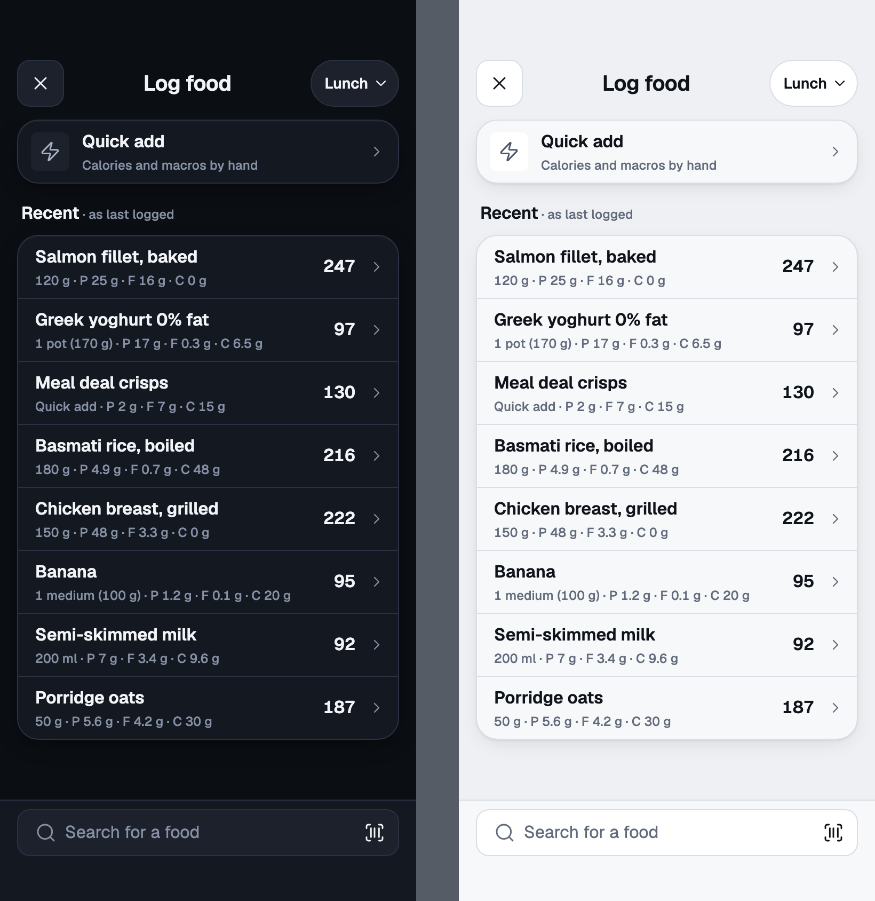
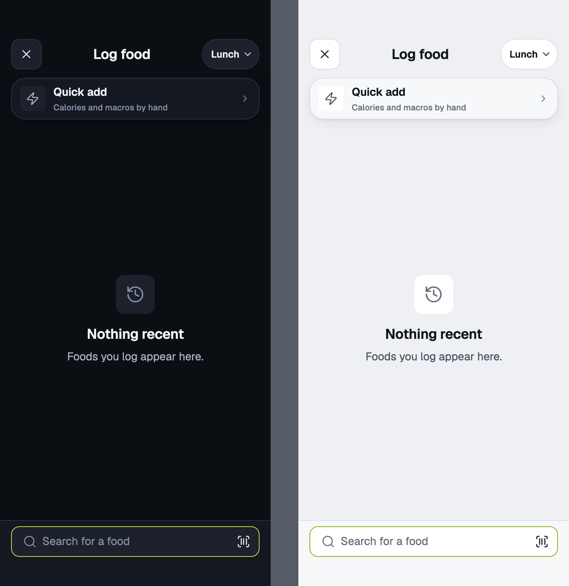
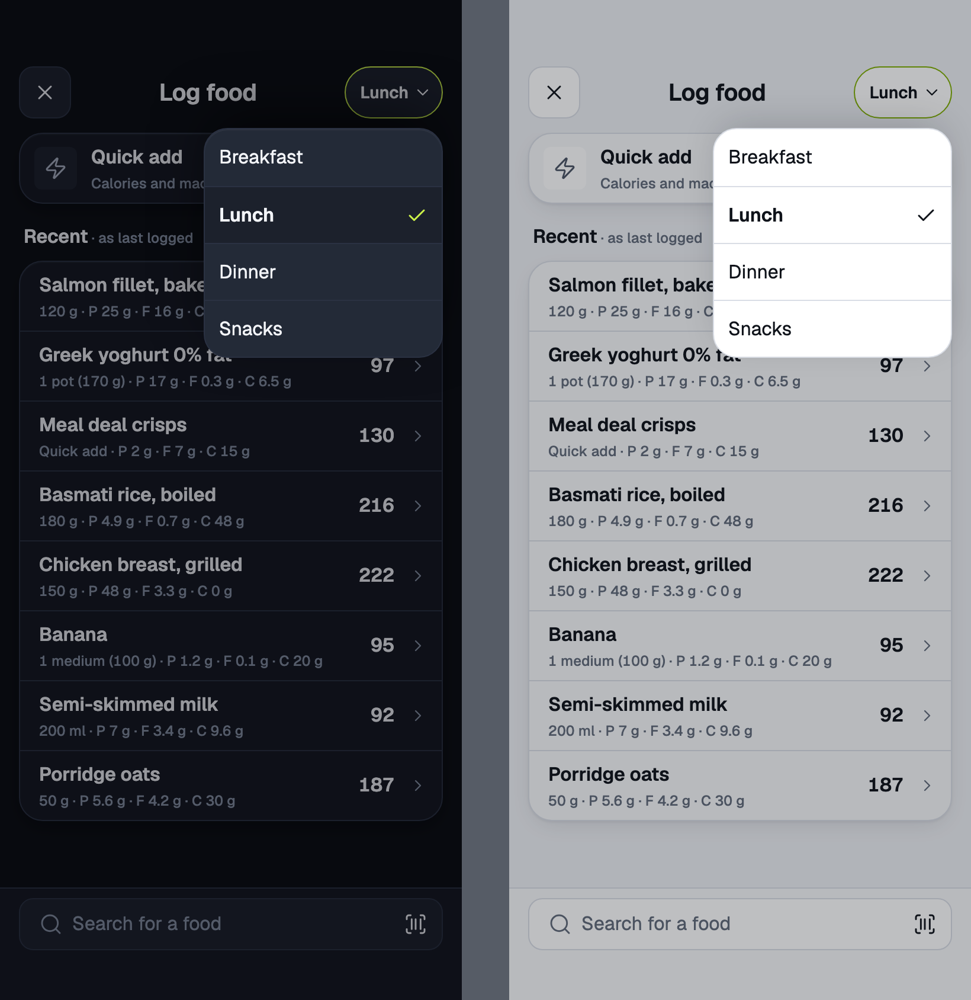
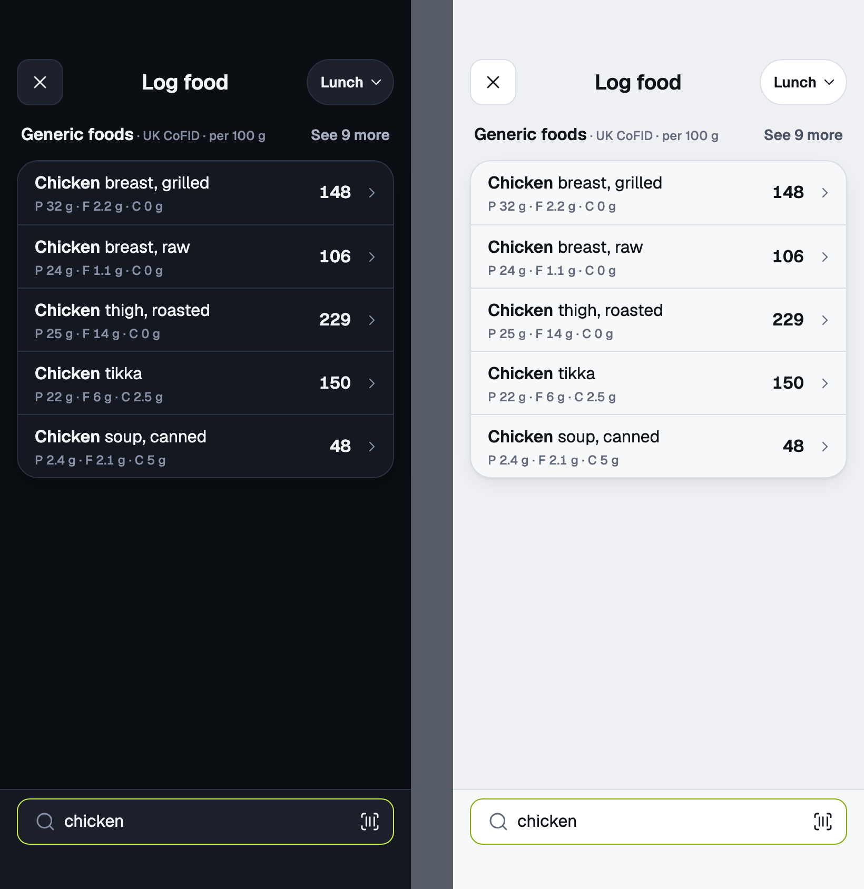
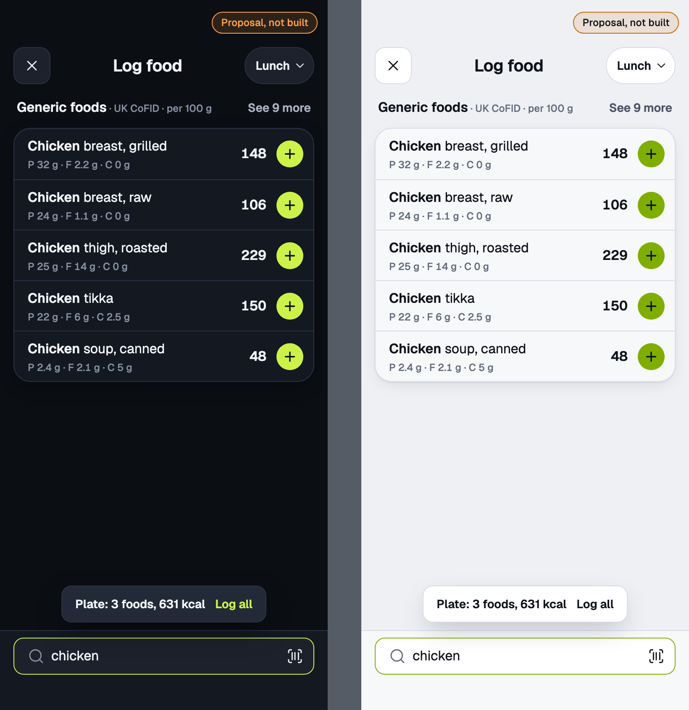

# log-search

Search in log mode · mobile · slot pill, Quick add, Recent

<!-- design-export:boards:start -->
Generated by `tools/design-export`. Do not edit between the markers.

## Boards

### idle-recent

log-search, idle-recent. Dark on the left, light on the right.

Open [idle-recent.html](idle-recent.html) in a browser, or read the source [log-search.idle-recent.dc.html](../source-m3/project/log-search.idle-recent.dc.html).

### idle-no-history

log-search, idle-no-history. Dark on the left, light on the right.

Open [idle-no-history.html](idle-no-history.html) in a browser, or read the source [log-search.idle-no-history.dc.html](../source-m3/project/log-search.idle-no-history.dc.html).

### slot-picker

log-search, slot-picker. Dark on the left, light on the right.

Open [slot-picker.html](slot-picker.html) in a browser, or read the source [log-search.slot-picker.dc.html](../source-m3/project/log-search.slot-picker.dc.html).

### results

log-search, results. Dark on the left, light on the right.

Open [results.html](results.html) in a browser, or read the source [log-search.results.dc.html](../source-m3/project/log-search.results.dc.html).

### plate-proposal

log-search, plate-proposal. Dark on the left, light on the right.

Open [plate-proposal.html](plate-proposal.html) in a browser, or read the source [log-search.plate-proposal.dc.html](../source-m3/project/log-search.plate-proposal.dc.html).

<!-- design-export:boards:end -->

## Decisions

Where the sources disagree, the order is: Zee's rulings, then the Ki-Lo design system (`../design-system/`), then MacroFactor for layout and behaviour, then the briefs. These boards are on the canvas "Ki-Lo M3 diary screens" and are **not yet approved by Zee** ([KEY-178](https://linear.app/sojisoft/issue/KEY-178)). Only items tagged Q1 to Q9 are Zee's rulings ([KEY-62](https://linear.app/sojisoft/issue/KEY-62), 2026-10-15). Everything else is brief or canvas content, and items marked as a recommendation are the orchestrator's, all awaiting Zee's approval on KEY-178.

- **The approved M2 search sheet in log mode.** The sheet header carries the meal pill. Opened from a meal's Add food, that meal is chosen. From the search bar or "+", the meal follows the time of day: Breakfast before 10:30, Lunch to 14:30, Snacks to 17:00, Dinner to 21:00, then Snacks (Q3).
- **One food at a time** (Q2). No "+" one-tap add on rows (recommendation). `plate-proposal` is MacroFactor's plate, not built.
- **Recent shows the amount last logged.** Tapping it pre-fills the portion picker. If that portion has gone, the same label is used, else the exact amount logged (orchestrator ruling, 2026-10-15).
