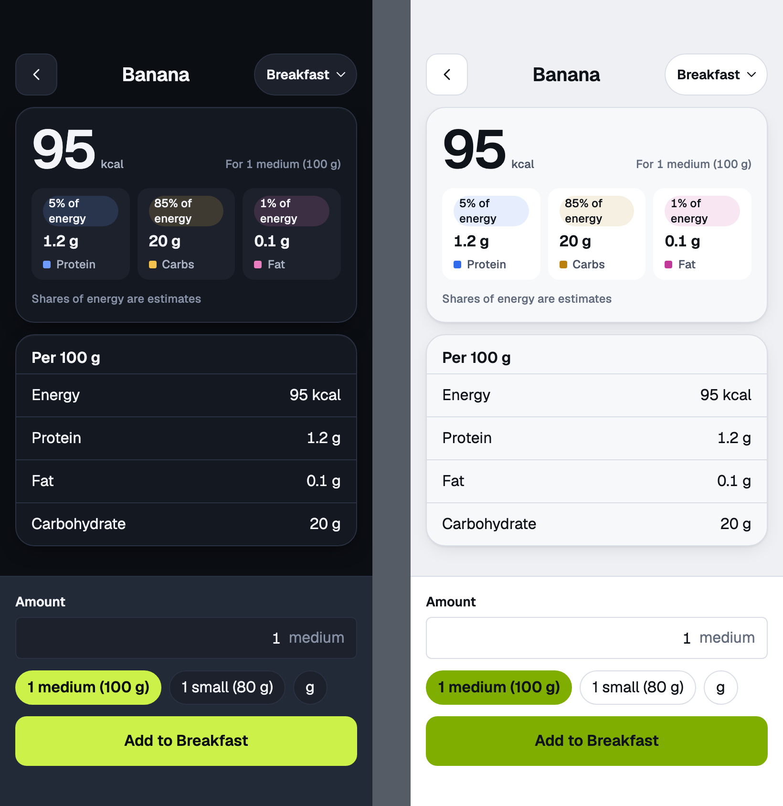
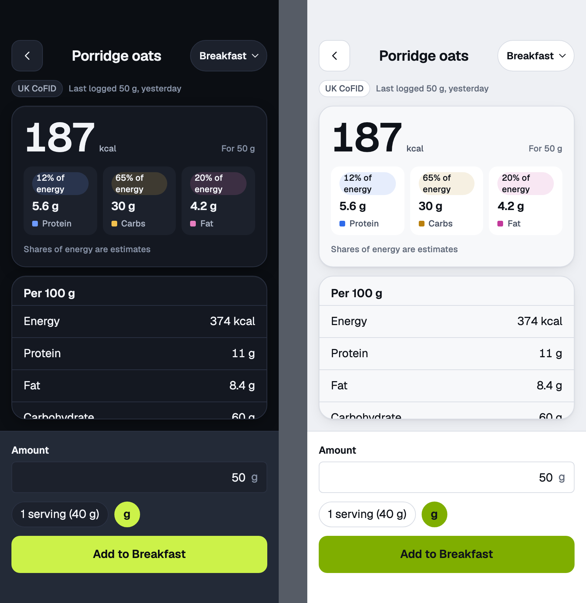
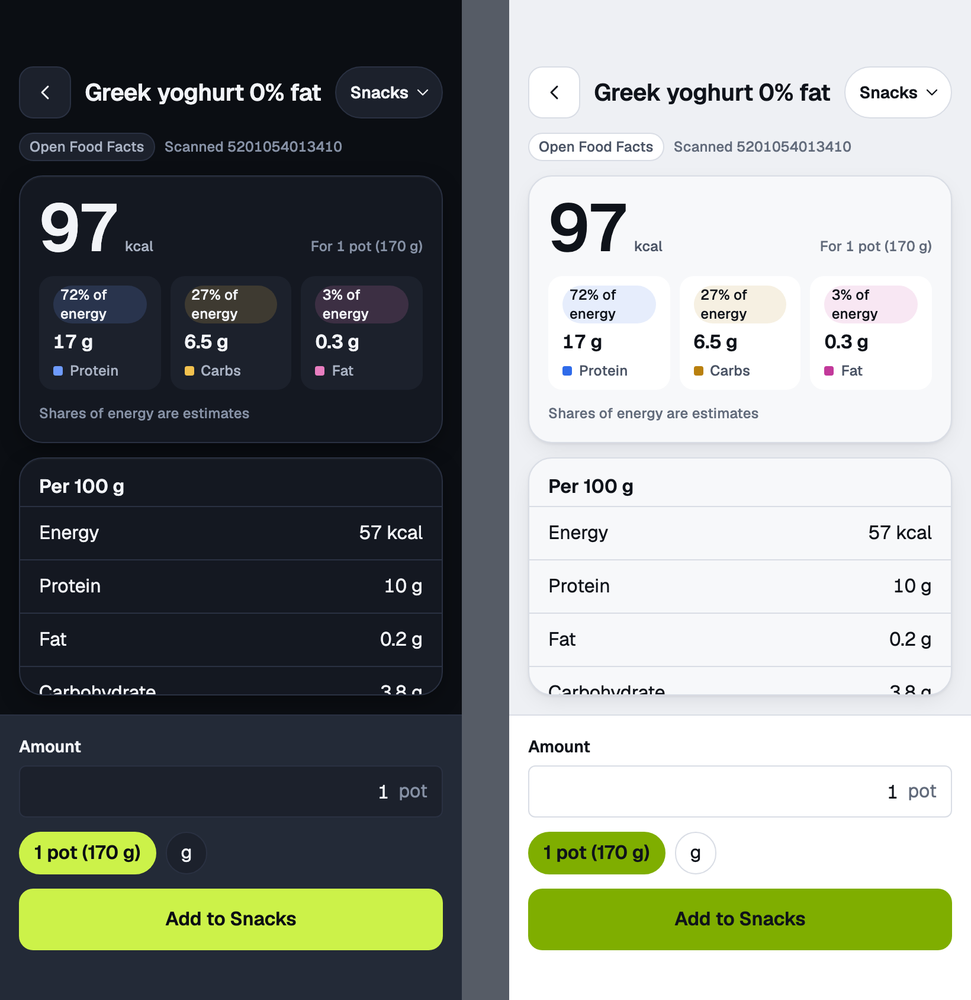
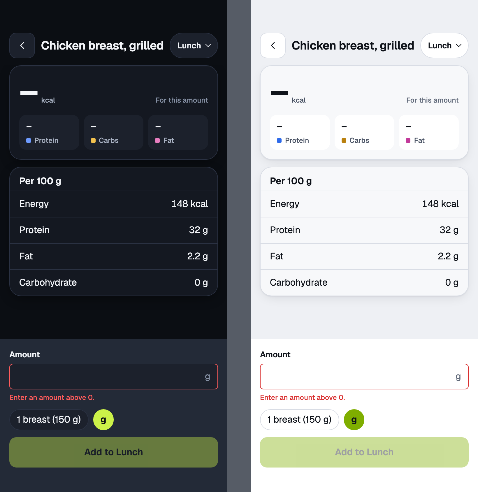
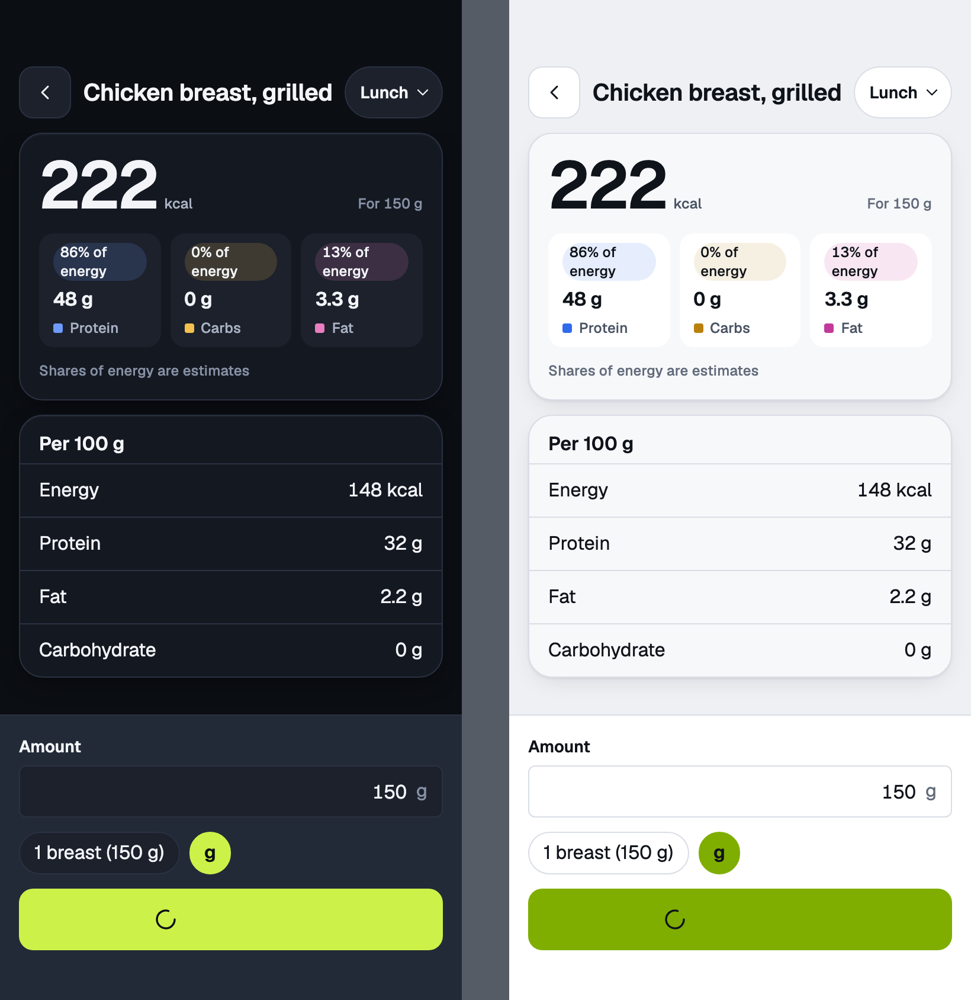
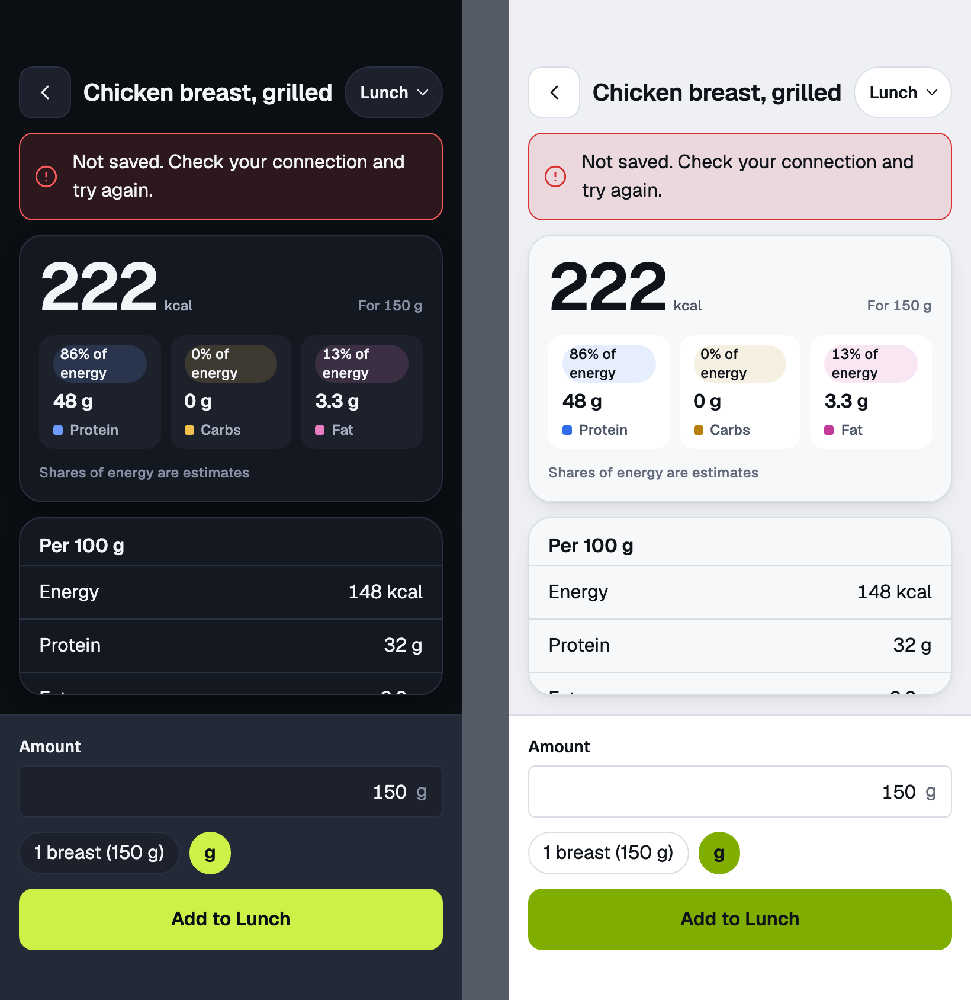
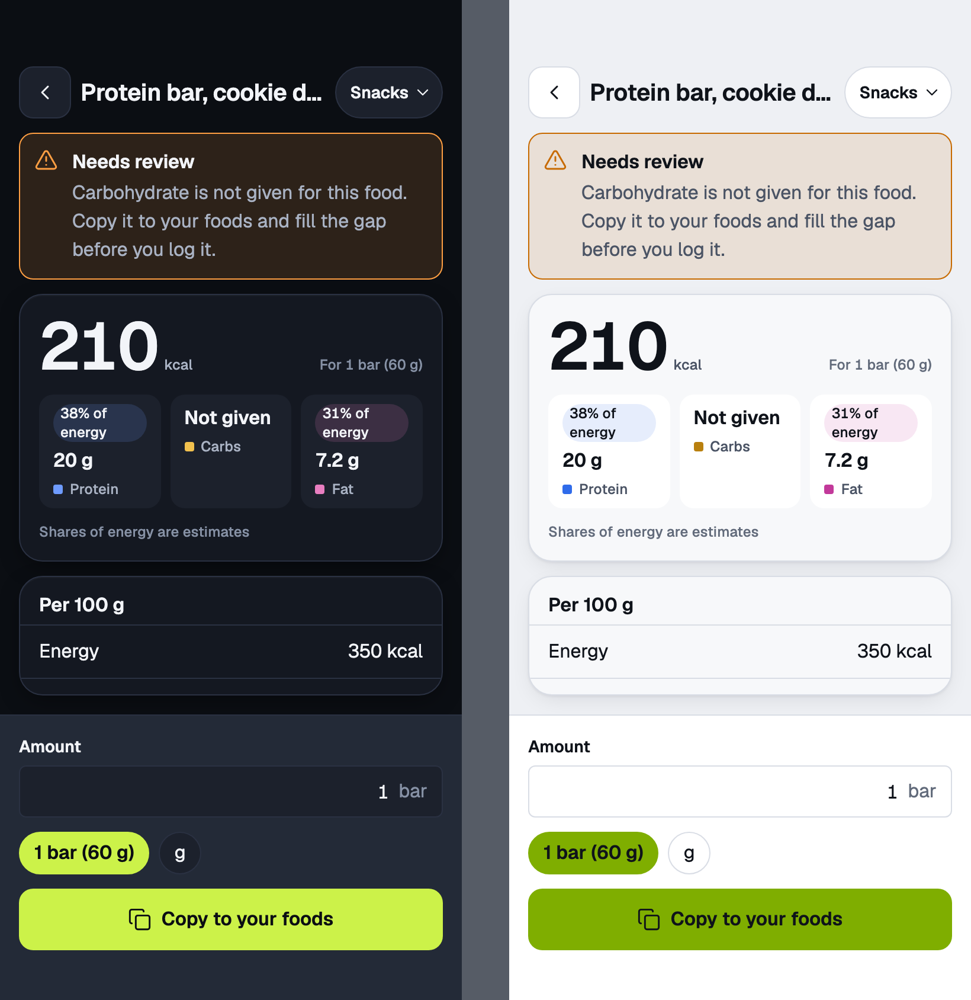
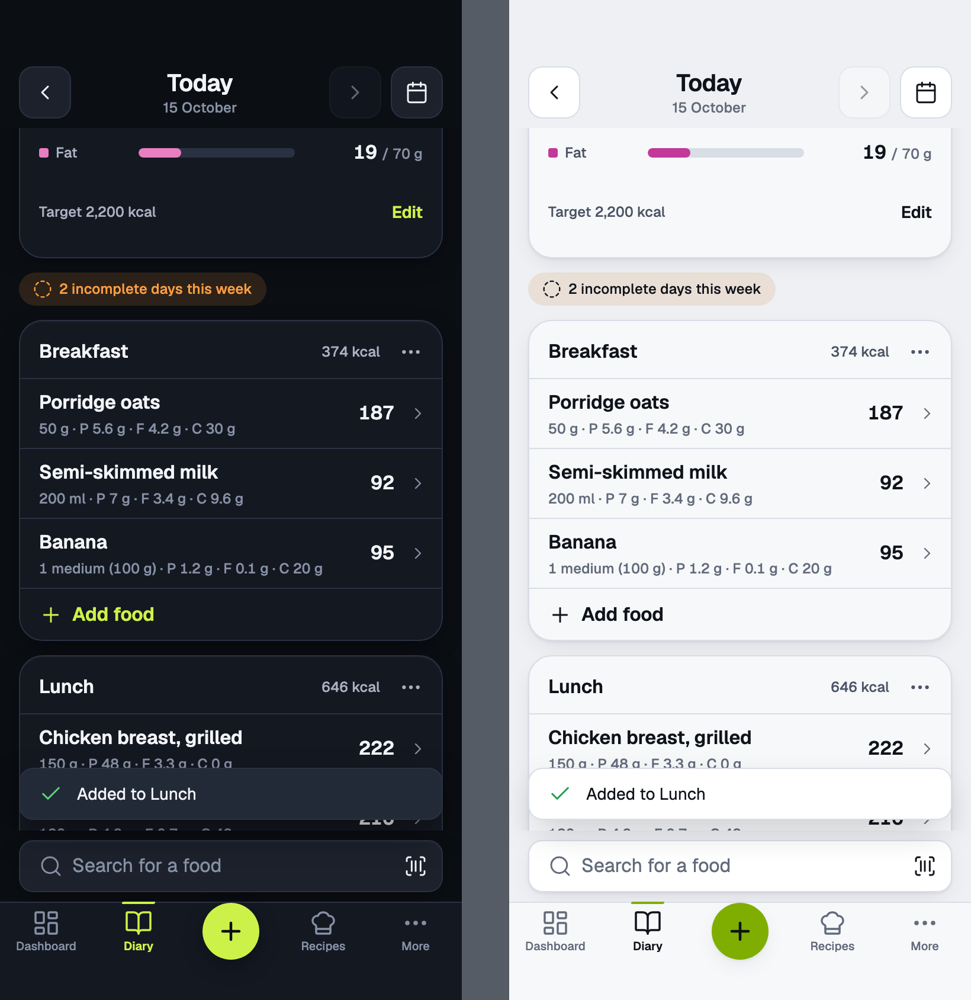
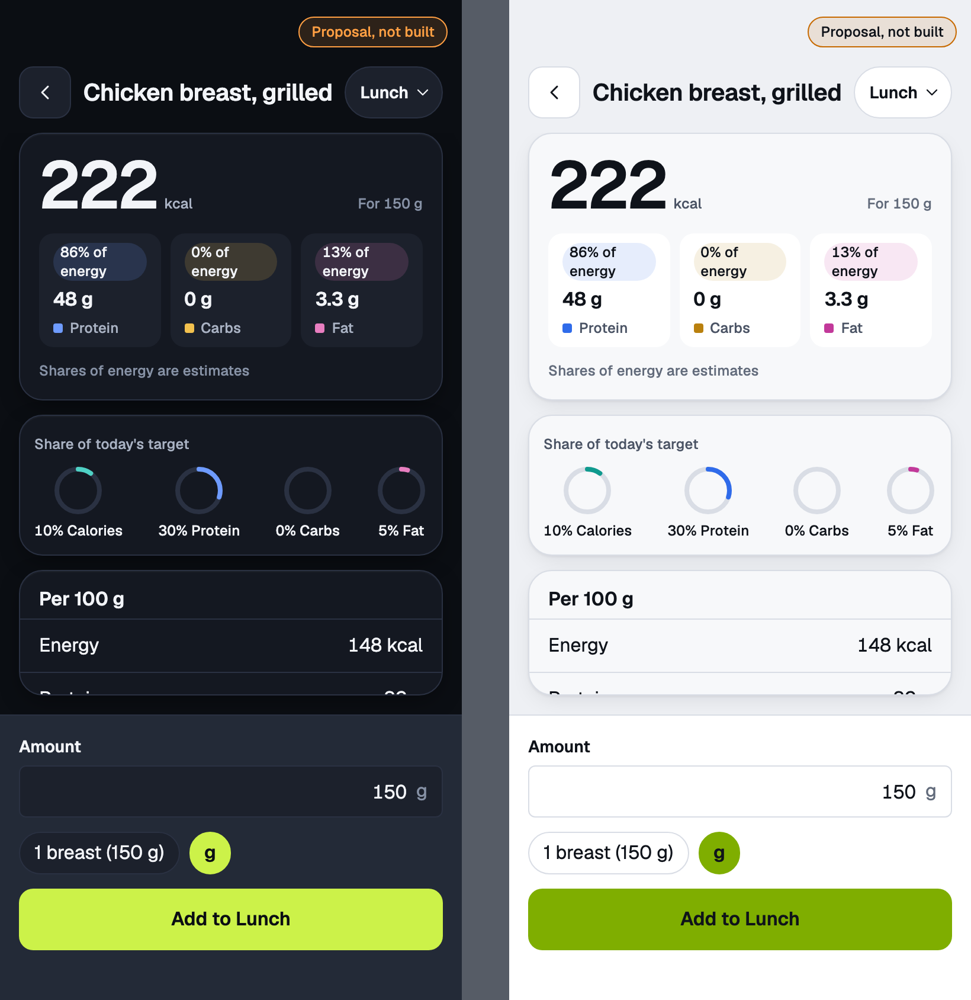

# portion

Portion picker · mobile · values for the chosen amount, one food at a time

<!-- design-export:boards:start -->
Generated by `tools/design-export`. Do not edit between the markers.

## Boards

### default-portion

portion, default-portion. Dark on the left, light on the right.

Open [default-portion.html](default-portion.html) in a browser, or read the source [portion.default-portion.dc.html](../source-m3/project/portion.default-portion.dc.html).

### grams

portion, grams. Dark on the left, light on the right.

Open [grams.html](grams.html) in a browser, or read the source [portion.grams.dc.html](../source-m3/project/portion.grams.dc.html).

### from-recent

portion, from-recent. Dark on the left, light on the right.

Open [from-recent.html](from-recent.html) in a browser, or read the source [portion.from-recent.dc.html](../source-m3/project/portion.from-recent.dc.html).

### from-scan

portion, from-scan. Dark on the left, light on the right.

Open [from-scan.html](from-scan.html) in a browser, or read the source [portion.from-scan.dc.html](../source-m3/project/portion.from-scan.dc.html).

### invalid-quantity

portion, invalid-quantity. Dark on the left, light on the right.

Open [invalid-quantity.html](invalid-quantity.html) in a browser, or read the source [portion.invalid-quantity.dc.html](../source-m3/project/portion.invalid-quantity.dc.html).

### saving

portion, saving. Dark on the left, light on the right.

Open [saving.html](saving.html) in a browser, or read the source [portion.saving.dc.html](../source-m3/project/portion.saving.dc.html).

### save-error

portion, save-error. Dark on the left, light on the right.

Open [save-error.html](save-error.html) in a browser, or read the source [portion.save-error.dc.html](../source-m3/project/portion.save-error.dc.html).

### suspect

portion, suspect. Dark on the left, light on the right.

Open [suspect.html](suspect.html) in a browser, or read the source [portion.suspect.dc.html](../source-m3/project/portion.suspect.dc.html).

### saved-toast

portion, saved-toast. Dark on the left, light on the right.

Open [saved-toast.html](saved-toast.html) in a browser, or read the source [portion.saved-toast.dc.html](../source-m3/project/portion.saved-toast.dc.html).

### impact-proposal-m6

portion, impact-proposal-m6. Dark on the left, light on the right.

Open [impact-proposal-m6.html](impact-proposal-m6.html) in a browser, or read the source [portion.impact-proposal-m6.dc.html](../source-m3/project/portion.impact-proposal-m6.dc.html).

<!-- design-export:boards:end -->

## Decisions

Where the sources disagree, the order is: Zee's rulings, then the Ki-Lo design system (`../design-system/`), then MacroFactor for layout and behaviour, then the briefs. These boards are on the canvas "Ki-Lo M3 diary screens" and are **not yet approved by Zee** ([KEY-178](https://linear.app/sojisoft/issue/KEY-178)). Only items tagged Q1 to Q9 are Zee's rulings ([KEY-62](https://linear.app/sojisoft/issue/KEY-62), 2026-10-15). Everything else is brief or canvas content, and items marked as a recommendation are the orchestrator's, all awaiting Zee's approval on KEY-178.

- **Values are for the chosen amount** ("For 150 g"), recalculated live. The per 100 g list stays below.
- **Units:** the food's own portions first, then g, then ml where it applies. The default is the default portion, else 100 g.
- **Barcode to log is scan, then Add:** at most three taps after the scan ([KEY-3](https://linear.app/sojisoft/issue/KEY-3)).
- **Suspect foods** (a missing macro) cannot be logged directly (Q6). The review banner has no action, and "Copy to your foods" replaces Add.
- `impact-proposal-m6` (share of today's target) is M6, not built.
- **Numbers.** Calories are whole numbers with a thousands separator (2,200). Grams take one decimal only under 10. Over target is warning, never danger.
