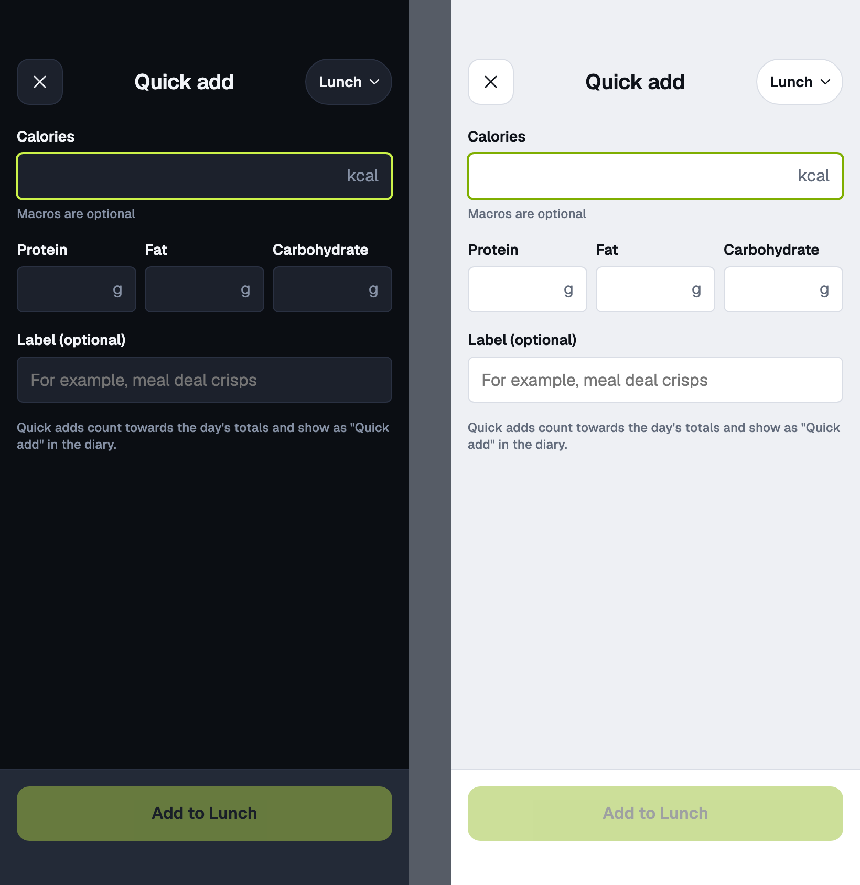
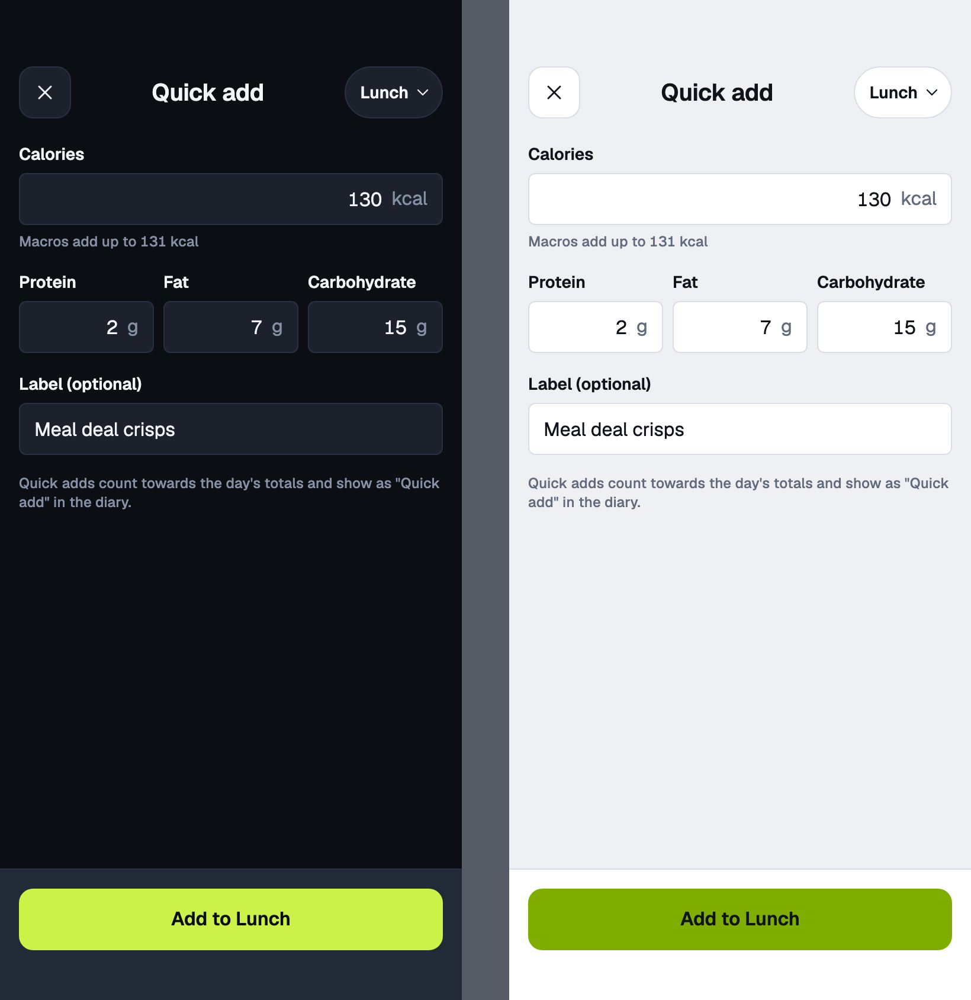
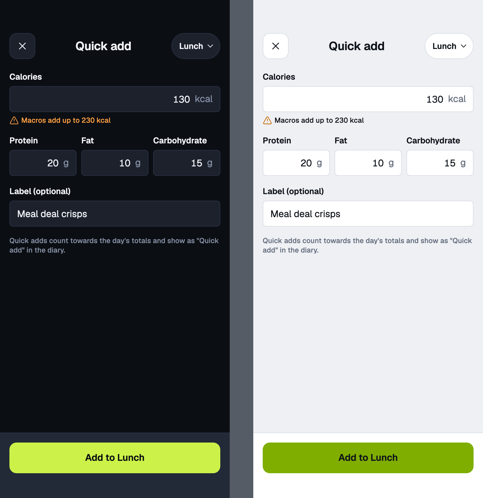
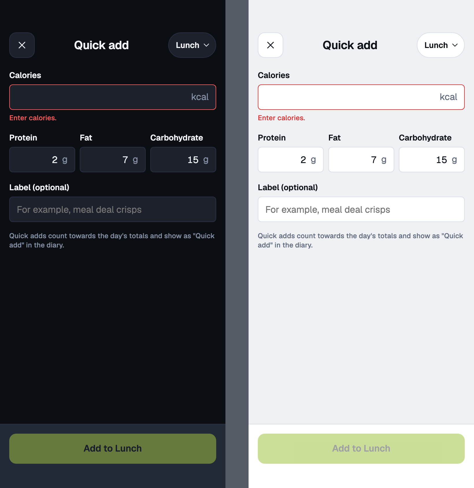
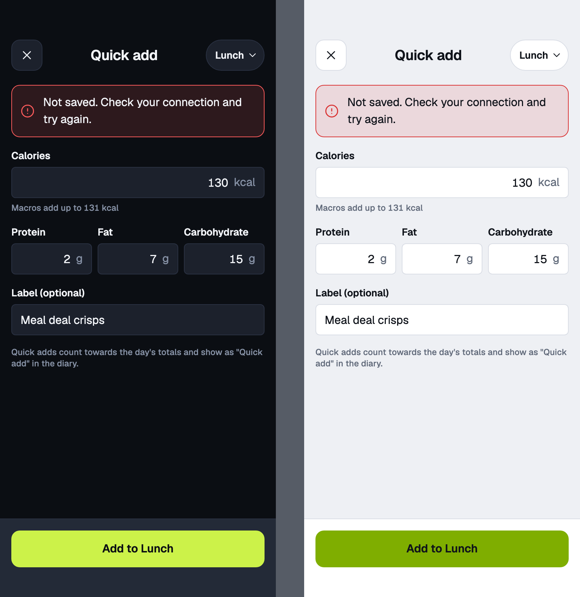

# quick-add

Quick add · mobile · calories required, macros optional

<!-- design-export:boards:start -->
Generated by `tools/design-export`. Do not edit between the markers.

## Boards

### empty

quick-add, empty. Dark on the left, light on the right.

Open [empty.html](empty.html) in a browser, or read the source [quick-add.empty.dc.html](../source-m3/project/quick-add.empty.dc.html).

### filled

quick-add, filled. Dark on the left, light on the right.

Open [filled.html](filled.html) in a browser, or read the source [quick-add.filled.dc.html](../source-m3/project/quick-add.filled.dc.html).

### macros-mismatch

quick-add, macros-mismatch. Dark on the left, light on the right.

Open [macros-mismatch.html](macros-mismatch.html) in a browser, or read the source [quick-add.macros-mismatch.dc.html](../source-m3/project/quick-add.macros-mismatch.dc.html).

### error

quick-add, error. Dark on the left, light on the right.

Open [error.html](error.html) in a browser, or read the source [quick-add.error.dc.html](../source-m3/project/quick-add.error.dc.html).

### save-error

quick-add, save-error. Dark on the left, light on the right.

Open [save-error.html](save-error.html) in a browser, or read the source [quick-add.save-error.dc.html](../source-m3/project/quick-add.save-error.dc.html).

<!-- design-export:boards:end -->

## Decisions

Where the sources disagree, the order is: Zee's rulings, then the Ki-Lo design system (`../design-system/`), then MacroFactor for layout and behaviour, then the briefs. These boards are on the canvas "Ki-Lo M3 diary screens" and are **not yet approved by Zee** ([KEY-178](https://linear.app/sojisoft/issue/KEY-178)). Only items tagged Q1 to Q9 are Zee's rulings ([KEY-62](https://linear.app/sojisoft/issue/KEY-62), 2026-10-15). Everything else is brief or canvas content, and items marked as a recommendation are the orchestrator's, all awaiting Zee's approval on KEY-178.

- **Calories are required and above 0. Protein, fat and carbohydrate are optional.** The label is optional and stored with the entry.
- **"Macros add up to N kcal" is information, not an error.** It turns warning-ink with an icon when the macros and calories differ by more than 25 %. Saving is still allowed.
- The sheet is full screen so the keyboard does not cover the fields.
