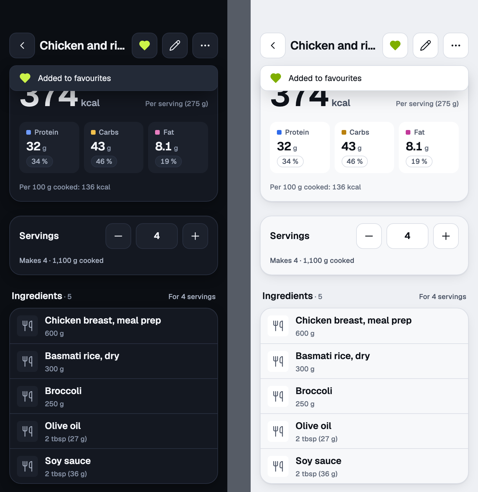

# recipe-view proposals

Recipe view · the screen you cook from · `apps/mobile/components/RecipeView`

The recipe view has no exported board. This folder holds a hand-drawn proposal for it, built from the kit tokens to match the screen as the app draws it today: the sheet header with Back, the recipe name, Edit and More, then the Per serving card, the Servings card and the ingredients. It is not on the canvas, so it sits in `proposals/` where `tools/design-export` does not look for boards. The PNG is 820 by 844 at device pixel ratio 2, dark on the left and light on the right.

## Boards

### favourite-on

A recipe just marked as a favourite: the filled heart first in the header's trailing controls, before Edit and More, and the toast "Added to favourites".

Open [favourite-on.html](favourite-on.html) in a browser.

## Decisions

- **Favourites (Zee, 2026-11-03).** Approved by Zee on 2026-11-03. Recipes can be favourites as well as foods, and Zee said whole recipes matter more. The heart is a secondary icon button, like Edit and More. Outline means not a favourite, named "Add to favourites". Filled, in `--accent` (Zee: green, not red), means a favourite, named "Remove from favourites". A tap toggles it at once and shows a toast: "Added to favourites" or "Removed from favourites". Zee wrote the copy in American spelling. It is British here, as AGENTS.md asks. Foods and recipes share one cap of 30. An archived or deleted recipe drops out of the favourites. A favourite recipe shows in the log search strip with the recipe icon, and a tap there opens the amount step (see [`../../food-search/README.md`](../../food-search/README.md)).
- **Settled with Zee (2026-11-03), heart stays in the header.** A third trailing control leaves the title less room, so a name like "Chicken and rice" is cut with an ellipsis. The alternative is to put the heart in the More menu, which hides it. The toast is drawn under the header and the filled heart needs a fill option on the kit's Icon, as the food detail README explains (see [`../../food-detail/README.md`](../../food-detail/README.md)). Offline, the heart is disabled like Edit and More, because the favourite needs a connection.
