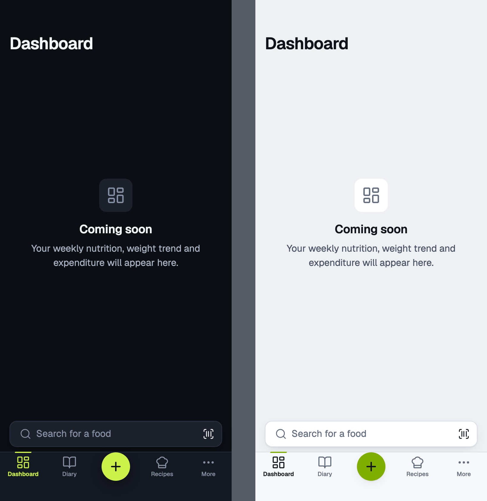
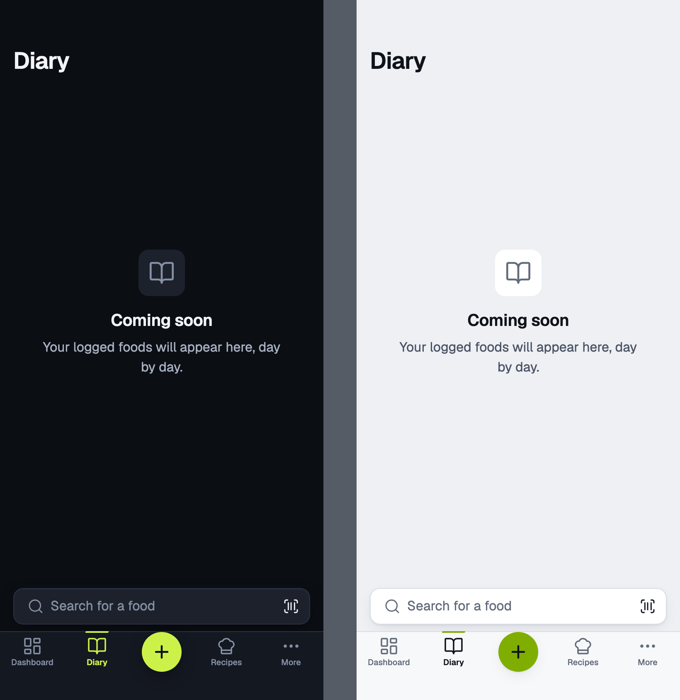
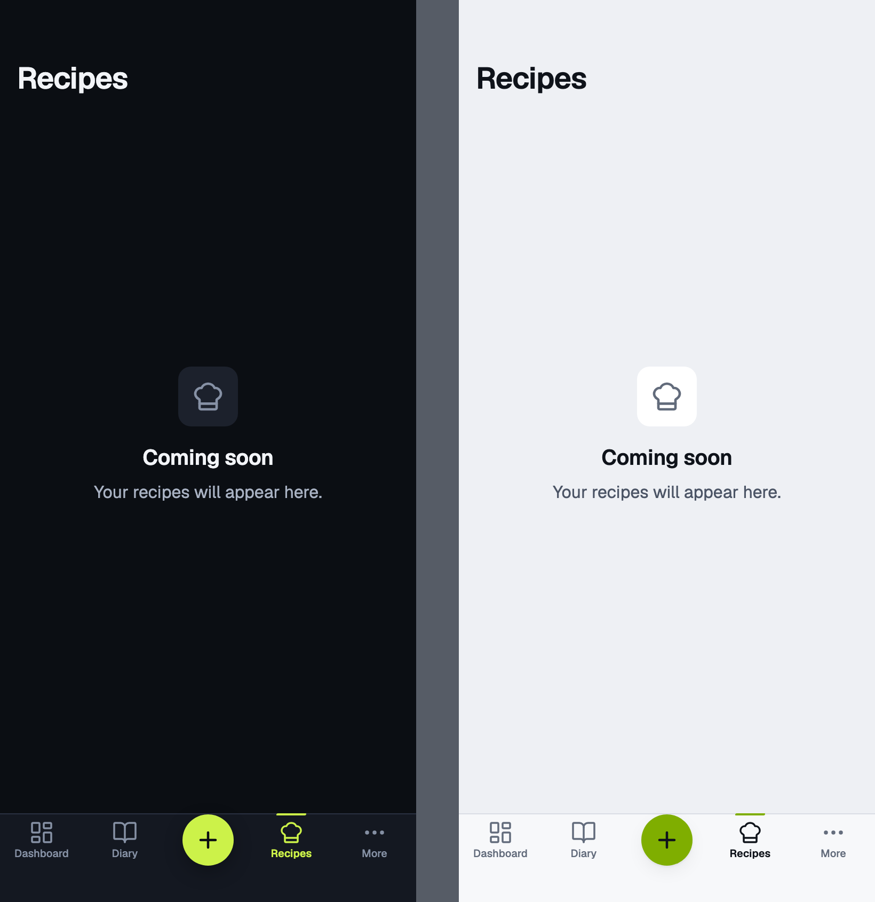
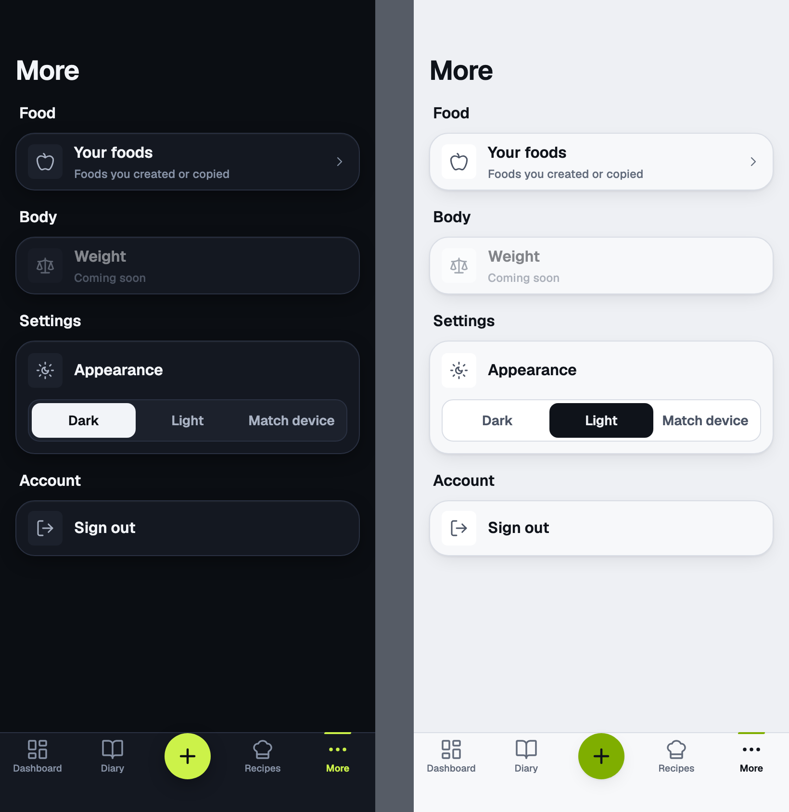
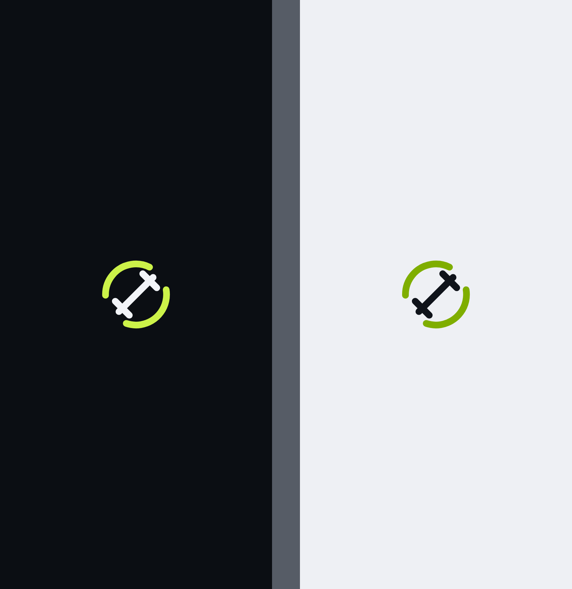

# tab-shell

Tab shell · Dashboard, Diary, +, Recipes, More · MacroFactor-style

<!-- design-export:boards:start -->
Generated by `tools/design-export`. Do not edit between the markers.

## Boards

### dashboard

Tab shell, dashboard. Dark on the left, light on the right.

Open [dashboard.html](dashboard.html) in a browser, or read the source [tab-shell.dashboard.dc.html](../source/project/tab-shell.dashboard.dc.html).

### diary

Tab shell, diary. Dark on the left, light on the right.

Open [diary.html](diary.html) in a browser, or read the source [tab-shell.diary.dc.html](../source/project/tab-shell.diary.dc.html).

### recipes

Tab shell, recipes. Dark on the left, light on the right.

Open [recipes.html](recipes.html) in a browser, or read the source [tab-shell.recipes.dc.html](../source/project/tab-shell.recipes.dc.html).

### more

Tab shell, more. Dark on the left, light on the right.

Open [more.html](more.html) in a browser, or read the source [tab-shell.more.dc.html](../source/project/tab-shell.more.dc.html).

### session-loading

Tab shell, session-loading. Dark on the left, light on the right.

Open [session-loading.html](session-loading.html) in a browser, or read the source [tab-shell.session-loading.dc.html](../source/project/tab-shell.session-loading.dc.html).

<!-- design-export:boards:end -->

## Decisions

Where the sources disagree, the order is: Zee's rulings, then the Ki-Lo design system (`../design-system/`), then MacroFactor for layout and behaviour, then the briefs. Zee approved these boards on 2026-10-13. Anything that would visibly change a board goes back to Zee first.

- **MacroFactor-style navigation (Zee, 2026-10-13).** The tab bar is Dashboard, Diary, a centre "+", Recipes and More. There is no Foods or Weight tab. The "+" is an action that opens the food search sheet, so it never shows as selected. A "Search for a food" bar sits above the tab bar on Dashboard and Diary.
- **Recipes leaves the tab bar for More (Zee, 2026-10-29).** "The recipes shouldn't be a tab anymore. Make it an option in nutrition in the more tab." The bar is Dashboard, Diary, the centre "+", Train and More. The library is the last row of More's Nutrition section, after Targets and Programme, with the ChefHat icon. It opens inside the More tab at `/more/recipes`, so the bar stays with More selected, and its header has a back control to More. The archived recipes are pushed after it in the same tab. The recipe view, editor and refresh are still pushed over the tabs at `/recipes/...`, and the old `/recipes` and `/recipes/archived` addresses redirect into the library. This supersedes the Recipes slot in the two bullets below and on the boards.
- **Recipes replaced Goals (Zee, 2026-10-13).** Recipes is a "Coming soon" placeholder with the ChefHat icon in M2, to be designed with Zee later. Calorie and macro targets, the old Goals content, have no home yet.
- **The app opens on Dashboard after sign in (Q12).** Dashboard, Diary and Recipes are placeholders in M2.
- **More as drawn on `more`:** Food (Your foods, live), Body (Weight, coming soon), Settings (Appearance inline: Dark, Light, Match device) and Account (Sign out). Settings and Weight no longer have tabs or screens.
- **Dark is the default and light is chosen in More (Q2).** The choice is kept per device.
- **Tab bar idioms.** The design system's iOS underline and Android pill both stay, with the five new slots and the same centre "+". Only iOS is drawn. Android follows the TabBar spec.
- **`session-loading` is the cover shown while the saved session is read.** It shows only the Ki-Lo mark, in the dark or light variant, with no text and no component from the design system.
- **Out of scope for M2:** a real Dashboard, the Diary timeline, Recipes content, weight logging and account management beyond sign out.
