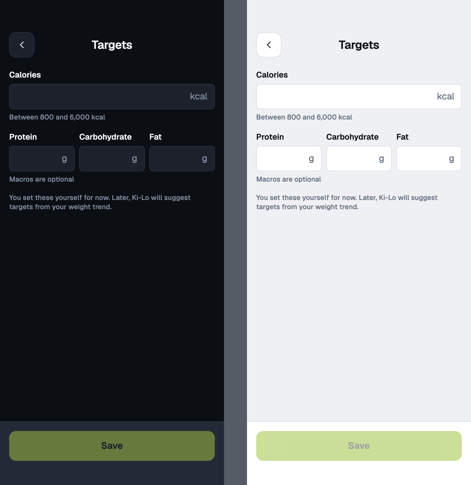
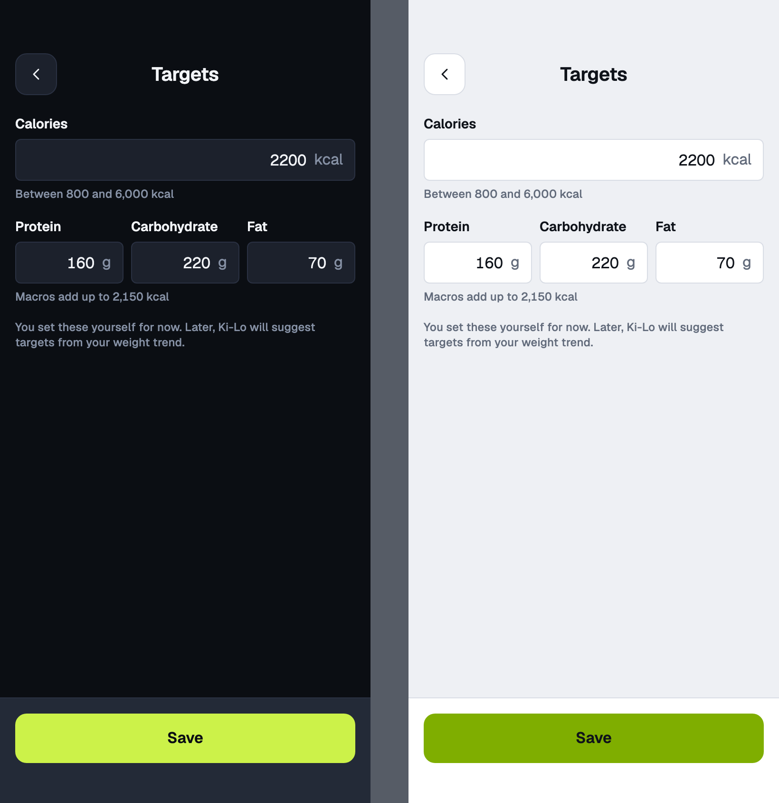
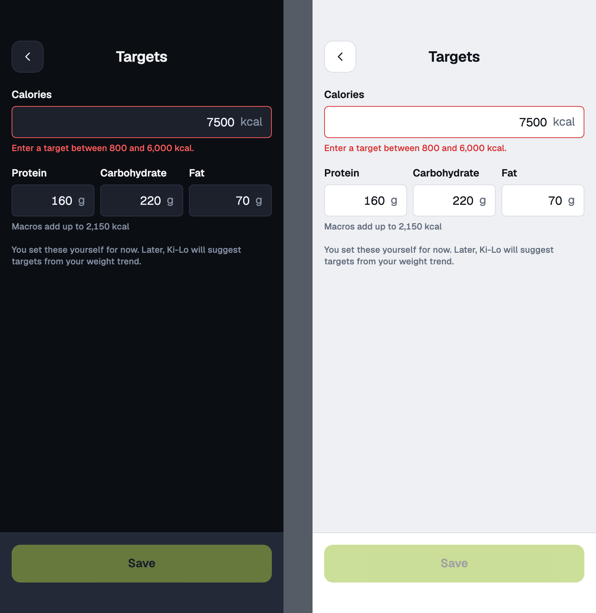
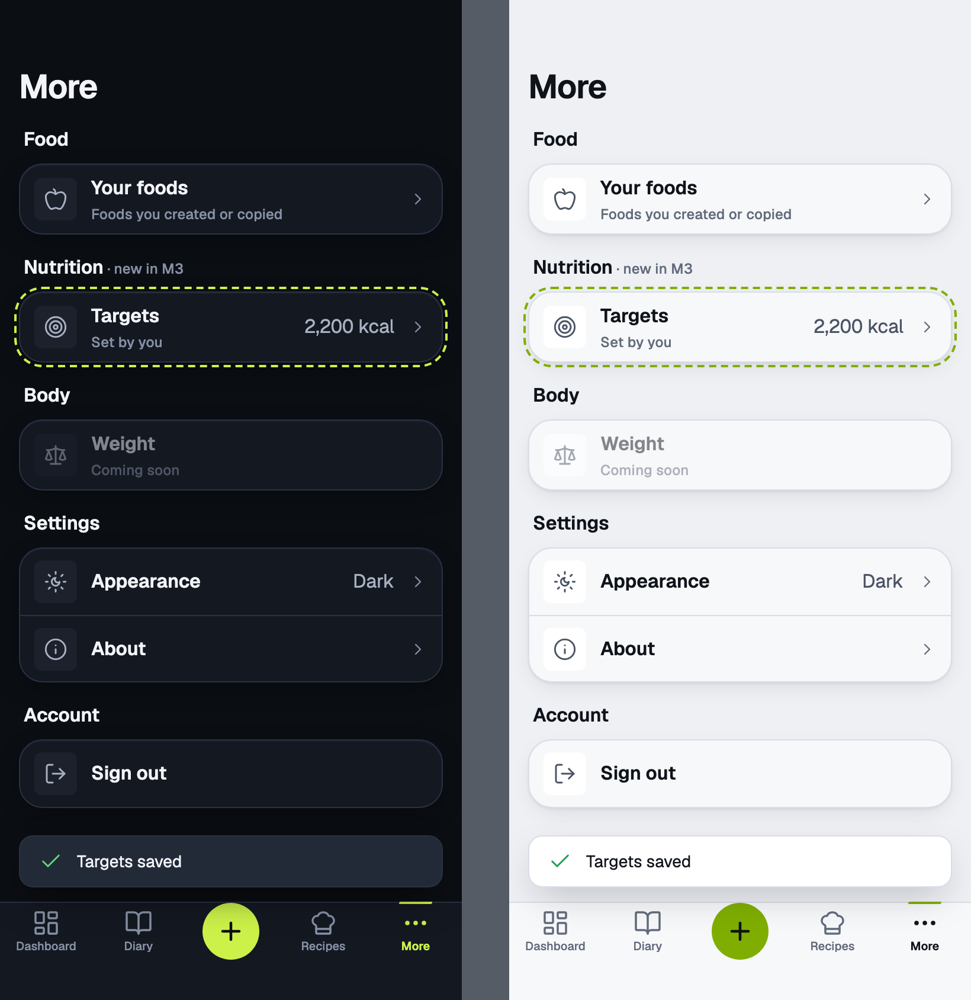

# targets

Manual target · mobile · More, Nutrition, Targets

<!-- design-export:boards:start -->
Generated by `tools/design-export`. Do not edit between the markers.

## Boards

### empty

targets, empty. Dark on the left, light on the right.

Open [empty.html](empty.html) in a browser, or read the source [targets.empty.dc.html](../source-m3/project/targets.empty.dc.html).

### filled

targets, filled. Dark on the left, light on the right.

Open [filled.html](filled.html) in a browser, or read the source [targets.filled.dc.html](../source-m3/project/targets.filled.dc.html).

### error

targets, error. Dark on the left, light on the right.

Open [error.html](error.html) in a browser, or read the source [targets.error.dc.html](../source-m3/project/targets.error.dc.html).

### saved

targets, saved. Dark on the left, light on the right.

Open [saved.html](saved.html) in a browser, or read the source [targets.saved.dc.html](../source-m3/project/targets.saved.dc.html).

<!-- design-export:boards:end -->

## Decisions

Where the sources disagree, the order is: Zee's rulings, then the Ki-Lo design system (`../design-system/`), then MacroFactor for layout and behaviour, then the briefs. These boards are on the canvas "Ki-Lo M3 diary screens" and are **not yet approved by Zee** ([KEY-178](https://linear.app/sojisoft/issue/KEY-178)). Only items tagged Q1 to Q9 are Zee's rulings ([KEY-62](https://linear.app/sojisoft/issue/KEY-62), 2026-10-15). Everything else is brief or canvas content, and items marked as a recommendation are the orchestrator's, all awaiting Zee's approval on KEY-178.

- **A stopgap until M6:** the user sets calories (required, 800 to 6,000 as a recommendation, Zee to confirm) and macros in grams by hand (Q4). M6's adaptive targets replace it.
- **It lives in More under a new Nutrition section,** between Food and Body. Only the Nutrition section, outlined dashed on `saved`, is new, and the outline is not built. The Appearance row ("Dark >") and the About row on `saved` are canvas drift: build every other section from the approved `tab-shell.more`.
- Also reached from the diary's "Edit" and "Set target".
