# web-diary

Web diary · 1280 dark, 1280 light, 375 dark, 375 light · day and week views, dialogs

<!-- design-export:boards:start -->
Generated by `tools/design-export`. Do not edit between the markers.

## Boards

### day

web-diary, day. 1280 dark, 1280 light, 375 dark, 375 light, from left to right.

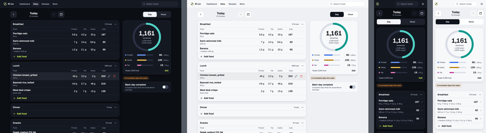

Open [day.html](day.html) in a browser, or read the source [web-diary.day.dc.html](../source-m3/project/web-diary.day.dc.html).

### day-empty

web-diary, day-empty. 1280 dark, 1280 light, 375 dark, 375 light, from left to right.

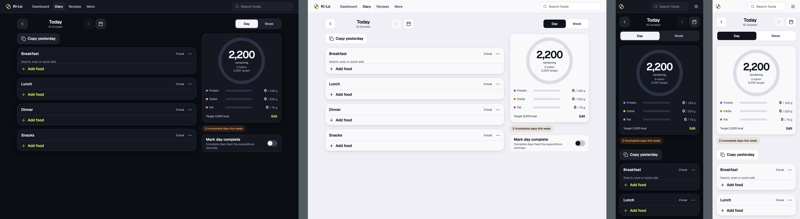

Open [day-empty.html](day-empty.html) in a browser, or read the source [web-diary.day-empty.dc.html](../source-m3/project/web-diary.day-empty.dc.html).

### day-over-target

web-diary, day-over-target. 1280 dark, 1280 light, 375 dark, 375 light, from left to right.

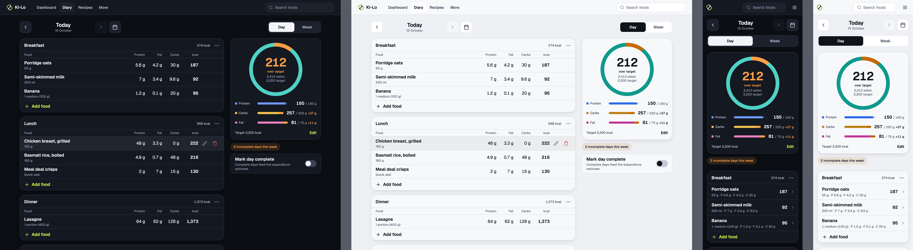

Open [day-over-target.html](day-over-target.html) in a browser, or read the source [web-diary.day-over-target.dc.html](../source-m3/project/web-diary.day-over-target.dc.html).

### day-complete

web-diary, day-complete. 1280 dark, 1280 light, 375 dark, 375 light, from left to right.

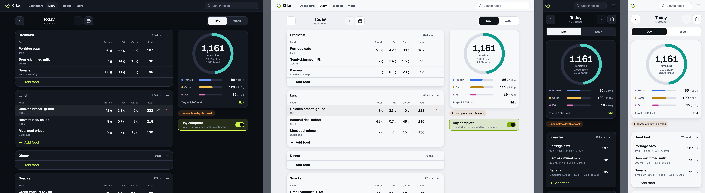

Open [day-complete.html](day-complete.html) in a browser, or read the source [web-diary.day-complete.dc.html](../source-m3/project/web-diary.day-complete.dc.html).

### add-dialog-search

web-diary, add-dialog-search. 1280 dark, 1280 light, 375 dark, 375 light, from left to right.

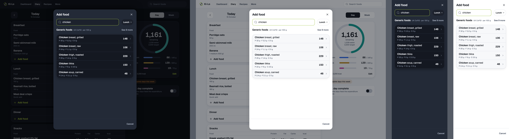

Open [add-dialog-search.html](add-dialog-search.html) in a browser, or read the source [web-diary.add-dialog-search.dc.html](../source-m3/project/web-diary.add-dialog-search.dc.html).

### add-dialog-portion

web-diary, add-dialog-portion. 1280 dark, 1280 light, 375 dark, 375 light, from left to right.

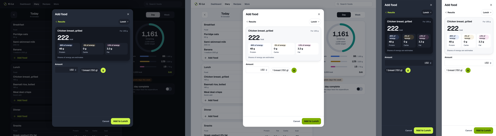

Open [add-dialog-portion.html](add-dialog-portion.html) in a browser, or read the source [web-diary.add-dialog-portion.dc.html](../source-m3/project/web-diary.add-dialog-portion.dc.html).

### edit-dialog

web-diary, edit-dialog. 1280 dark, 1280 light, 375 dark, 375 light, from left to right.

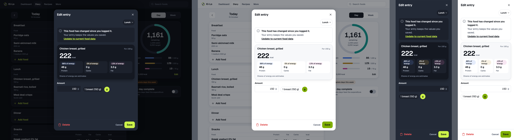

Open [edit-dialog.html](edit-dialog.html) in a browser, or read the source [web-diary.edit-dialog.dc.html](../source-m3/project/web-diary.edit-dialog.dc.html).

### quick-add-dialog

web-diary, quick-add-dialog. 1280 dark, 1280 light, 375 dark, 375 light, from left to right.

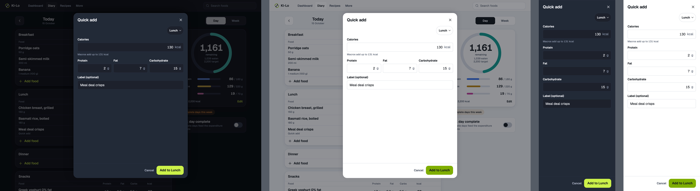

Open [quick-add-dialog.html](quick-add-dialog.html) in a browser, or read the source [web-diary.quick-add-dialog.dc.html](../source-m3/project/web-diary.quick-add-dialog.dc.html).

### week

web-diary, week. 1280 dark, 1280 light, 375 dark, 375 light, from left to right.

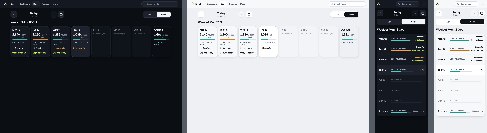

Open [week.html](week.html) in a browser, or read the source [web-diary.week.dc.html](../source-m3/project/web-diary.week.dc.html).

### week-copied

web-diary, week-copied. 1280 dark, 1280 light, 375 dark, 375 light, from left to right.

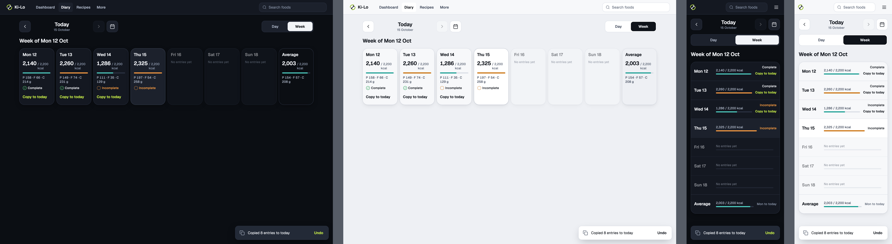

Open [week-copied.html](week-copied.html) in a browser, or read the source [web-diary.week-copied.dc.html](../source-m3/project/web-diary.week-copied.dc.html).

### loading

web-diary, loading. 1280 dark, 1280 light, 375 dark, 375 light, from left to right.

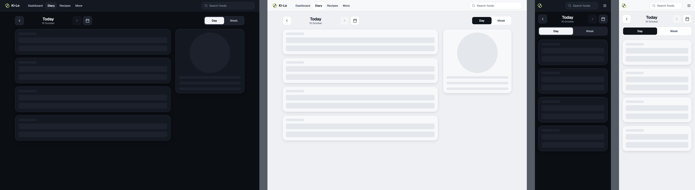

Open [loading.html](loading.html) in a browser, or read the source [web-diary.loading.dc.html](../source-m3/project/web-diary.loading.dc.html).

### error

web-diary, error. 1280 dark, 1280 light, 375 dark, 375 light, from left to right.

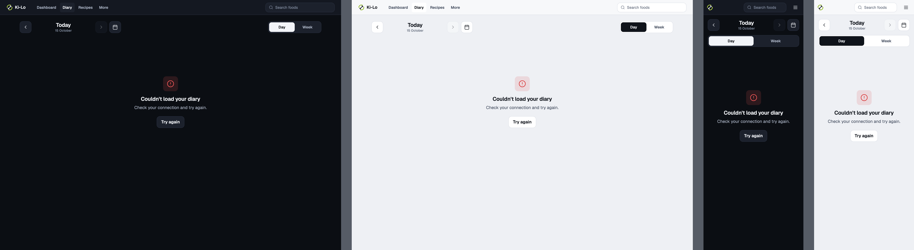

Open [error.html](error.html) in a browser, or read the source [web-diary.error.dc.html](../source-m3/project/web-diary.error.dc.html).

<!-- design-export:boards:end -->

## Decisions

Where the sources disagree, the order is: Zee's rulings, then the Ki-Lo design system (`../design-system/`), then MacroFactor for layout and behaviour, then the briefs. These boards are on the canvas "Ki-Lo M3 diary screens" and are **not yet approved by Zee** ([KEY-178](https://linear.app/sojisoft/issue/KEY-178)). Only items tagged Q1 to Q9 are Zee's rulings ([KEY-62](https://linear.app/sojisoft/issue/KEY-62), 2026-10-15). Everything else is brief or canvas content, and items marked as a recommendation are the orchestrator's, all awaiting Zee's approval on KEY-178.

- **Day view:** the meal cards on the left as tables (Edit and Delete on hover and focus), with the summary, chip and complete toggle in a column on the right, intended to stay in view as the meals scroll (brief 15). At 375 it stacks like mobile.
- **Add, edit and quick add open in a dialog over the diary** (Q9), not the foods page. The dialog is 560 wide, and full screen at 375.
- **Week view:** Monday to Sunday plus an average, with "Copy to today" on each past day that has entries (Q8).
- **Keyboard route to Undo** is [KEY-218](https://linear.app/sojisoft/issue/KEY-218).
- **Numbers.** Calories are whole numbers with a thousands separator (2,200). Grams take one decimal only under 10. Over target is warning, never danger.
