# web-food

Web · food detail and food form

<!-- design-export:boards:start -->
Generated by `tools/design-export`. Do not edit between the markers.

## Boards

### detail-loading

Web food page, detail-loading. 1280 dark, 1280 light, 375 dark, 375 light, from left to right.

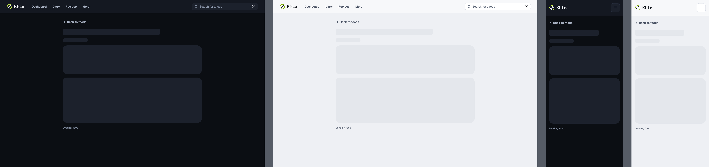

Open [detail-loading.html](detail-loading.html) in a browser, or read the source [web-food.detail-loading.dc.html](../source/project/web-food.detail-loading.dc.html).

### detail-error

Web food page, detail-error. 1280 dark, 1280 light, 375 dark, 375 light, from left to right.

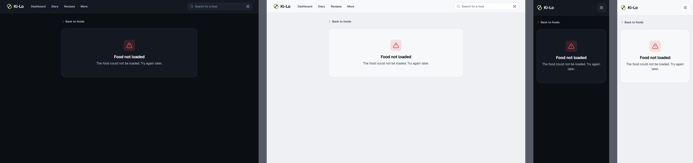

Open [detail-error.html](detail-error.html) in a browser, or read the source [web-food.detail-error.dc.html](../source/project/web-food.detail-error.dc.html).

### detail-not-found

Web food page, detail-not-found. 1280 dark, 1280 light, 375 dark, 375 light, from left to right.

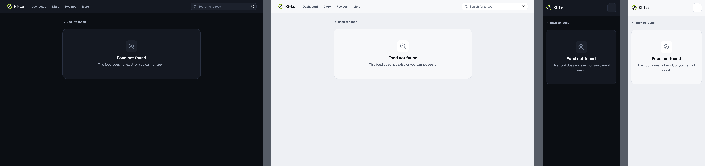

Open [detail-not-found.html](detail-not-found.html) in a browser, or read the source [web-food.detail-not-found.dc.html](../source/project/web-food.detail-not-found.dc.html).

### detail-cofid

Web food page, detail-cofid. 1280 dark, 1280 light, 375 dark, 375 light, from left to right.

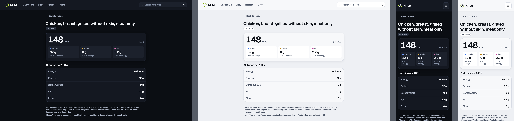

Open [detail-cofid.html](detail-cofid.html) in a browser, or read the source [web-food.detail-cofid.dc.html](../source/project/web-food.detail-cofid.dc.html).

### detail-off-product

Web food page, detail-off-product. 1280 dark, 1280 light, 375 dark, 375 light, from left to right.

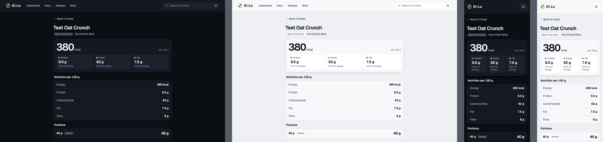

Open [detail-off-product.html](detail-off-product.html) in a browser, or read the source [web-food.detail-off-product.dc.html](../source/project/web-food.detail-off-product.dc.html).

### detail-own-food

Web food page, detail-own-food. 1280 dark, 1280 light, 375 dark, 375 light, from left to right.

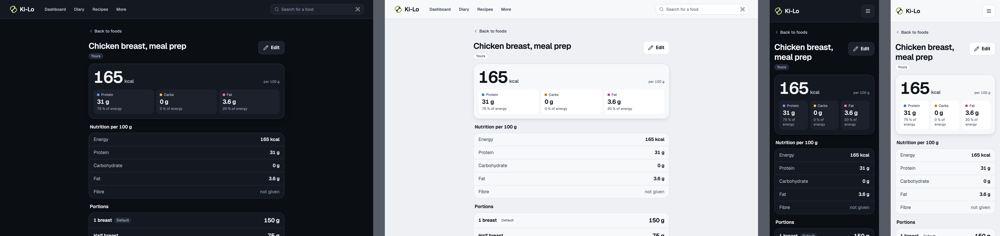

Open [detail-own-food.html](detail-own-food.html) in a browser, or read the source [web-food.detail-own-food.dc.html](../source/project/web-food.detail-own-food.dc.html).

### detail-missing-values-off

Web food page, detail-missing-values-off. 1280 dark, 1280 light, 375 dark, 375 light, from left to right.

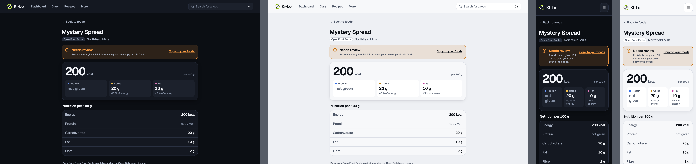

Open [detail-missing-values-off.html](detail-missing-values-off.html) in a browser, or read the source [web-food.detail-missing-values-off.dc.html](../source/project/web-food.detail-missing-values-off.dc.html).

### detail-missing-values-cofid

Web food page, detail-missing-values-cofid. 1280 dark, 1280 light, 375 dark, 375 light, from left to right.

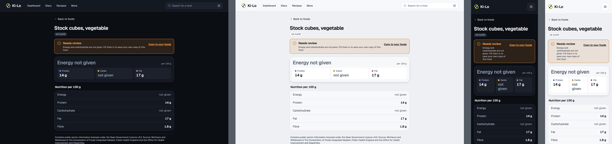

Open [detail-missing-values-cofid.html](detail-missing-values-cofid.html) in a browser, or read the source [web-food.detail-missing-values-cofid.dc.html](../source/project/web-food.detail-missing-values-cofid.dc.html).

### detail-missing-values-us-carbs

Web food page, detail-missing-values-us-carbs. 1280 dark, 1280 light, 375 dark, 375 light, from left to right.

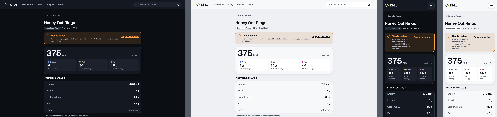

Open [detail-missing-values-us-carbs.html](detail-missing-values-us-carbs.html) in a browser, or read the source [web-food.detail-missing-values-us-carbs.dc.html](../source/project/web-food.detail-missing-values-us-carbs.dc.html).

### form-new-empty

Web food page, form-new-empty. 1280 dark, 1280 light, 375 dark, 375 light, from left to right.

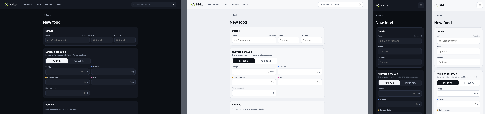

Open [form-new-empty.html](form-new-empty.html) in a browser, or read the source [web-food.form-new-empty.dc.html](../source/project/web-food.form-new-empty.dc.html).

### form-new-from-barcode

Web food page, form-new-from-barcode. 1280 dark, 1280 light, 375 dark, 375 light, from left to right.

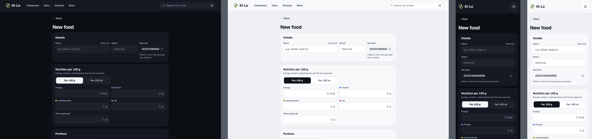

Open [form-new-from-barcode.html](form-new-from-barcode.html) in a browser, or read the source [web-food.form-new-from-barcode.dc.html](../source/project/web-food.form-new-from-barcode.dc.html).

### form-new-filled

Web food page, form-new-filled. 1280 dark, 1280 light, 375 dark, 375 light, from left to right.

Open [form-new-filled.html](form-new-filled.html) in a browser, or read the source [web-food.form-new-filled.dc.html](../source/project/web-food.form-new-filled.dc.html).

### form-validation-errors

Web food page, form-validation-errors. 1280 dark, 1280 light, 375 dark, 375 light, from left to right.

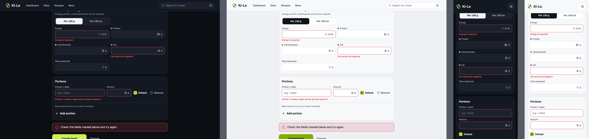

Open [form-validation-errors.html](form-validation-errors.html) in a browser, or read the source [web-food.form-validation-errors.dc.html](../source/project/web-food.form-validation-errors.dc.html).

### form-saving

Web food page, form-saving. 1280 dark, 1280 light, 375 dark, 375 light, from left to right.

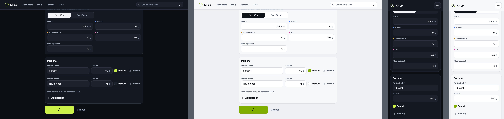

Open [form-saving.html](form-saving.html) in a browser, or read the source [web-food.form-saving.dc.html](../source/project/web-food.form-saving.dc.html).

### form-save-error

Web food page, form-save-error. 1280 dark, 1280 light, 375 dark, 375 light, from left to right.

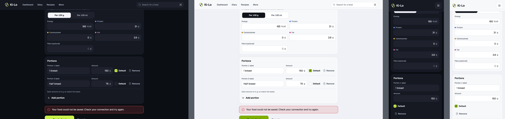

Open [form-save-error.html](form-save-error.html) in a browser, or read the source [web-food.form-save-error.dc.html](../source/project/web-food.form-save-error.dc.html).

### form-save-partial

Web food page, form-save-partial. 1280 dark, 1280 light, 375 dark, 375 light, from left to right.

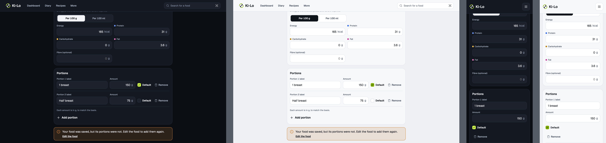

Open [form-save-partial.html](form-save-partial.html) in a browser, or read the source [web-food.form-save-partial.dc.html](../source/project/web-food.form-save-partial.dc.html).

### form-copy-off

Web food page, form-copy-off. 1280 dark, 1280 light, 375 dark, 375 light, from left to right.

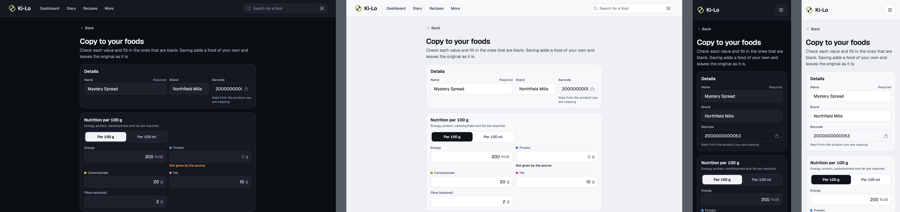

Open [form-copy-off.html](form-copy-off.html) in a browser, or read the source [web-food.form-copy-off.dc.html](../source/project/web-food.form-copy-off.dc.html).

### form-copy-us-carbs

Web food page, form-copy-us-carbs. 1280 dark, 1280 light, 375 dark, 375 light, from left to right.

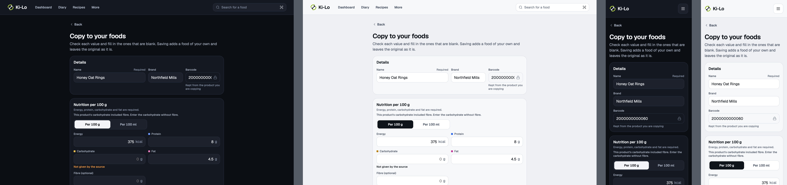

Open [form-copy-us-carbs.html](form-copy-us-carbs.html) in a browser, or read the source [web-food.form-copy-us-carbs.dc.html](../source/project/web-food.form-copy-us-carbs.dc.html).

### form-edit

Web food page, form-edit. 1280 dark, 1280 light, 375 dark, 375 light, from left to right.

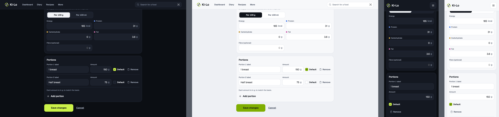

Open [form-edit.html](form-edit.html) in a browser, or read the source [web-food.form-edit.dc.html](../source/project/web-food.form-edit.dc.html).

### form-edit-shared

Web food page, form-edit-shared. 1280 dark, 1280 light, 375 dark, 375 light, from left to right.

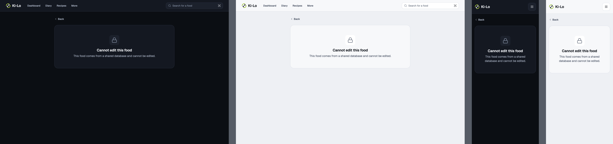

Open [form-edit-shared.html](form-edit-shared.html) in a browser, or read the source [web-food.form-edit-shared.dc.html](../source/project/web-food.form-edit-shared.dc.html).

<!-- design-export:boards:end -->

## Decisions

Where the sources disagree, the order is: Zee's rulings, then the Ki-Lo design system (`../design-system/`), then MacroFactor for layout and behaviour, then the briefs. Zee approved these boards on 2026-10-13. Anything that would visibly change a board goes back to Zee first.

- **These are the web counterparts of mobile food detail and the food form** (see `../food-detail/` and `../food-form/`). Detail is `/foods/<id>`. The form is `/foods/new`, `/foods/new?from=<id>` for a copy, and `/foods/<id>/edit`. Every state is drawn at 1280 and 375, dark and light.
- **Detail** has "Back to foods", the food name and brand, the source Badge, the nutrition table per 100 g or per 100 ml, the portions and the attribution on shared foods. Missing values read "not given", never 0.
- **Missing values use the "Needs review" Banner with the action "Copy to your foods".** The web page used to outline this block in the error colour, and the Banner replaces that. Warning, never danger, is the design's call.
- **Form buttons match mobile:** "Create food", "Save to your foods" and "Save changes".
- **Undrawn web states follow their mobile boards** (orchestrator confirmation, 2026-10-13). These are `form-new-per-100ml`, `form-copy-off-error`, `form-copy-cofid` and `detail-off-drink`.
- **Edit and copy loading, load error and not-found reuse the detail boards,** as on mobile.
- **Out of scope for M2:** logging, deleting foods, recipes, saturated fat, sugars, salt, micronutrients and density. Quantity entry, impact on targets and favourites are M3 proposals with no web boards.
