# web-foods

Web · Foods page · search, barcode lookup, your foods

<!-- design-export:boards:start -->
Generated by `tools/design-export`. Do not edit between the markers.

## Boards

### idle

Web foods, idle. 1280 dark, 1280 light, 375 dark, 375 light, from left to right.

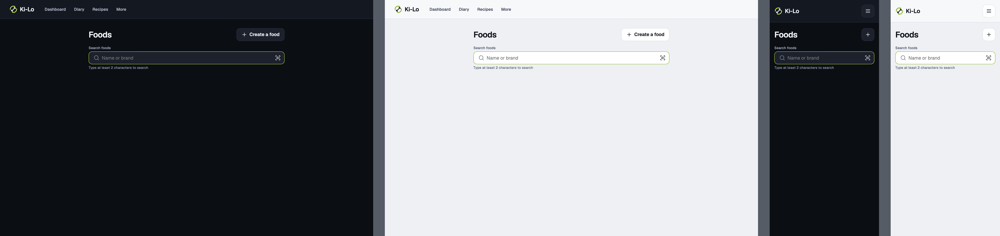

Open [idle.html](idle.html) in a browser, or read the source [web-foods.idle.dc.html](../source/project/web-foods.idle.dc.html).

### search-loading

Web foods, search-loading. 1280 dark, 1280 light, 375 dark, 375 light, from left to right.

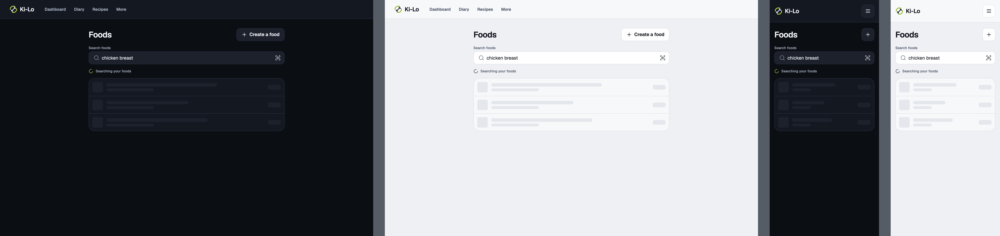

Open [search-loading.html](search-loading.html) in a browser, or read the source [web-foods.search-loading.dc.html](../source/project/web-foods.search-loading.dc.html).

### search-results-local

Web foods, search-results-local. 1280 dark, 1280 light, 375 dark, 375 light, from left to right.

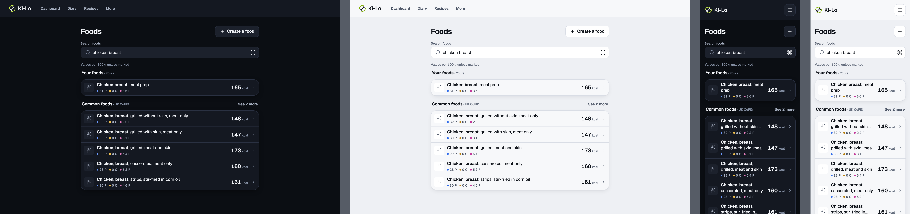

Open [search-results-local.html](search-results-local.html) in a browser, or read the source [web-foods.search-results-local.dc.html](../source/project/web-foods.search-results-local.dc.html).

### search-refining

Web foods, search-refining. 1280 dark, 1280 light, 375 dark, 375 light, from left to right.

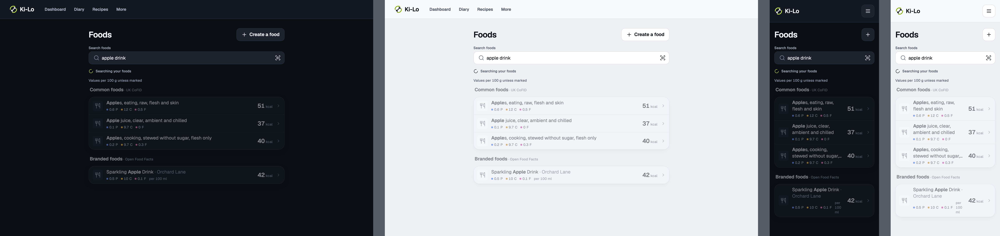

Open [search-refining.html](search-refining.html) in a browser, or read the source [web-foods.search-refining.dc.html](../source/project/web-foods.search-refining.dc.html).

### search-loading-off

Web foods, search-loading-off. 1280 dark, 1280 light, 375 dark, 375 light, from left to right.

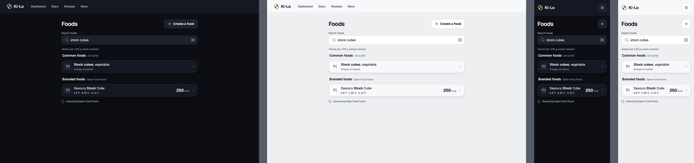

Open [search-loading-off.html](search-loading-off.html) in a browser, or read the source [web-foods.search-loading-off.dc.html](../source/project/web-foods.search-loading-off.dc.html).

### search-results-with-off

Web foods, search-results-with-off. 1280 dark, 1280 light, 375 dark, 375 light, from left to right.

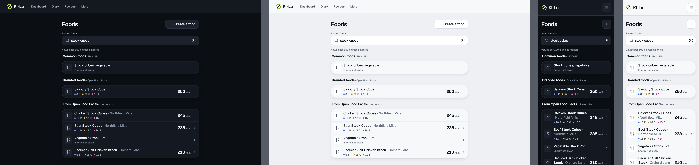

Open [search-results-with-off.html](search-results-with-off.html) in a browser, or read the source [web-foods.search-results-with-off.dc.html](../source/project/web-foods.search-results-with-off.dc.html).

### search-adding-product

Web foods, search-adding-product. 1280 dark, 1280 light, 375 dark, 375 light, from left to right.

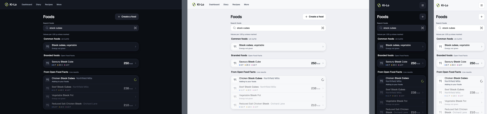

Open [search-adding-product.html](search-adding-product.html) in a browser, or read the source [web-foods.search-adding-product.dc.html](../source/project/web-foods.search-adding-product.dc.html).

### search-add-error

Web foods, search-add-error. 1280 dark, 1280 light, 375 dark, 375 light, from left to right.

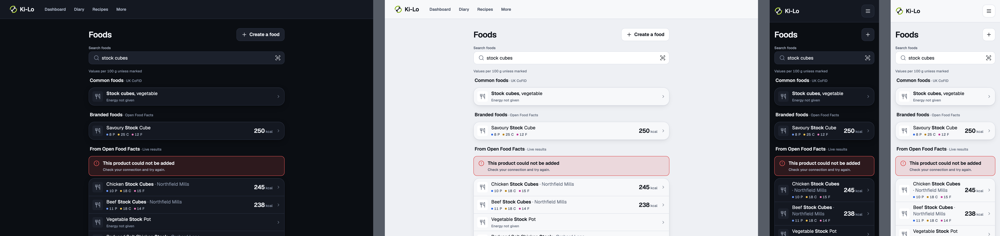

Open [search-add-error.html](search-add-error.html) in a browser, or read the source [web-foods.search-add-error.dc.html](../source/project/web-foods.search-add-error.dc.html).

### search-off-error

Web foods, search-off-error. 1280 dark, 1280 light, 375 dark, 375 light, from left to right.

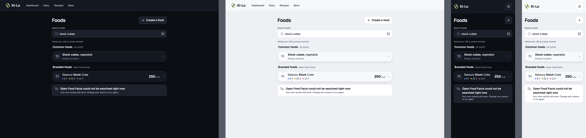

Open [search-off-error.html](search-off-error.html) in a browser, or read the source [web-foods.search-off-error.dc.html](../source/project/web-foods.search-off-error.dc.html).

### search-empty

Web foods, search-empty. 1280 dark, 1280 light, 375 dark, 375 light, from left to right.

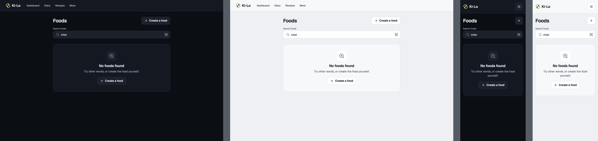

Open [search-empty.html](search-empty.html) in a browser, or read the source [web-foods.search-empty.dc.html](../source/project/web-foods.search-empty.dc.html).

### search-empty-off-error

Web foods, search-empty-off-error. 1280 dark, 1280 light, 375 dark, 375 light, from left to right.

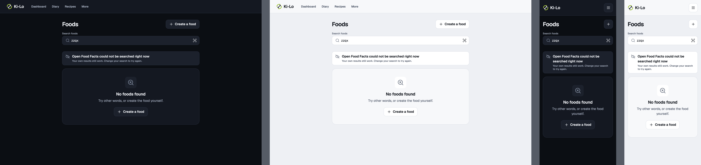

Open [search-empty-off-error.html](search-empty-off-error.html) in a browser, or read the source [web-foods.search-empty-off-error.dc.html](../source/project/web-foods.search-empty-off-error.dc.html).

### search-local-error

Web foods, search-local-error. 1280 dark, 1280 light, 375 dark, 375 light, from left to right.

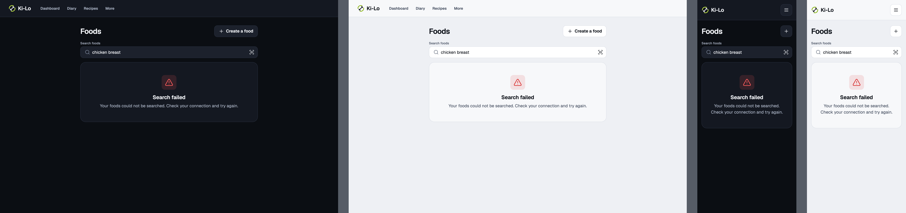

Open [search-local-error.html](search-local-error.html) in a browser, or read the source [web-foods.search-local-error.dc.html](../source/project/web-foods.search-local-error.dc.html).

### barcode-open

Web foods, barcode-open. 1280 dark, 1280 light, 375 dark, 375 light, from left to right.

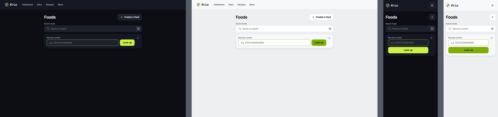

Open [barcode-open.html](barcode-open.html) in a browser, or read the source [web-foods.barcode-open.dc.html](../source/project/web-foods.barcode-open.dc.html).

### barcode-invalid

Web foods, barcode-invalid. 1280 dark, 1280 light, 375 dark, 375 light, from left to right.

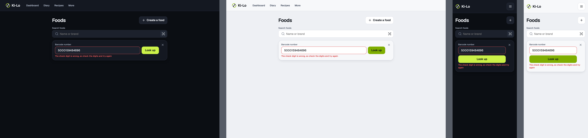

Open [barcode-invalid.html](barcode-invalid.html) in a browser, or read the source [web-foods.barcode-invalid.dc.html](../source/project/web-foods.barcode-invalid.dc.html).

### barcode-looking-up

Web foods, barcode-looking-up. 1280 dark, 1280 light, 375 dark, 375 light, from left to right.

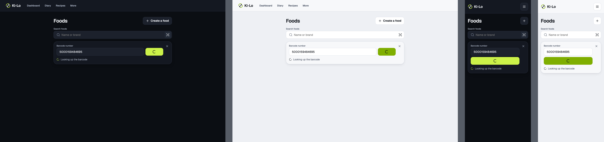

Open [barcode-looking-up.html](barcode-looking-up.html) in a browser, or read the source [web-foods.barcode-looking-up.dc.html](../source/project/web-foods.barcode-looking-up.dc.html).

### barcode-opening

Web foods, barcode-opening. 1280 dark, 1280 light, 375 dark, 375 light, from left to right.

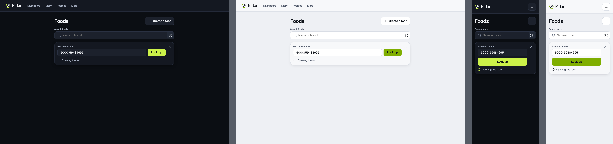

Open [barcode-opening.html](barcode-opening.html) in a browser, or read the source [web-foods.barcode-opening.dc.html](../source/project/web-foods.barcode-opening.dc.html).

### barcode-not-found

Web foods, barcode-not-found. 1280 dark, 1280 light, 375 dark, 375 light, from left to right.

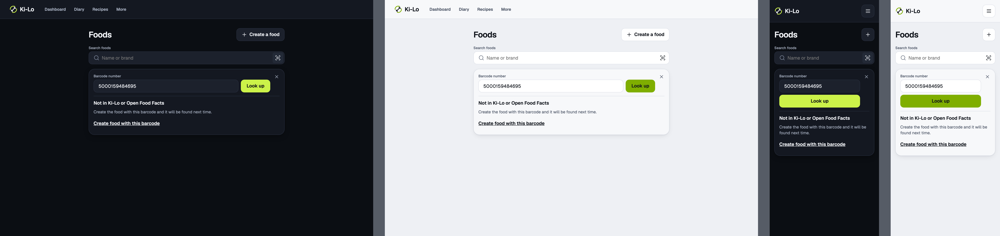

Open [barcode-not-found.html](barcode-not-found.html) in a browser, or read the source [web-foods.barcode-not-found.dc.html](../source/project/web-foods.barcode-not-found.dc.html).

### barcode-error

Web foods, barcode-error. 1280 dark, 1280 light, 375 dark, 375 light, from left to right.

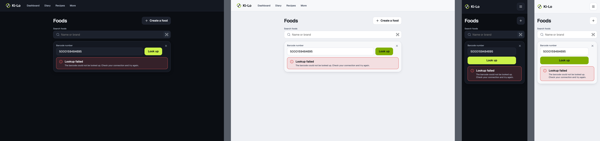

Open [barcode-error.html](barcode-error.html) in a browser, or read the source [web-foods.barcode-error.dc.html](../source/project/web-foods.barcode-error.dc.html).

### your-foods

Web foods, your-foods. 1280 dark, 1280 light, 375 dark, 375 light, from left to right.

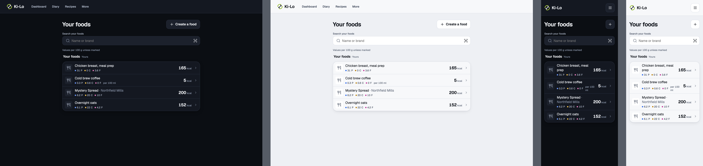

Open [your-foods.html](your-foods.html) in a browser, or read the source [web-foods.your-foods.dc.html](../source/project/web-foods.your-foods.dc.html).

### your-foods-empty

Web foods, your-foods-empty. 1280 dark, 1280 light, 375 dark, 375 light, from left to right.

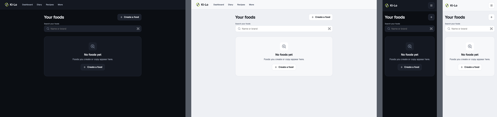

Open [your-foods-empty.html](your-foods-empty.html) in a browser, or read the source [web-foods.your-foods-empty.dc.html](../source/project/web-foods.your-foods-empty.dc.html).

<!-- design-export:boards:end -->

## Decisions

Where the sources disagree, the order is: Zee's rulings, then the Ki-Lo design system (`../design-system/`), then MacroFactor for layout and behaviour, then the briefs. Zee approved these boards on 2026-10-13. Anything that would visibly change a board goes back to Zee first.

- **The Foods page is a page at `/foods`, not an overlay (Q15).** It is reached from the top bar's "Search for a food" field or its barcode icon, which opens the page with the barcode panel open. This keeps the URL, the existing routes and the tests.
- **It adapts the mobile search sheet** (see `../food-search/`). Groups, row content, the "Values per 100 g unless marked" caption, the quiet Open Food Facts failure banner and the Your foods mode all follow the mobile boards. Every state is drawn at 1280 and 375, dark and light.
- **The barcode lookup is a typed panel behind the search field's icon,** since there is no camera on web. It has its own states (`barcode-open`, `barcode-invalid`, `barcode-looking-up`, `barcode-opening`, `barcode-not-found`, `barcode-error`).
- **Your foods mode (Zee, Q13 yes).** `your-foods` and `your-foods-empty` follow the mobile boards, selected by `scope=own`.
- **A local result opens `/foods/<id>`.** A live Open Food Facts result is saved first, then its page opens. "Create a food" opens `/foods/new`, and "Create food with this barcode" opens it with the barcode locked.
- **Out of scope for M2:** camera scanning on web, logging, filters and sorting. History in idle is an M3 proposal that the mobile board covers.
