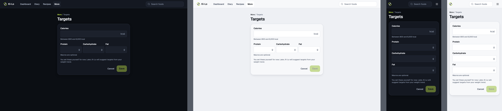
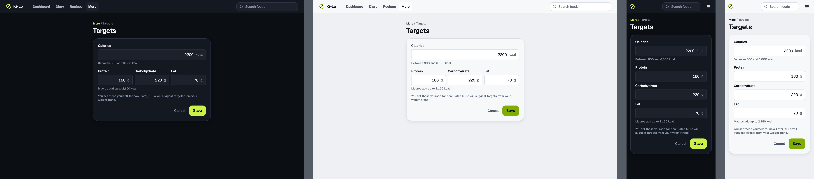
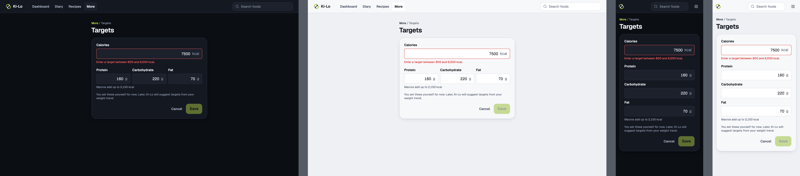
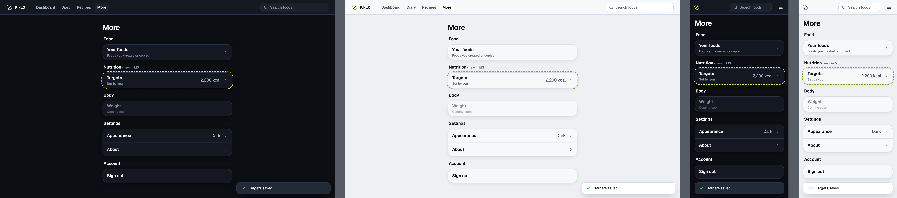

# web-targets

Web targets · 1280 and 375, dark and light

<!-- design-export:boards:start -->
Generated by `tools/design-export`. Do not edit between the markers.

## Boards

### empty

web-targets, empty. 1280 dark, 1280 light, 375 dark, 375 light, from left to right.

Open [empty.html](empty.html) in a browser, or read the source [web-targets.empty.dc.html](../source-m3/project/web-targets.empty.dc.html).

### filled

web-targets, filled. 1280 dark, 1280 light, 375 dark, 375 light, from left to right.

Open [filled.html](filled.html) in a browser, or read the source [web-targets.filled.dc.html](../source-m3/project/web-targets.filled.dc.html).

### error

web-targets, error. 1280 dark, 1280 light, 375 dark, 375 light, from left to right.

Open [error.html](error.html) in a browser, or read the source [web-targets.error.dc.html](../source-m3/project/web-targets.error.dc.html).

### saved

web-targets, saved. 1280 dark, 1280 light, 375 dark, 375 light, from left to right.

Open [saved.html](saved.html) in a browser, or read the source [web-targets.saved.dc.html](../source-m3/project/web-targets.saved.dc.html).

<!-- design-export:boards:end -->

## Decisions

Where the sources disagree, the order is: Zee's rulings, then the Ki-Lo design system (`../design-system/`), then MacroFactor for layout and behaviour, then the briefs. These boards are on the canvas "Ki-Lo M3 diary screens" and are **not yet approved by Zee** ([KEY-178](https://linear.app/sojisoft/issue/KEY-178)). Only items tagged Q1 to Q9 are Zee's rulings ([KEY-62](https://linear.app/sojisoft/issue/KEY-62), 2026-10-15). Everything else is brief or canvas content, and items marked as a recommendation are the orchestrator's, all awaiting Zee's approval on KEY-178.

- **The same rules as mobile targets,** on a separate page with a "More / Targets" breadcrumb, Cancel and Save. The board does not show the route, and `/more/targets` is the recommendation.
- `saved` shows `/more` with the new Nutrition section. Only the Nutrition section is new. The Appearance and About rows on `saved`, and the missing segmented control and email line, are canvas drift: build everything else from the approved `web.shell-more` (`../web/`).
