# web-weight

Web, the Weight page, the weigh-in dialog and the trend explainer ([KEY-825](https://linear.app/sojisoft/issue/KEY-825), part of [KEY-367](https://linear.app/sojisoft/issue/KEY-367)).

This README sits in `proposals/` and not in `docs/design/web-weight/`, because `check:boards` reports a top-level README of a folder that is not a canvas screen as extra, and that check is outside this ticket's lane. The `recipe-view` proposals do the same.

The canvas "Ki-Lo M5 screens" draws the phone only, so these boards are drawn by hand from its phone boards (`docs/canvas/m5-body-composition/`: `weight: chart and weigh-ins`, `weigh-in-entry: add and edit`, `trend-explainer`) and from the merged mobile screens. They are not exported from the canvas, so they live in `proposals/`, where `tools/design-export` does not look (the same way [KEY-798](https://linear.app/sojisoft/issue/KEY-798) added its boards). Each is a PNG at device pixel ratio 2 and a standalone HTML page that links `packages/tokens/css/kilo-tokens.css` by relative path, uses token references only (no raw hex) and opens from `file://`.

Every board shows four frames, left to right: 1280 dark, 1280 light, 375 dark, 375 light. Frames are 812 high, except where the page needs more at 375 (`page-chart` is 1340 and `page-settling` is 960, so the list shows). The frame chrome is the live web shell: the top bar with Dashboard, Diary and More (More current), and the search launcher. The board heading is the page title of each HTML file, `web-weight, <board>`.

Every word is from `packages/core/src/copy/weight.ts` (`WEIGHT_SCREEN`, `WEIGHT_ERROR`, `WEIGHT_EMPTY`, `WEIGHT_RANGE_LABELS`, `WEIGH_IN_SHEET`, `TREND_EXPLAINER`), with one new string, below. The numbers are the phone board's own mock series (17 Oct, 90 days, one left-out reading of 88.9 kg), so web and phone draw the same weeks.

## Boards

### page-chart

Board `web-weight, page-chart`. The Weight page with 90 days selected: a Back to More link, the title, the How the trend works icon button and Add weigh-in, the trend card (rate badge, numeral, line), the range control (1 week, 30 days, 90 days, 1 year), the chart with its legend, and the Weigh-ins list: manual rows (pencil), imported rows (heart, "Health Connect") and a row with the "Left out of trend" badge.

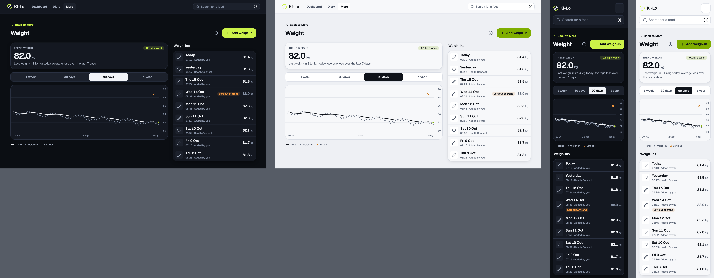

[page-chart.html](page-chart.html)

### page-settling

Board `web-weight, page-settling`. Fewer than 7 weigh-ins: the Settling badge replaces the rate, the line reads "Settles after 7 weigh-ins. 3 of 7 so far." and the trend is dashed.

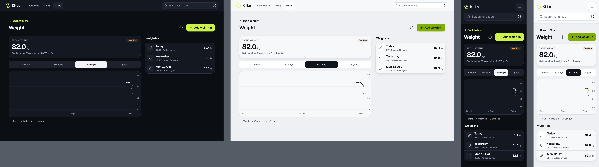

[page-settling.html](page-settling.html)

### page-empty

Board `web-weight, page-empty`. "No weigh-ins yet" with the web's own sentence and one action.

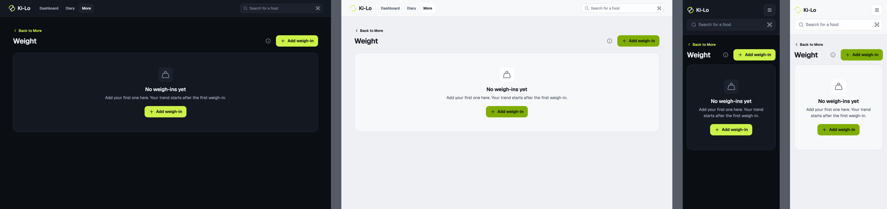

[page-empty.html](page-empty.html)

### page-loading

Board `web-weight, page-loading`. The region named "Loading your weigh-ins", with a shape for each part of the loaded page.

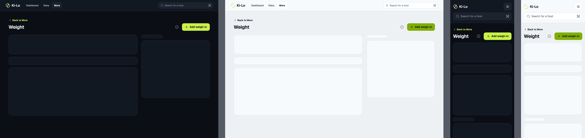

[page-loading.html](page-loading.html)

### page-error

Board `web-weight, page-error`. "Couldn't load your weigh-ins" with Try again.

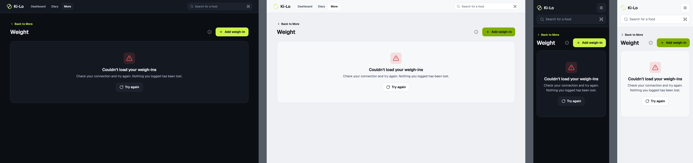

[page-error.html](page-error.html)

### entry-add

Board `web-weight, entry-add`. Add weigh-in as a `Dialog` over the dimmed page, in the phone's `new` state: an empty Weight field showing the "0.0" placeholder with its help line, Date and Time set to now, an empty Note, Cancel, and Save disabled until a weight is typed. Nothing is prefilled.

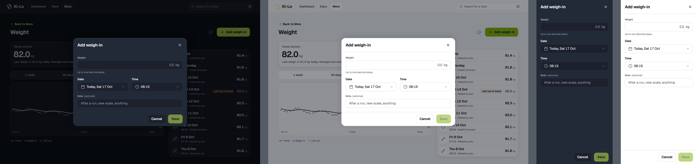

[entry-add.html](entry-add.html)

### entry-edit

Board `web-weight, entry-edit`. A manual weigh-in. The title is "Weigh-in", the fields are filled, and Delete weigh-in sits at the left of the footer.

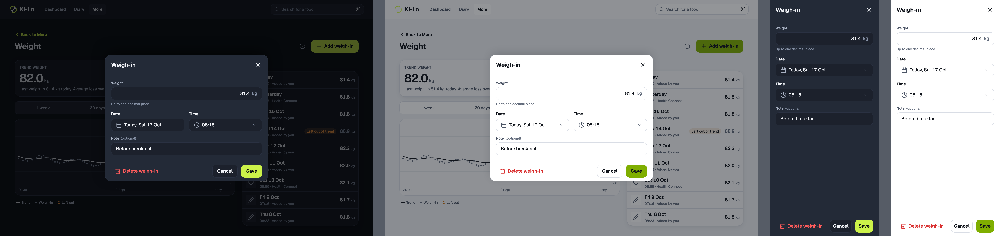

[entry-edit.html](entry-edit.html)

### entry-imported

Board `web-weight, entry-imported`. An imported reading is read only: the notice, the dimmed weight, date, time and note, the deletion warning, Delete weigh-in and Cancel. There is no Save.

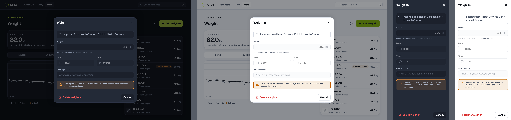

[entry-imported.html](entry-imported.html)

### entry-save-error

Board `web-weight, entry-save-error`. The save failed: an error banner under the note, what was typed is kept.

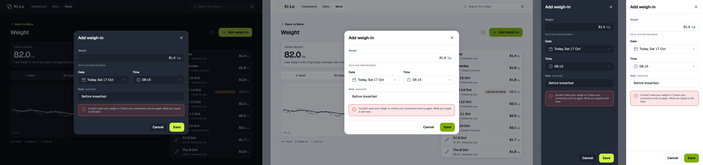

[entry-save-error.html](entry-save-error.html)

### explainer-default

Board `web-weight, explainer-default`. How your trend works as a `Dialog`: five sections, the estimate line, Done.

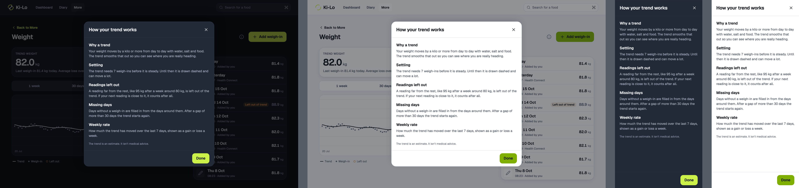

[explainer-default.html](explainer-default.html)

### explainer-settling

Board `web-weight, explainer-settling`. The same dialog with the settling banner and its progress bar ("Your trend is settling: 3 of 7 weigh-ins") over the sections.

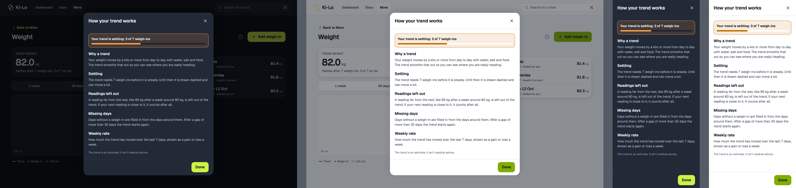

[explainer-settling.html](explainer-settling.html)

## States not drawn

The phone's `invalid` and `saving` states of the weigh-in sheet have no board. They build from the kit. `invalid` is the weight field's `error` prop on `NumericInput`, with the sentence from `describeWeightProblem` ("Enter a weight between 20 and 400 kg." for a weight out of range). `saving` is the Save button in its loading state with the label `WEIGH_IN_SHEET.saving` ("Saving"), disabled while it runs.

## Left out on purpose (phone only)

The web adds weigh-ins by hand, so there are no `importing` or `not-connected` states, no Connect Health Connect, no pull to refresh and no Health access screen. There is no Weight / Composition switch, no Body composition section ([KEY-655](https://linear.app/sojisoft/issue/KEY-655) stays mobile for now) and so no sixth "Body fat and lean mass" section in the explainer (`TREND_EXPLAINER.sections` has five, and `TREND_EXPLAINER_BODY_SECTION` is not used). Imported rows still show in the list, read only, because a phone's readings are in the same list.

## Decisions for Zee to check after merge

Each is reversible.

1. **Two columns at 1280** (Zee away, recommended). The trend card, range control, chart and legend on the left, the Weigh-ins list on the right (400 wide), in the Train page's `max-w-[1180px]` frame. At 375 it is one column in the phone's order.
2. **The web's own empty sentence** (Zee away, recommended). `WEIGHT_EMPTY.body` talks about Health Connect, which the web cannot connect. The web says "Add your first one here. Your trend starts after the first weigh-in." This is the only new string, added by the page ticket as `WEIGHT_EMPTY.bodyWeb`.
3. **The dialog is the kit `Dialog`**, not a copy of the phone sheet: the 560 wide panel with the close button in its header, and a full screen panel at 375. Cancel and Save sit in the footer, and Delete weigh-in is its `leadingAction`.
4. **The weight field is the kit `NumericInput`** (44 high, digits right aligned, "kg" after), not the phone's 64 high, 32 point field. The phone's size comes from the sheet, and the kit field keeps the dialog like the other web forms.
5. **Date and Time sit side by side** at 1280 and stack at 375. Time is the kit `TimeField`. Date is a new `DateField`, the same box with a calendar icon that opens the existing `DatePicker`, no days after today (the ruling: no future dates). An imported reading shows "Today" and its time, dimmed.
6. **The imported dialog dims the note too**, as the phone sheet does (`disabled` when imported), since there is nothing to save.
7. **The page header stays in every state**, and both Add weigh-in buttons stay in the empty state (the header and the empty state), which matches the phone.
8. **The "Left out of trend" badge** sits beside the value at 1280 and under the time at 375, where the row is too narrow for both.
9. **The explainer is a `Dialog` that scrolls** if its content is taller than the window. At 812 high it fits with the settling banner.
10. **The frame chrome follows the merged app**, so the nav is Dashboard, Diary and More, not the older `web/shell-more` board, which still lists Recipes.

## Build notes

For the build tickets ([KEY-826](https://linear.app/sojisoft/issue/KEY-826), [KEY-827](https://linear.app/sojisoft/issue/KEY-827), [KEY-829](https://linear.app/sojisoft/issue/KEY-829), [KEY-830](https://linear.app/sojisoft/issue/KEY-830)). Reuse: `GroupedList`, `ListRow`, `SegmentedControl`, `Card`, `Badge`, `Banner`, `EmptyState`, `ErrorState`, `Skeleton`, `Dialog`, `NumericInput`, `Input`, `TimeField`, `DatePicker`, `IconButton`, `Button`, `BackToFoodsLink`. Extend: `ListRow` needs an opt-in badge, a `kg` unit after the value and a stronger value style (the mobile `ListRow` has `badge`, `unit` and `valueTone`). New: `DateField` and the chart (an inline SVG, no chart library, [KEY-829](https://linear.app/sojisoft/issue/KEY-829)). The chart uses `--chart-grid`, `--chart-point`, `--chart-trend` and `--chart-marker`, and `--warning` for left-out points. The `TimeField` label is 14 point and the `Input` label is 12 point in the kit today, so the dialog shows both as the kit draws them.

The chart's y axis is derived from the data, not fixed. `buildAxis` in `packages/core/src/weight/prepareWeightChart.ts` takes the readings, the left-out readings and the trend points, and runs from floor(min - 0.5) to ceil(max + 0.5), with a tick every 1 kg, or every 2 kg when the span is over 6. The 80 to 90 axis on `page-chart` is only that rule applied to the mock series with its 88.9 kg left-out reading. `prepareWeightChart` lived in `apps/mobile` and [KEY-829](https://linear.app/sojisoft/issue/KEY-829) moved it to `@keylow/core`, so the web chart reuses it and does not copy it.
