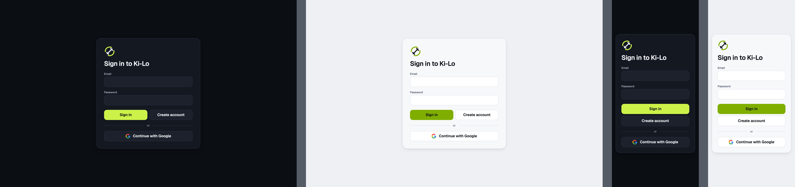
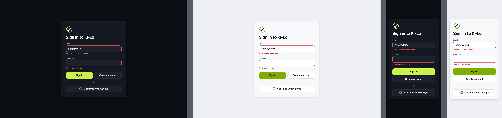
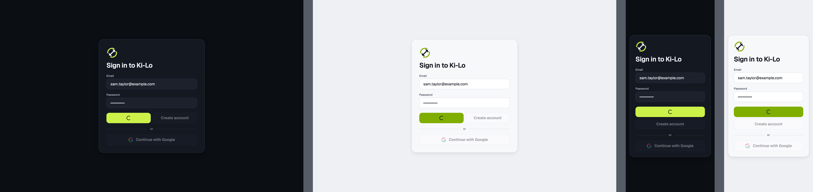
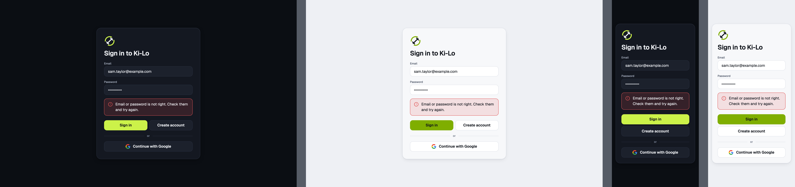
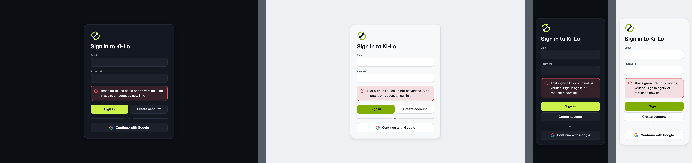
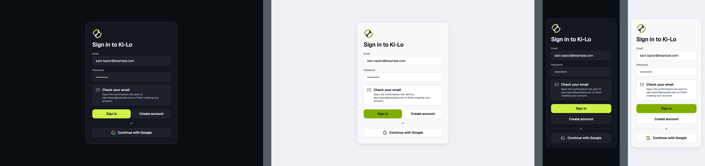
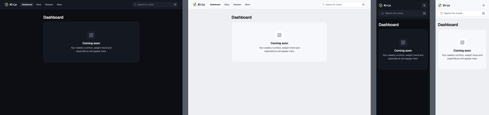
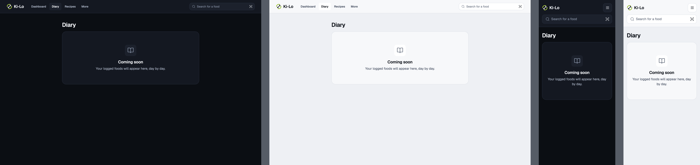
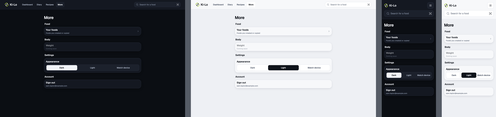
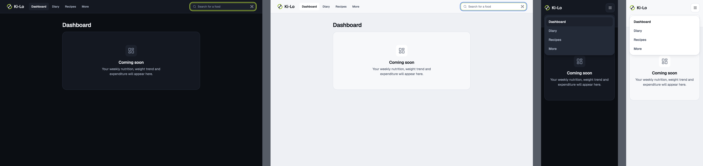

# web

Web · login and app shell · Dashboard, Diary, Recipes, More

<!-- design-export:boards:start -->
Generated by `tools/design-export`. Do not edit between the markers.

## Boards

### login-default

Web, login-default. 1280 dark, 1280 light, 375 dark, 375 light, from left to right.

Open [login-default.html](login-default.html) in a browser, or read the source [web.login-default.dc.html](../source/project/web.login-default.dc.html).

### login-field-errors

Web, login-field-errors. 1280 dark, 1280 light, 375 dark, 375 light, from left to right.

Open [login-field-errors.html](login-field-errors.html) in a browser, or read the source [web.login-field-errors.dc.html](../source/project/web.login-field-errors.dc.html).

### login-pending

Web, login-pending. 1280 dark, 1280 light, 375 dark, 375 light, from left to right.

Open [login-pending.html](login-pending.html) in a browser, or read the source [web.login-pending.dc.html](../source/project/web.login-pending.dc.html).

### login-server-error

Web, login-server-error. 1280 dark, 1280 light, 375 dark, 375 light, from left to right.

Open [login-server-error.html](login-server-error.html) in a browser, or read the source [web.login-server-error.dc.html](../source/project/web.login-server-error.dc.html).

### login-link-error

Web, login-link-error. 1280 dark, 1280 light, 375 dark, 375 light, from left to right.

Open [login-link-error.html](login-link-error.html) in a browser, or read the source [web.login-link-error.dc.html](../source/project/web.login-link-error.dc.html).

### login-check-email

Web, login-check-email. 1280 dark, 1280 light, 375 dark, 375 light, from left to right.

Open [login-check-email.html](login-check-email.html) in a browser, or read the source [web.login-check-email.dc.html](../source/project/web.login-check-email.dc.html).

### shell-dashboard

Web, shell-dashboard. 1280 dark, 1280 light, 375 dark, 375 light, from left to right.

Open [shell-dashboard.html](shell-dashboard.html) in a browser, or read the source [web.shell-dashboard.dc.html](../source/project/web.shell-dashboard.dc.html).

### shell-diary

Web, shell-diary. 1280 dark, 1280 light, 375 dark, 375 light, from left to right.

Open [shell-diary.html](shell-diary.html) in a browser, or read the source [web.shell-diary.dc.html](../source/project/web.shell-diary.dc.html).

### shell-more

Web, shell-more. 1280 dark, 1280 light, 375 dark, 375 light, from left to right.

Open [shell-more.html](shell-more.html) in a browser, or read the source [web.shell-more.dc.html](../source/project/web.shell-more.dc.html).

### shell-menu-open

Web, shell-menu-open. 1280 dark, 1280 light, 375 dark, 375 light, from left to right.

Open [shell-menu-open.html](shell-menu-open.html) in a browser, or read the source [web.shell-menu-open.dc.html](../source/project/web.shell-menu-open.dc.html).

<!-- design-export:boards:end -->

## Decisions

Where the sources disagree, the order is: Zee's rulings, then the Ki-Lo design system (`../design-system/`), then MacroFactor for layout and behaviour, then the briefs. Zee approved these boards on 2026-10-13. Anything that would visibly change a board goes back to Zee first.

- **The web shell is a top bar,** adapted from the mobile shell because MacroFactor has no web app. It carries the Ki-Lo mark, the sections Dashboard, Diary, Recipes and More, and a "Search for a food" field that goes to the Foods page. Every state is drawn at 1280 and 375, dark and light. At 375 the sections move into the menu (`shell-menu-open`).
- **Recipes leaves the top bar for More (Zee, 2026-10-29).** "The recipes shouldn't be a tab anymore. Make it an option in nutrition in the more tab." The sections are Dashboard, Diary and More. More's Nutrition section has a Recipes row after Targets that opens the library, which keeps its `/recipes` address and gains a link back to More above its title. More is the current section on every `/recipes` page. This supersedes the Recipes section in the bullet above and on the boards.
- **Sign out moves into More,** off the top bar.
- **Web Recipes is the same "Coming soon" placeholder as Dashboard and Diary,** with the ChefHat icon and the body "Your recipes will appear here." (orchestrator confirmation, 2026-10-13).
- **The old `/settings` and `/weight` routes go.** They redirect to `/more`, so old links still land.
- **The home page `/` is not a screen.** It redirects to the Dashboard when signed in and to `/login` when not (Q10).
- **Login is one centred Card** with the Ki-Lo mark, "Sign in to Ki-Lo", Email and Password, a message line and two buttons, "Sign in" and "Create account", which submit the same form. The drawn Google button has no "G". The build adds the official one (Q17, answered yes).
- **Errors never show the raw message.** Each kind maps to one fixed sentence from `packages/core` copy.
- **The slug is `web`** (orchestrator confirmation), so the files are `web/<state>.png` and `web/<state>.html`.
- **Out of scope for M2:** forgotten password, account settings and real Dashboard, Diary and Recipes pages.
