# web

Web · login and app shell · Dashboard, Diary, Recipes, More

<!-- design-export:boards:start -->
Generated by `tools/design-export`. Do not edit between the markers.

## Boards

### login-default

Web, login-default. 1280 dark, 1280 light, 375 dark, 375 light, from left to right.

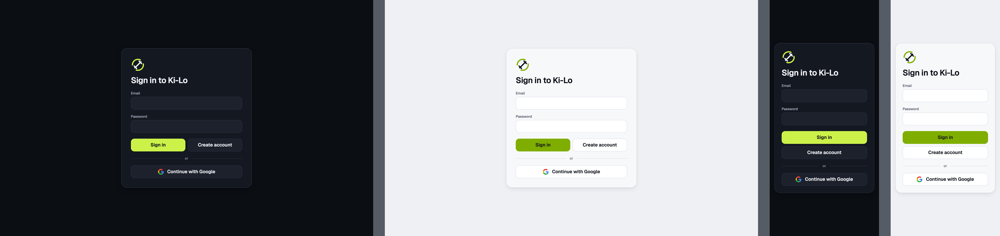

Open [login-default.html](login-default.html) in a browser, or read the source [web.login-default.dc.html](../source/project/web.login-default.dc.html).

### login-field-errors

Web, login-field-errors. 1280 dark, 1280 light, 375 dark, 375 light, from left to right.

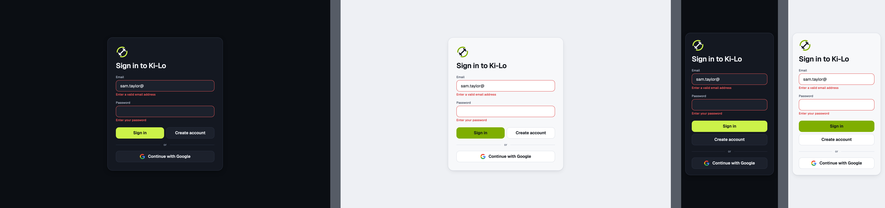

Open [login-field-errors.html](login-field-errors.html) in a browser, or read the source [web.login-field-errors.dc.html](../source/project/web.login-field-errors.dc.html).

### login-pending

Web, login-pending. 1280 dark, 1280 light, 375 dark, 375 light, from left to right.

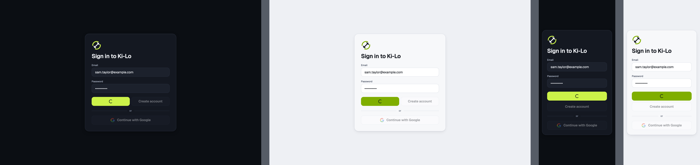

Open [login-pending.html](login-pending.html) in a browser, or read the source [web.login-pending.dc.html](../source/project/web.login-pending.dc.html).

### login-server-error

Web, login-server-error. 1280 dark, 1280 light, 375 dark, 375 light, from left to right.

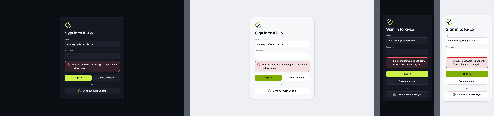

Open [login-server-error.html](login-server-error.html) in a browser, or read the source [web.login-server-error.dc.html](../source/project/web.login-server-error.dc.html).

### login-link-error

Web, login-link-error. 1280 dark, 1280 light, 375 dark, 375 light, from left to right.

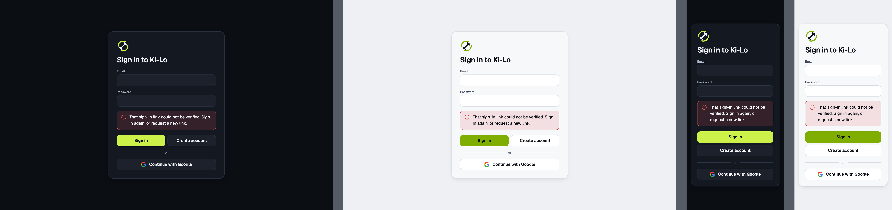

Open [login-link-error.html](login-link-error.html) in a browser, or read the source [web.login-link-error.dc.html](../source/project/web.login-link-error.dc.html).

### login-check-email

Web, login-check-email. 1280 dark, 1280 light, 375 dark, 375 light, from left to right.

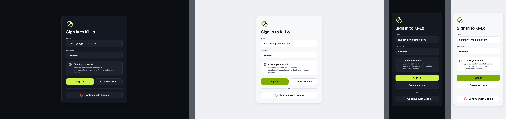

Open [login-check-email.html](login-check-email.html) in a browser, or read the source [web.login-check-email.dc.html](../source/project/web.login-check-email.dc.html).

### shell-dashboard

Web, shell-dashboard. 1280 dark, 1280 light, 375 dark, 375 light, from left to right.

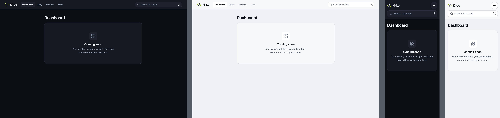

Open [shell-dashboard.html](shell-dashboard.html) in a browser, or read the source [web.shell-dashboard.dc.html](../source/project/web.shell-dashboard.dc.html).

### shell-diary

Web, shell-diary. 1280 dark, 1280 light, 375 dark, 375 light, from left to right.

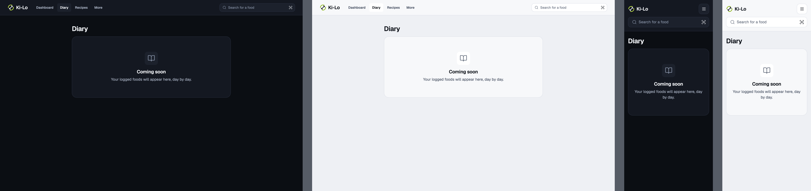

Open [shell-diary.html](shell-diary.html) in a browser, or read the source [web.shell-diary.dc.html](../source/project/web.shell-diary.dc.html).

### shell-more

Web, shell-more. 1280 dark, 1280 light, 375 dark, 375 light, from left to right.

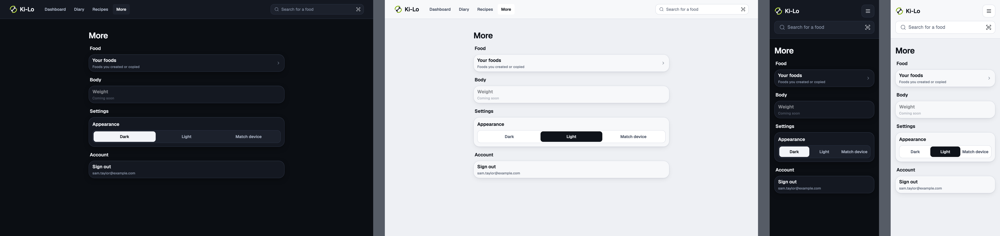

Open [shell-more.html](shell-more.html) in a browser, or read the source [web.shell-more.dc.html](../source/project/web.shell-more.dc.html).

### shell-menu-open

Web, shell-menu-open. 1280 dark, 1280 light, 375 dark, 375 light, from left to right.

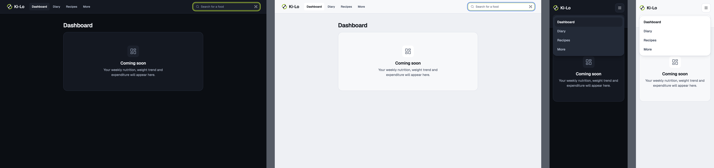

Open [shell-menu-open.html](shell-menu-open.html) in a browser, or read the source [web.shell-menu-open.dc.html](../source/project/web.shell-menu-open.dc.html).

<!-- design-export:boards:end -->

## Decisions

Where the sources disagree, the order is: Zee's rulings, then the Ki-Lo design system (`../design-system/`), then MacroFactor for layout and behaviour, then the briefs. Zee approved these boards on 2026-10-13. Anything that would visibly change a board goes back to Zee first.

- **The web shell is a top bar,** adapted from the mobile shell because MacroFactor has no web app. It carries the Ki-Lo mark, the sections Dashboard, Diary, Recipes and More, and a "Search for a food" field that goes to the Foods page. Every state is drawn at 1280 and 375, dark and light. At 375 the sections move into the menu (`shell-menu-open`).
- **Recipes leaves the top bar for More (Zee, 2026-10-29).** "The recipes shouldn't be a tab anymore. Make it an option in nutrition in the more tab." The sections are Dashboard, Diary and More. More's Nutrition section has a Recipes row after Targets that opens the library, which keeps its `/recipes` address and gains a link back to More above its title. More is the current section on every `/recipes` page. This supersedes the Recipes section in the bullet above and on the boards.
- **Sign out moves into More,** off the top bar.
- **Web Recipes is the same "Coming soon" placeholder as Dashboard and Diary,** with the ChefHat icon and the body "Your recipes will appear here." (orchestrator confirmation, 2026-10-13).
- **The old `/settings` and `/weight` routes go.** They redirect to `/more`, so old links still land.
- **The home page `/` is not a screen.** It redirects to the Dashboard when signed in and to `/login` when not (Q10).
- **Login is one centred Card** with the Ki-Lo mark, "Sign in to Ki-Lo", Email and Password, a message line and two buttons, "Sign in" and "Create account", which submit the same form. The drawn Google button has no "G". The build adds the official one (Q17, answered yes).
- **Errors never show the raw message.** Each kind maps to one fixed sentence from `packages/core` copy.
- **The slug is `web`** (orchestrator confirmation), so the files are `web/<state>.png` and `web/<state>.html`.
- **Out of scope for M2:** forgotten password, account settings and real Dashboard, Diary and Recipes pages.

## 3D body proposal

Boards for the web 3D body ([KEY-831](https://linear.app/sojisoft/issue/KEY-831), part of [KEY-565](https://linear.app/sojisoft/issue/KEY-565)). The design gate was met by these boards, drawn by hand from the mobile boards `body · 3d`, `body · 3d-loading` and `tab-shell.more · body-map-setting`, in the way [KEY-798](https://linear.app/sojisoft/issue/KEY-798) added its boards. Zee reviews them after merge. They are not on the canvas, so they sit in `proposals/`, where `tools/design-export` does not look. Each is a PNG at device pixel ratio 2 and a standalone page that opens from `file://`. The frames are 1280 dark, 1280 light, 375 dark and 375 light, from left to right. The pages link `packages/tokens` by relative path and use no raw hex. The 3D images are the committed renders in `tools/body-model/renders/muscles/`, linked by relative path.

### body-3d

The body map card of `web-body · actual-heat` with one body on a dark stage where the 2D page has two figures. The stage is dark in both themes, and the light frames carry the board's line "Drawn on a dark stage in both themes." Under the stage are the Front / Back control and the zoom buttons, then the hint, then the day row. The Show projected button and the side by side button keep their place at the top of the card (under the figures on a phone, as on the 2D page).

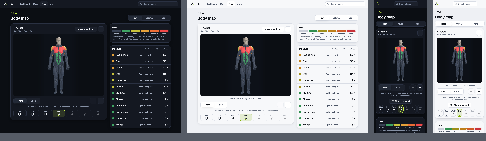

Open [proposals/body-3d.html](proposals/body-3d.html).

### body-3d-zoomed

The same card zoomed to 2× on the torso, turned three-quarters. The zoom pill (2×) and Reset sit at the top right of the stage, as on mobile. Zoom out is off at the whole body and on here.

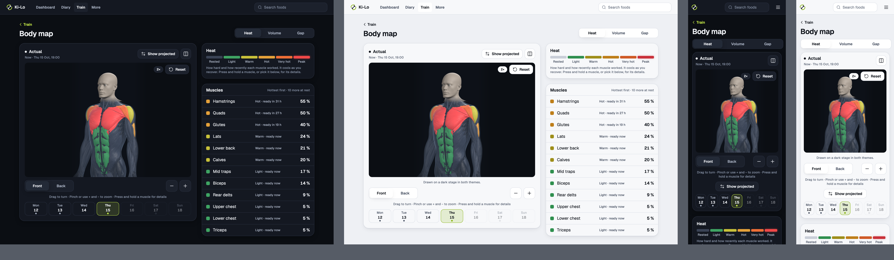

Open [proposals/body-3d-zoomed.html](proposals/body-3d-zoomed.html).

### body-3d-loading

The 2D front figure in the place of the stage, with "Loading 3D…" at its bottom right corner and the zoom buttons off. The stage is clear and in the page's theme while 3D loads, as on mobile, and it darkens when the body has drawn. The 2D figure shows at once and fades to 3D when it is ready. If 3D cannot load, the 2D figure stays and the label goes. While it loads, the figure's name ends "3D is loading." and the label is a status.

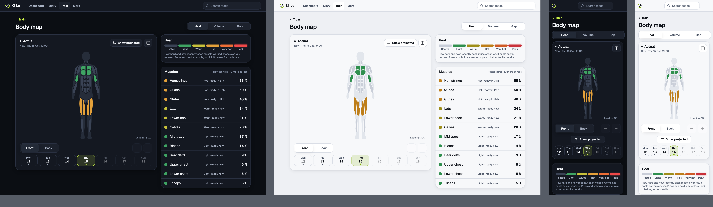

Open [proposals/body-3d-loading.html](proposals/body-3d-loading.html).

### more-body-map-setting

The More page with the Body map row (2D, 3D) in the Settings group, between Appearance and About. The dark frames show 2D chosen, the default, and the light frames show 3D chosen, as the mobile board shows the two choices. The row is built like Appearance: a label over a segmented control.

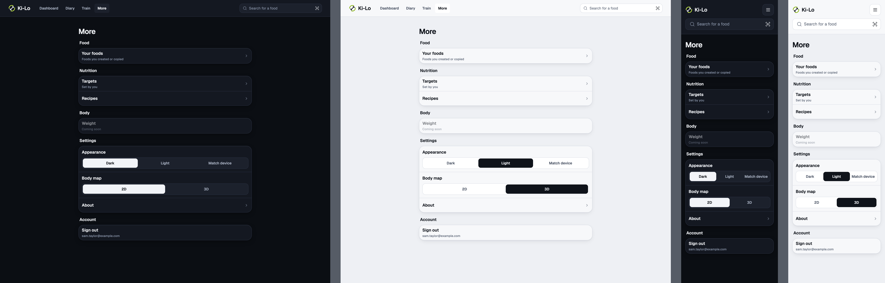

Open [proposals/more-body-map-setting.html](proposals/more-body-map-setting.html).

### more-body-map-setting-female

The same page for a female figure: 3D is chosen and the caption `MORE_SCREEN.settings.bodyMap.femaleNote` sits under the control ("3D draws the male body for now. Your figure is female, so the body map stays 2D."). The control keeps the choice, and the body map page stays 2D.

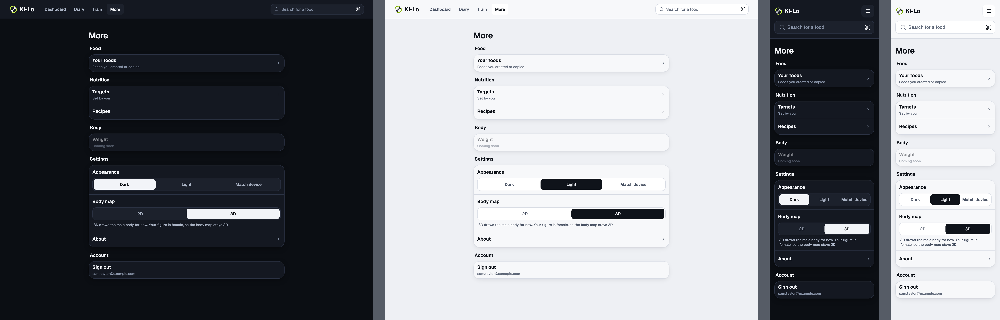

Open [proposals/more-body-map-setting-female.html](proposals/more-body-map-setting-female.html).

### Decisions for Zee to check after merge

These are recommendations made while Zee was away, and each can be reversed.

- **Zoom on web.** A pinch on touch, and the same on a trackpad (the browser reports the trackpad's pinch as a wheel event with `ctrlKey`). A mouse and the keyboard use the minus and plus buttons. A plain mouse wheel scrolls the page, so the page never traps a scroll.
- **The hint.** "Drag to turn · Pinch or use + and − to zoom · Press and hold a muscle for details", a new string `BODY_MAP.rotateHintWeb`. Mobile's `rotateHint` says long-press and stays as it is.
- **3D only on the body map page.** The dashboard and Train cards, the priorities summary and the "Muscles it works" dialog ([KEY-765](https://linear.app/sojisoft/issue/KEY-765)) stay 2D on web. Side by side stays 2D, as on mobile until [KEY-564](https://linear.app/sojisoft/issue/KEY-564).
- **Where the controls sit.** Front / Back on the left and the two zoom buttons on the right, in one row under the stage, so nothing sits over the body. The buttons are 44 pixels square. Zoom out is off at the whole body.
- **New strings the build needs, four in all, in `packages/core/src/copy/bodyMap.ts`.** `BODY_MAP.rotateHintWeb` ("Drag to turn · Pinch or use + and − to zoom · Press and hold a muscle for details"), and `BODY_MAP.zoom.in` ("Zoom in"), `BODY_MAP.zoom.out` ("Zoom out") and `BODY_MAP.zoom.groupName` ("Zoom"), beside the existing `zoom.reset` and `zoom.resetName`. The Front / Back group is named by `BODY_MAP.sideSwitch.name` ("Side shown"), where the mobile board's markup says "Snap to".
- **The stage colour.** The stage is the dark theme's `--background` in both themes. In the app `packages/tokens/css/kilo-tokens.css` defines dark on `:root` and light under `[data-theme="light"]`, and `apps/web/app/layout.tsx` sets `data-theme` on `<html>`, so `var(--background)` is light in a light page and the stage would turn light. The build adds a stage token to `packages/tokens` (`--stage-background`, carrying the dark theme's value in both themes) through the generator `packages/tokens/scripts/generate.ts`. A dark scope around the stage is not the way, because the zoom pill, the buttons and the hint over and under it must keep the page's tokens. The boards' own `--stage-background` is a board-only workaround: each page declares it once on `:root`, where it resolves in dark, and inherits it unchanged. The renders' own backdrop is not exactly `--background`, so the boards feather it into the stage at its two sides.
- **The top bar and the More page are drawn as main has them.** Every board has the live top bar: Dashboard, Diary, Train and More. Train is current on the body map frames and More on the More frames. The More boards start from `shell-more`, with Recipes out of the top bar (ruling of 2026-10-29) and Train in it, the Nutrition section (Targets, Recipes) and the About row added, so the Body map row sits in the page as it is today. The Weight row is still "Coming soon" there.
- **The body map boards keep the scale switch, day row, legend and muscle list of `web-body · actual-heat`.** Only the figures inside the card change.
- **Segmented controls.** Front / Back follows the card's own Scale switch on the canvas board (a 44 pixel track with 36 pixel segments), and the More row follows Appearance on `shell-more`. The two looks differ on the existing boards and are left as drawn.

## Dashboard body map proposal

Boards for the dashboard training card in Weekly volume and the More row that chooses it ([KEY-773](https://linear.app/sojisoft/issue/KEY-773), the web twin of [KEY-772](https://linear.app/sojisoft/issue/KEY-772)). The design gate was met by these boards, drawn by hand from the approved phone boards `dashboard · training-card-volume`, `dashboard · training-card-volume-empty` and `tab-shell.more · dashboard-chart-setting` (canvas version 74, approved on 2026-11-02) and from the built web card. They are drawn by hand and not exported, and Zee has not reviewed them yet: he reviews them after merge. They are not on the canvas, so they sit in `proposals/`, where `tools/design-export` does not look. Each is a PNG at device pixel ratio 2 and a standalone page that opens from `file://`, with no script. The frames are 1280 dark, 1280 light, 375 dark and 375 light, from left to right. The pages link `packages/tokens` by relative path and use no raw hex. Every word is from `packages/core/src/copy/` (`BODY_MAP.dashboardCard`, `describeDashboardVolumeCard`, `MORE_SCREEN.settings.dashboardBodyChart`), and the figures are the male artwork of `BODY_ARTWORK` filled from the Volume scale, with the same muscle values as the phone board (8 of 22 muscles at Growing or above).

### shell-dashboard-volume

The Dashboard with the training card in Weekly volume, where `DashboardScreen` puts it: in the second column under the This week card at 1280, and last in the stack at 375. The bar is the one the app has now (Dashboard, Diary, Train, More). The other cards are one labelled skeleton block each, as the phone board draws them. The card keeps the built web card's structure: the "Training" caption with its dumbbell, the "Actual · this week" line, the "Body map" label with its chevron, front and back at 100 pixels on the Volume scale, the High to None strip, and under a hairline "8 of 22 muscles at Growing or above" and "Today: Legs". The whole card is one link to the body map on Volume, named "Body map, weekly volume, Actual this week, Monday to Sunday. 8 of 22 muscles at Growing or above. Today: Legs, 16 sets planned. Open the body map on Volume".

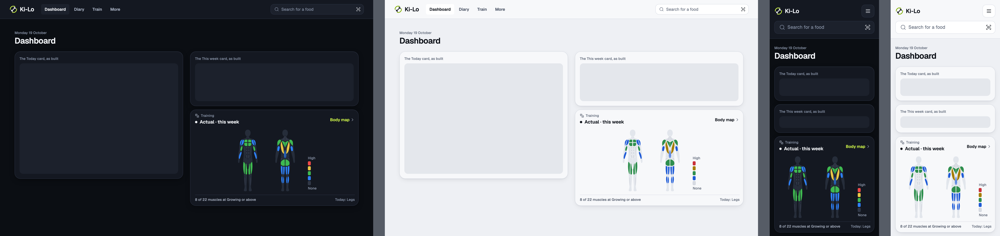

Open [proposals/shell-dashboard-volume.html](proposals/shell-dashboard-volume.html).

### shell-dashboard-volume-empty

The same card on a Monday before the first set: every muscle is Not trained and the summary says "No sets yet this week". The legend and the Today line stay, so the card keeps its height, and it does not fall back to Heat's 14-day message.

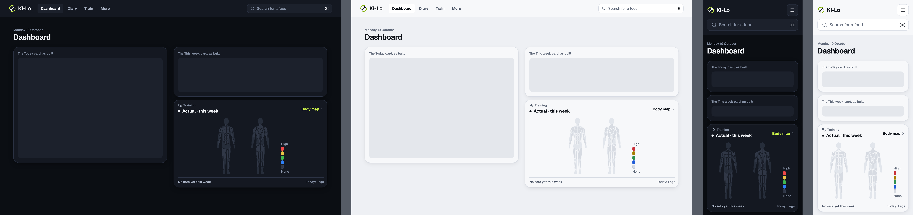

Open [proposals/shell-dashboard-volume-empty.html](proposals/shell-dashboard-volume-empty.html).

### shell-more-dashboard-chart

The More page with the Dashboard body map row in the Settings group, after Appearance and before About, with the groups as the app has them now (Food, Nutrition, Body, Settings, Account). The row is built like Appearance: the label over a segmented control of Heat and Weekly volume, and under it the caption that says what the chosen one shows. The dark frames show Heat, the default, with "How hard and how recently each muscle worked, right now." and the light frames show Weekly volume with "Sets for each muscle this week, Monday to Sunday.", as the phone board does. There is no 2D or 3D row (web 3D is parked) and no leading icon, matching the web Appearance row.

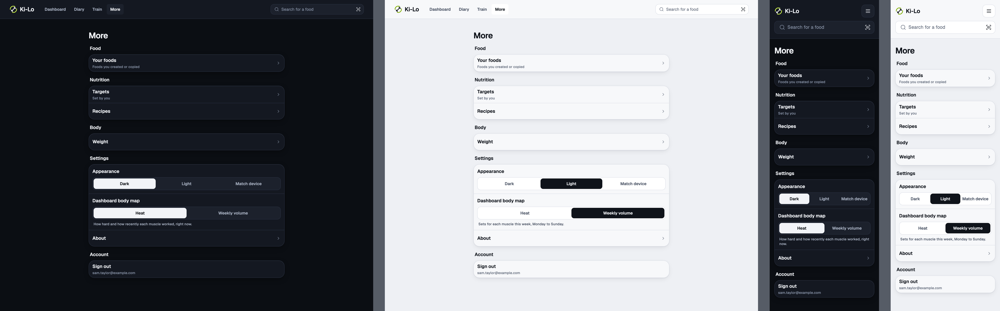

Open [proposals/shell-more-dashboard-chart.html](proposals/shell-more-dashboard-chart.html).

### Decisions

- **Volume, Actual only, the calendar week from Monday to Sunday.** The week start is fixed, and Projected is not on the card (Zee, 2026-11-02).
- **The choice is saved in the browser,** like the Appearance setting, and Heat is the default.
- **The card does not change shape.** Volume keeps Heat's header, figures, legend strip and summary row. Only the second line ("Actual · this week"), the strip, the summary and the link target change.
- **Only the Not trained swatch has a border,** the strong border, because it is the one that could pass for the card behind it.
- **More is 1070 high, not 812,** because the page does not fit in 812 at either width. The web-weight boards take the same exception for a page that needs more, and `more-body-map-setting` is 1100.
