# Web plate boards

Boards for the plate on the web ([KEY-842](https://linear.app/sojisoft/issue/KEY-842), part of [KEY-709](https://linear.app/sojisoft/issue/KEY-709)). They are the design gate for [KEY-862](https://linear.app/sojisoft/issue/KEY-862) (the kit), [KEY-867](https://linear.app/sojisoft/issue/KEY-867) (the switch-on) and [KEY-874](https://linear.app/sojisoft/issue/KEY-874) (the panel). Zee reviews them after the build.

Each board is a PNG at device pixel ratio 2 and a standalone page that opens from `file://`. The frames are 1280 dark, 1280 light, 375 dark and 375 light, from left to right, each 940 high, as the web-diary dialog boards are. The pages link `packages/tokens` by relative path and use no raw hex. Every word is the output of `packages/core/src/copy/`, and the bars are the output of `progressBars` with `describeProgressValue`.

Golden data, all made up: the plate canvas's day, 1,039 kcal, P 86, C 129, F 19 eaten against 2,200, 160, 220, 70. The plate is Chicken and rice (recipe, 1 serving, 374 kcal), Greek yoghurt 0% fat (1 pot, 97), Banana (1 medium, 95) and Semi-skimmed milk (200 ml, 92), which makes 658 kcal and 1,697 with the day. The over plate adds Naan bread (1 naan, 430 kcal, P 12, C 72, F 8.5) and Meal deal crisps (1 bag, 130 kcal, P 2, C 15, F 7). The four foods come to P 57.2, C 79.1, F 11.9, so with the day the over plate reads 2,257 kcal, P 157.2, C 295.1, F 46.4, drawn as 2,257, 157, 295 and 46.

## The shape, in one paragraph

From 1024 wide the dialog is its usual 560 wide, with the plate chip in its header, the four bars under the header, and Log food or Log foods in its footer. The chip opens Your plate as a 400 pixel column beside the results, and the dialog grows to 960, centred. Under 1024 the chip opens Your plate as a step of the dialog, with the Results link above it. While Your plate is open the chip is drawn pressed, filled with `--accent`, with `aria-expanded`. It closes with a second press on the chip, or with the Results link, which sits in the panel's heading at 1024 and up, because the chip has moved 200 pixels from under the pointer. The amount step always draws in the 560 dialog, as the phone draws the picker over the sheet: an open column is kept and comes back when the step ends. Under 700 the dialog fills the screen, as every dialog does. There is one Log button, in the footer, at every width and in every state.

## Boards

Zee searches by heading. Each heading below is the file's name, and on a canvas it would read `web-diary · <the part after plate->`.

### plate-dialog-idle

Nothing on the plate. Quick add, Favourites, Recent. No chip and no Log button, because the merged phone draws neither at nothing, so the footer is Cancel alone. The bars show the day alone. Kit: reuse `Dialog`, `SearchField`, `TimeField` compact, `Card`, `ListRow`, `GroupedList`, `FoodRow` search. Extend `MacroProgressStrip`. New favourite tile, which belongs to [KEY-857](https://linear.app/sojisoft/issue/KEY-857).

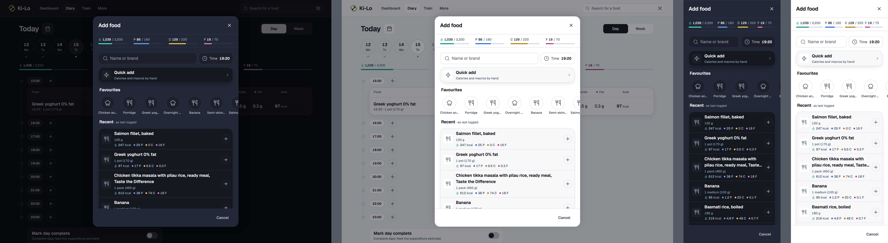

### plate-dialog-one

One food after a plus. The chip reads 1, the bars carry the plate's share at 45 per cent after the eaten fill, the field has cleared and the list is back at idle, as on the phone. The button says Log food. No toast: a screen reader hears `describeAddedToPlate`. New: `PlateChip`.

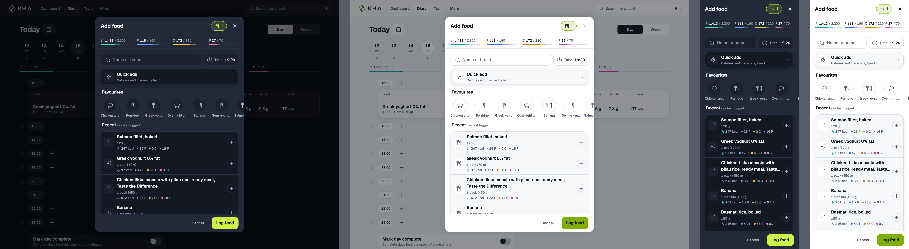

### plate-dialog-several

Four foods with a search typed, so the board shows the rows the plus works on: recipes first, then the groups. The button says Log foods. The phone draws this state on Recent, which `plate-dialog-one` already shows.

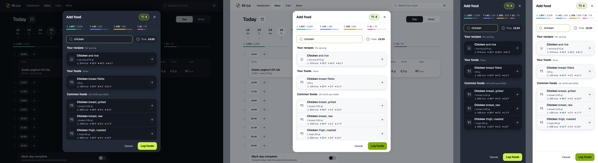

### plate-dialog-over

Six foods. Calories (2,257 of 2,200) and carbs (295 of 220) go over: the bar is full with the outline, the number stays in primary text, and there is no warning colour. The outline's gap is `--surface-sheet` here, where the kit's is `--background`.

### plate-panel

Your plate open: the heading with the count, Clear plate, the rows, the totals card, Time. New: `PlateRow`, `PlatePanel`. Extend `TimeField` with a one line row form. `NumericInput` is reused at 36 high through `frameClassName`. The rows and the totals scroll, and Time stays. The bars move into the totals card while it is open, and the compact Time field leaves the search row, so nothing shows twice. The Results link closes the column. It is the same `BackToResults`, moved into the heading.

### plate-panel-cleared

After Clear plate: it acts at once, the panel goes, the plate is empty, and the toast carries Undo, which puts back the rows, the amounts and the time. The focus goes to the search field, because the chip has gone. A keyboard reaches Undo through `useKeyboardUndo`: call `afterPressingButton({ returnTo: () => searchField.current })` before clearing, and spread what the function it returns gives into the toast's options after clearing, so a key press puts the focus on Undo and then on the search field when the toast goes. Removing the last row sends the focus to the search field in the same way, with no toast.

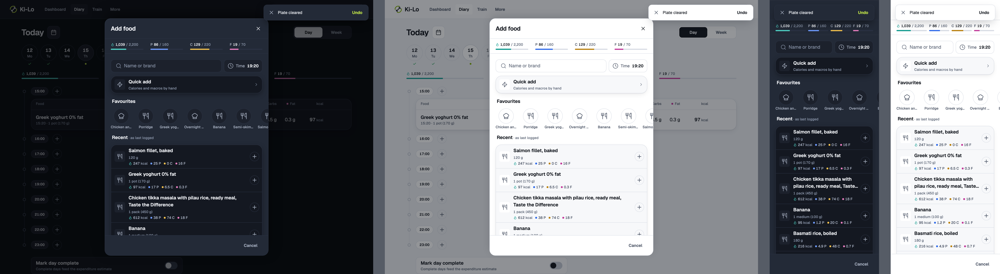

### plate-edit-amount

The milk at 300 ml in place, with the field focused. The row, the totals and the bars follow as it is typed.

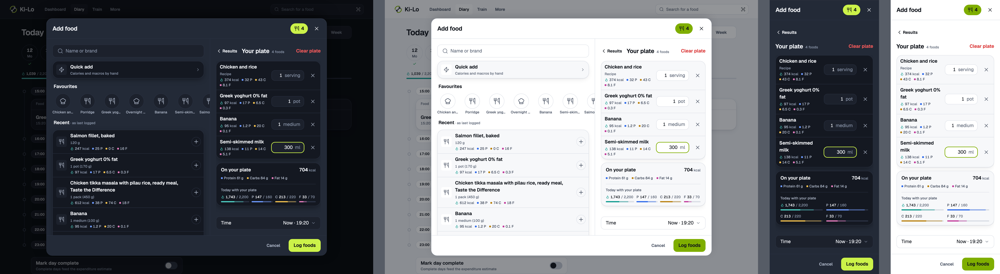

### plate-edit-amount-invalid

Added to the ticket's list, from the merged `PlateSheetRow`. The field is empty, `DIARY_PROBLEMS.quantity` sits under the row, the row counts as 0 across, and Log foods is off.

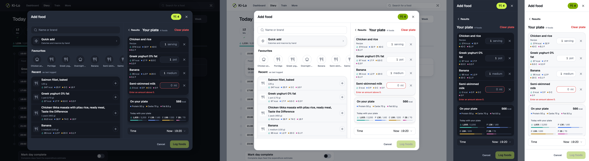

### plate-portion-add

A press on a row or a Favourites tile opens the amount step, with Add to plate in the footer. There is no Time field, because the time belongs to the plate, as on the phone. Add to plate returns to the search with the field cleared. Cancel goes back to Results and never asks "Discard your plate?". Close, Escape and the dim are still Close, and they ask when there is food on the plate. The chip is inert during the draft, in add mode and in edit mode: dimmed, `aria-disabled`, and a press does nothing, so no draft is lost. Kit: reuse `MacroHero`, `NumericInput`, `ChipGroup`, `BackToResults`.

The recipe amount step is not drawn. It fits under the same header and strip with the height it has: `DIARY_RECIPE_AMOUNT_DIALOG_CLASSES` stays (32 from the top and the bottom), the strip adds 51 and the Time field leaves, which gives back at least 82 (its label, box and gap). The badge, the hero, the per 100 g list, the amount and the chips stand as on `web-diary · add-dialog-recipe-serving`, with Add to plate or Save in the footer and the same Cancel and inert chip. Under 700 it scrolls, as it does today.

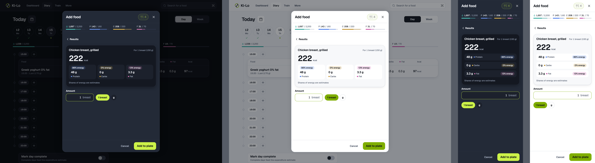

### plate-portion-edit

Added to the ticket's list, from the phone's `portion.plate-edit`. A press on a row's name opens the same step on that row's amount and unit, with Save, and the link back reads Your plate (`PLATE.title`). Cancel does the same as that link, and changes nothing. At 1024 and up the column comes back. `BackToResults` takes a label.

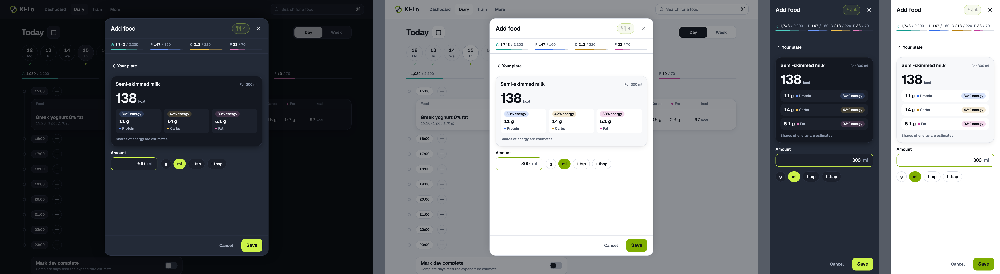

### plate-discard

Close, Cancel or Escape with food on the plate. Built as `DiscardRecipeDialog` is: 440 wide over the dialog, Keep adding (secondary, and it takes the focus) and Discard (destructive). Its `closeLabel` is "Keep adding", and its Close and Escape keep the plate. It comes from Close, Escape or the dim on any view, and from Cancel on the search and plate views. Under 700 it fills the screen, because `Dialog` does. An empty plate closes with no question.

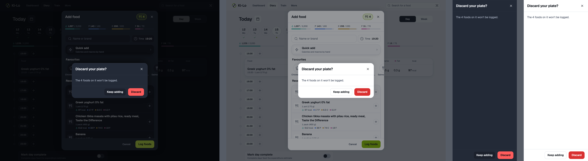

### plate-logging

Log foods shows its spinner at full strength. The pluses, the chip, Cancel and Close dim and take no presses. Escape and a press on the dim are guarded as well, through `closeDisabled` on `Dialog`.

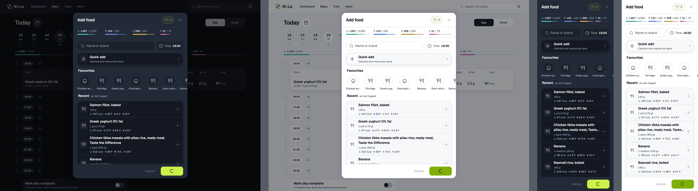

### plate-logging-panel

Added to the ticket's list. The same with the panel open: the rows, Clear plate, the Results link and Time dim as well, and the totals stay readable.

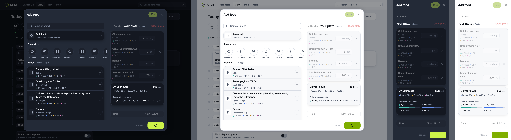

### plate-logged

Added to the ticket's list, from the phone's `plate.logged`. The dialog has closed on the diary, the four rows read 19:20 in the 19:00 hour group, and the bars have moved. The toast says "Logged 4 foods" (one food: "Logged Chicken and rice"), in green, at the top, with no Undo.

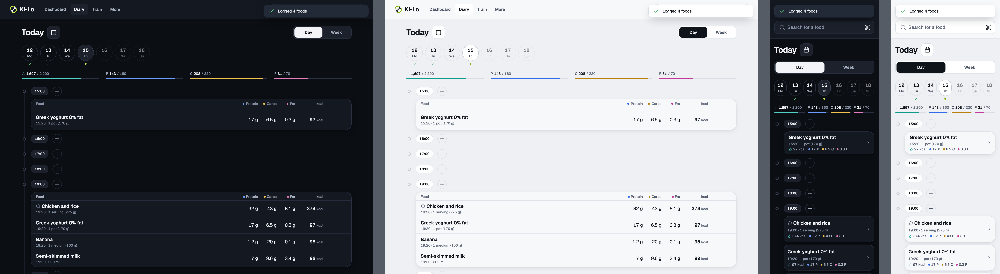

### plate-log-error

Nothing was written. The plate is as it was, the toast says `PLATE.notLogged`, and Log foods works again.

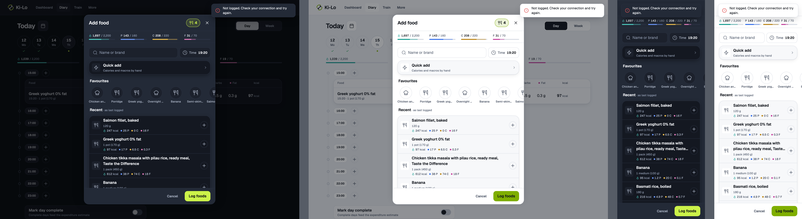

### plate-log-error-panel

Added to the ticket's list, from the merged `PlateSheetContent`. With the panel open the same sentence is an error `Banner` in the panel, which stays open. It goes when the panel closes.

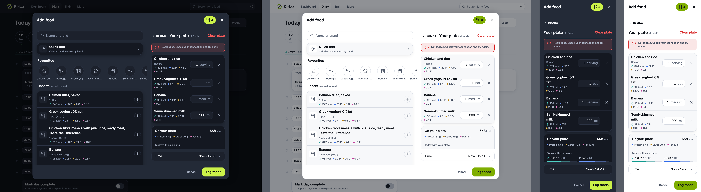

### plate-offline

The plus still works, because it writes nothing. The banner says why Log foods is off. The button is `aria-disabled`, not `disabled`, so it keeps the focus and is still read out, and a press does nothing: `opacity-40` by class, as `FoodLogRow` does its plus, since `Button` only dims `disabled`. Quick add stays pressable, and its form waits for a connection itself.

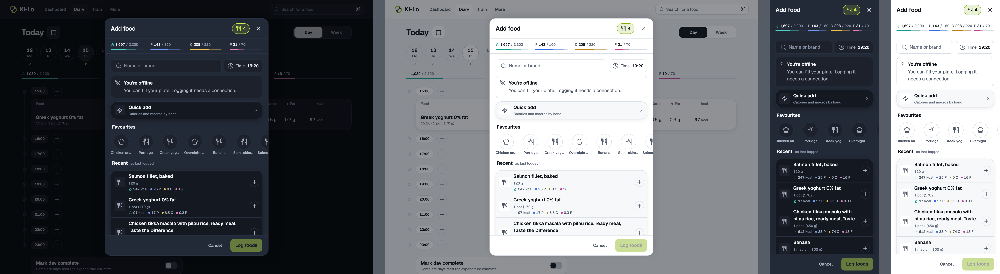

### plate-offline-panel

Added to the ticket's list. Amounts and removal still work. Row names dim, because the amount step reads the food's portions. Under 1024 the banner comes with the step, since the search's copy is out of view.

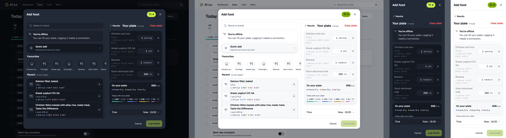

### plate-loading

Before the day, its targets and the time zone are read, the strip's place holds a skeleton of the same 51 pixels (26 of column, 24 of padding, 1 of hairline) with four placeholder columns, so the rows do not move when the bars arrive. If a read fails, or the read is paused offline with nothing cached (`fetchStatus === "paused"`, as KEY-850's Recent does), the strip collapses and the search works without it, so the skeleton is never endless. Favourites and Recent have their skeletons. With food on the plate, the totals card leaves out its bars and heading until they are read. New: a favourites skeleton, a strip skeleton.

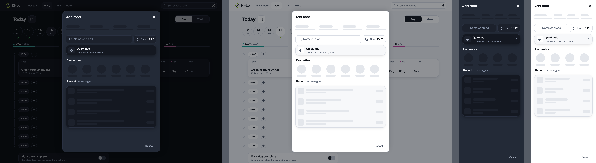

## Kit: reuse, extend, new

- **Reuse:** `Dialog`, `Button`, `Card`, `ListRow`, `GroupedList`, `SearchField`, `TimeField` compact, `FoodRow` (search), `NumericInput`, `ChipGroup`, `MacroHero`, `Banner`, `Toast`, `Skeleton` rows.
- **Extend `Dialog`:** a slot in the header, before Close, for the chip. A fixed slot under the header for the strip, which does not scroll with the body. A way to leave the body's padding off, for the two columns. `closeDisabled`, which dims Close and guards Escape and the dim, while the plate logs.
- **Extend `MacroProgressStrip`:** a status group with no button and a label, as the phone's (`describeStripDay`), the plate's share (`plateFillFraction`) and `describeProgressValue`, the outline's gap taken from the surface it sits on, and a card form. On the card the columns size to their numbers, and in the panel's step they are two by two, because four columns collide at 375.
- **Extend `FoodLogRow`:** `describeAddToPlateName` for the plus's name.
- **Extend `TimeField`:** a row form, "Time", then `describeTimeValue` and the chevron.
- **Extend `BackToResults`:** a label, and a place in the panel's heading.
- **Extend `diaryDialogClasses`:** a wide class, `min-[1024px]:w-[960px]`, used only while the panel is open.
- **New:** `PlateChip` (36 high pill, `--accent-muted` with an `--accent` border, Utensils 18, the count in body strong), `PlateRow` (112 wide amount, 44 pixel remove), `PlatePanel`, the favourite tile and its skeleton (with KEY-857).

## New strings

None that show. Two names are literals in the mobile code and should move to `PLATE` when the web needs them: `rowsLabel` ("Foods on your plate") and `totalsLabel` ("Totals"). `describeAddToPlateName`, `describeRemoveFromPlate`, `describePlateAmountField` and `describeLogPlateActionName` already exist.

## Decisions for Zee to check after the build

Each is reversible.

- **Recommended (Zee away), reversible:** the plate lives inside the Add food dialog and goes when it closes, as it dies with the sheet on the phone. Nothing is stored.
- **Recommended (Zee away), reversible:** at 1280 the panel is a column beside the results, and at 375 it is a step of the dialog, as the ticket proposed.
- **Recommended (Zee away), reversible:** the column opens from the chip and not by itself. The dialog grows from the centre, so opening it on the first plus would slide the row out from under the pointer of a person adding several foods. The chip's press is the only thing that moves the rows. The column closes on the chip, on the Results link, on Clear plate and with the last food, so it never reads "0 foods". The focus goes to its heading when it opens and to the chip when the chip or the link closes it. After Clear plate or the last row the chip has gone, so it goes to the search field.
- **Recommended (Zee away), reversible:** the column starts at 1024 wide, where 960 fits with a margin. From 700 to 1023 the panel is the step, in the 560 dialog.
- **Recommended (Zee away), reversible:** one Log button, in the dialog's footer, beside Cancel, where the web has Add today. The phone docks it beside the search field and repeats it in the sheet, which a footer does not need. It leaves the footer during the amount step, where Add to plate or Save is the main action.
- **Recommended (Zee away), reversible:** the title stays "Add food" (`ADD_FOOD_DIALOG.title`), where the phone says "Log food".
- **Recommended (Zee away), reversible:** the compact Time field stays beside the search as the web has it, and sets the plate's one time. It leaves while the panel is open, where the Time row does the same job. The amount step has no Time field.
- **Recommended (Zee away), reversible:** the bars and the chip stay on the amount step, because it is the same dialog and they would otherwise jump. The bars do not count the amount being chosen, until Add to plate.
- **Recommended (Zee away), reversible:** on the search and the plate, Cancel acts as Close and asks when there is food on the plate. On the amount step Cancel is a step back, to Results or in edit mode to Your plate, and never asks.
- **Recommended (Zee away), reversible:** the chip is inert during an amount draft, so opening the plate cannot lose what was typed.
- **Recommended (Zee away), reversible:** the strip's height is reserved while it loads, where the phone draws nothing, so the rows under a pointer stay still.
- **Recommended (Zee away), reversible:** while the plate logs, Close and Cancel are dimmed as well as blocked, so a press that does nothing does not look live.
- **The logged toast has no Undo,** as the merged phone (orchestrator's decision).
- **Follows main:** past day wording is `describePlateDay`: "Yesterday with your plate", or "Wed 14 Oct with your plate".

## Quick add with a plate

Quick add still logs straight away and never goes on the plate. Today the row calls `FoodLogActionsProvider`'s `openQuickAdd`, and the provider's one `dialog` slot swaps `AddFoodDialog` out, which would lose the plate. So for the row in this dialog:

- **`AddFoodDialog` owns Quick add** as a sibling dialog: it renders `QuickAddDialog` itself, inside the plate's provider and over the search. `Dialog` already stacks. The provider's `openQuickAdd` stays for every other caller.
- **The focus returns to the Quick add row,** through `returnFocusTo`, when the form closes.
- **Closing the form without logging** returns to the search, with the plate as it was.
- **After a Quick add log:** if the plate has food, it returns to the search, and if the plate is empty, everything closes, as the phone's `quick-add.tsx` does.
- **Escape** answers the form first, because only the topmost dialog answers it.

## With KEY-850

Agreed against [KEY-850](https://linear.app/sojisoft/issue/KEY-850)'s `RecentFoods`, in its worktree on d80ac665 with its uncommitted edits, as read on 2026-11-06.

- **The hint.** `SEARCH_IDLE.hint` goes while Recent has rows, as the phone has no such line, so no board draws it. KEY-850 keeps it for no history and for the failed state, inside `RecentFoods`, and neither is a plate state.
- **The semibold name.** The boards draw Recent names semibold, as the phone's. KEY-850 passes `matched: false`, which the `search` layout renders at normal weight, and it does not build this. It goes with the plate tickets, in [KEY-862](https://linear.app/sojisoft/issue/KEY-862): `matched: true` on the whole name gives the weight with no kit change.
- **Recent in an ingredient search.** KEY-850 also shows Recent there, with no plus, as the phone does. An ingredient search has no plate, no chip and no strip, so none of these boards applies to it.
- **The plus offline.** KEY-850 passes `addDisabled={!isOnline}` because its plus writes today. On the plate it writes nothing and works offline, so [KEY-867](https://linear.app/sojisoft/issue/KEY-867) drops that from Recent, as from the search hits and the recipes, and passes the logging state instead.

## Where the sources disagreed

- **The logged toast.** [KEY-867](https://linear.app/sojisoft/issue/KEY-867) asks for Undo on it. The merged `useLogPlate` and the phone's `plate.logged` have no Undo, and the boards follow the phone.
- **The chip at nothing.** The ticket says "chip at nothing" and KEY-862 asks for a story of the chip at none. The merged `PlateSheetChip` draws nothing at 0, so the boards draw none.
- **The panel's empty state.** KEY-862 asks for a story of one. The merged sheet closes with its last food and never shows an empty plate, so none is drawn.
- **`plate-loading`.** The merged phone strip draws nothing until the bars are read. The web reserves their 51 pixels with a skeleton, so the rows do not move. This is the one place the boards leave the phone's behaviour on purpose.
- **Describe.** The phone's idle list has a Describe row under Quick add. The ticket's idle list does not, and `apps/web` has no such row, so it is not drawn.
- **The phone's boards.** `log-search.plate-over` reads 4 on its chip and its numbers do not sum, so this board's six foods and totals are worked out. `portion.plate-edit` has the milk at 142 kcal for 300 ml where `plate.edit-amount` has 138, and these boards use 138. Its Recent shows a quick add row, where the merged `RecentFoods` lists foods by `foodId`, so Banana takes its place. The favourites proposal puts "as last logged" at the right, and the web's `GroupedList` puts it after the title.
- **The favourite's name.** `describeLogFavouriteName` says "Log Porridge", although a tile now opens the amount step. It is the phone's string and is left as it is.
