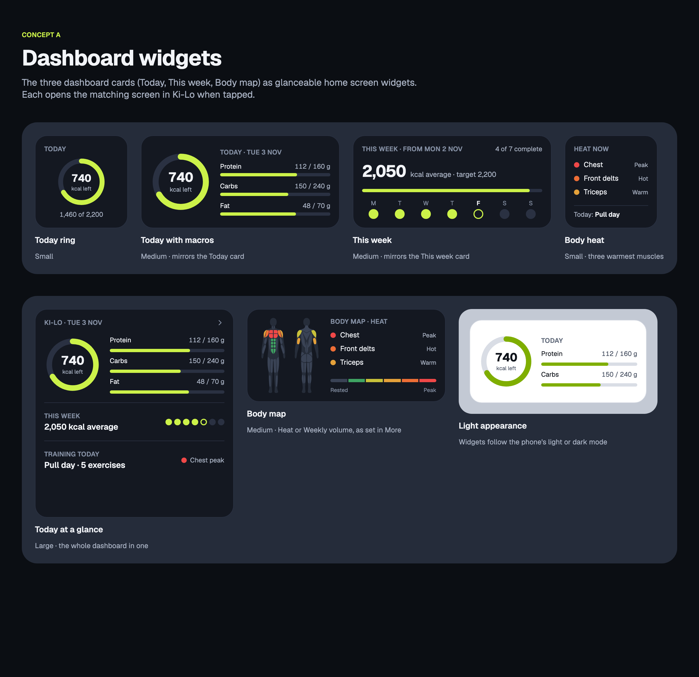
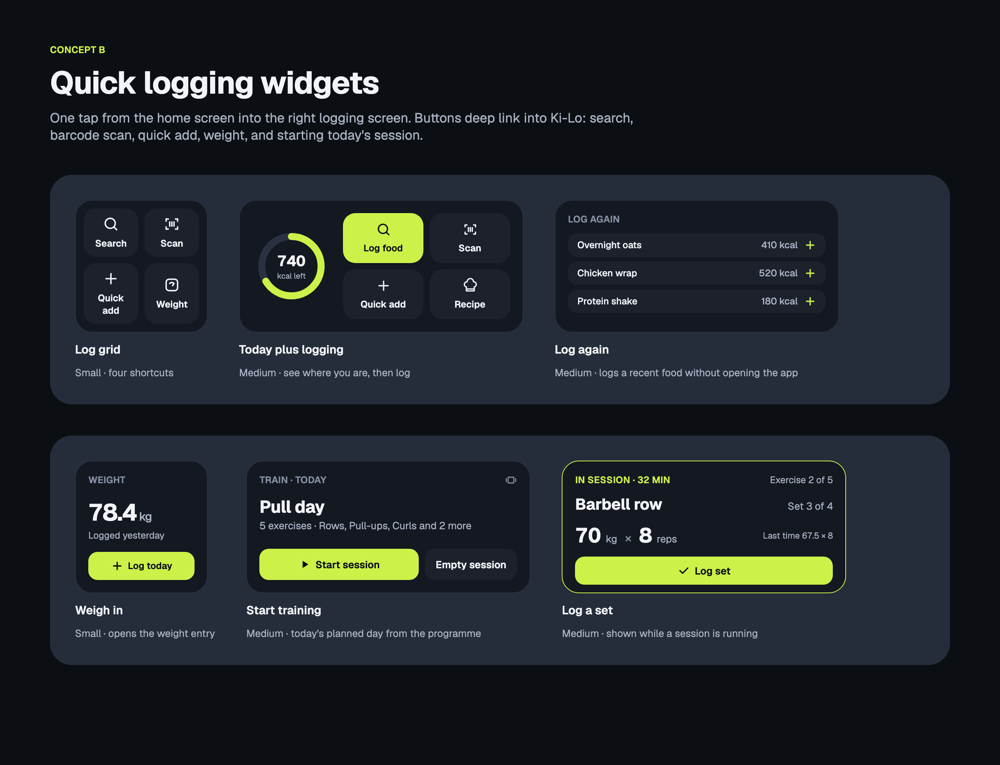
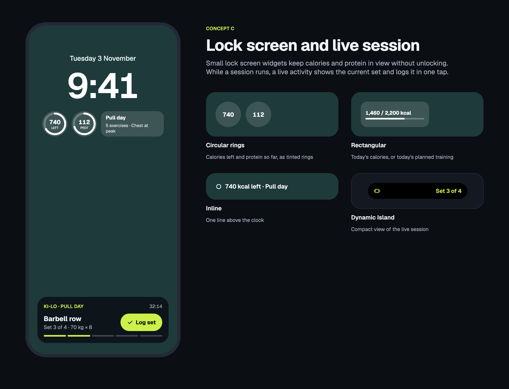

# widgets

Phone home screen and lock screen widgets for Ki-Lo, from the canvas "Ki-Lo home screen widgets: proof of concept". Zee approved boards A, B and C on 2026-11-03. Board D (states) is not approved yet, so it is not exported. Its source is kept in `source-widgets/` beside the others and is not a board here.

These boards use raw hex colours and no Ki-Lo token stylesheet, so each page links Google Fonts and nothing else. They are exported by `tools/design-export` as a second canvas set, with the source kept in `docs/design/source-widgets/` so it does not mix with the M2 `source/` folder (both canvases have a `Main.dc.html`).

## Frames

Every board is 1280 points wide. Board A is 1240 high, B and C are 980 high.

| Board | Page | Frames |
| --- | --- | --- |
| A, dashboard widgets | [`dashboard`](dashboard.html) | Today ring, Today with macros, This week, Body heat, Today at a glance, Body map, Light appearance |
| B, quick logging widgets | [`quick-log`](quick-log.html) | Log grid, Today plus logging, Log again, Weigh in, Start training, Log a set |
| C, lock screen and live session | [`lock-screen`](lock-screen.html) | Circular rings, Rectangular, Inline, Live activity, Dynamic Island |

## Decisions

- The sample numbers on the boards (740 kcal left, 2,050 kcal average, 78.4 kg, 70 kg by 8 reps and so on) are placeholders. They are not data and not a spec.
- Muscle names come from core (`packages/core/src/copy/muscleNames.ts`). The board's "Chest" is drawn per muscle in the app: Upper chest and Lower chest.
- Start training and Log a set ship as one Training widget that switches by state: Start training when no session is running, Log a set while one is.
- Ki-Lo ships Android only today, so board C (lock screen widgets, Live activity and Dynamic Island) waits for iOS.
- Board D (states) follows once Zee approves it.

<!-- design-export:boards:start -->
Generated by `tools/design-export`. Do not edit between the markers.

## Boards

### dashboard

Dashboard widgets. One board with its frames side by side, each in the theme it shows.

Open [dashboard.html](dashboard.html) in a browser, or read the source [Main.dc.html](../source-widgets/project/Main.dc.html).

### quick-log

Quick logging widgets. One board with its frames side by side, each in the theme it shows.

Open [quick-log.html](quick-log.html) in a browser, or read the source [QuickLog.dc.html](../source-widgets/project/QuickLog.dc.html).

### lock-screen

Lock screen and live session. One board with its frames side by side, each in the theme it shows.

Open [lock-screen.html](lock-screen.html) in a browser, or read the source [LockScreen.dc.html](../source-widgets/project/LockScreen.dc.html).

<!-- design-export:boards:end -->
